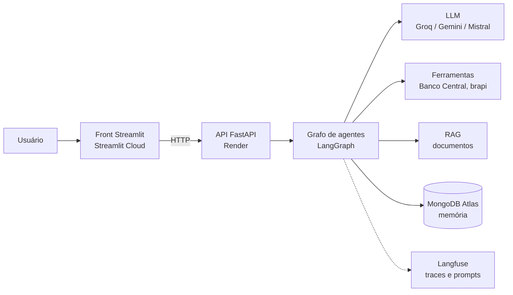
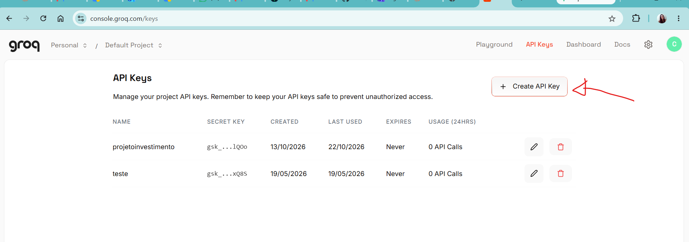

# Aula 1 — Ambiente, estrutura do projeto e primeiro chat

> **Ao final desta aula** você terá um repositório no GitHub com o esqueleto do FinBot e um chat funcionando no terminal, conversando com um LLM de verdade por uma API gratuita.

## O que vamos construir nas 7 aulas

Um chat de investimentos com vários agentes especialistas, dados reais de mercado e consulta a documentos, publicado na internet.



Hoje fazemos só o começo: **LLM + prompt + terminal**.

---

## Parte 1 — Conceitos

### O que é um LLM

Um **LLM** (*Large Language Model*) é uma rede neural treinada para uma única tarefa: **prever o próximo pedaço de texto**. Ele faz isso repetidamente, e assim gera frases inteiras. Tudo o que ele "sabe" veio dos textos de treinamento, até uma data de corte.

Duas consequências importantes para o projeto:

1. **O LLM não sabe a cotação de hoje.** Para dados atuais, vamos dar **ferramentas** a ele (Aula 4).
2. **O LLM pode inventar** (*alucinar*) com muita confiança. Para respostas confiáveis, vamos entregar **documentos** a ele (RAG, Aula 5).

### Token e janela de contexto

O modelo não lê palavras: lê **tokens**, pedaços de palavra. "investimento" pode virar `invest` + `imento`. Em português, uma palavra dá em média 1,5 token.

- **Janela de contexto:** quantos tokens o modelo consegue ler de uma vez (pergunta + histórico + instruções).
- **Custo e limites** das APIs são contados em tokens. No plano gratuito do Groq o limite é por minuto e por dia.

### Mensagens e papéis

As APIs de chat recebem uma **lista de mensagens**, cada uma com um papel:

| Papel | No LangChain | Para que serve |
|---|---|---|
| `system` | `SystemMessage` | Instruções de comportamento ("você é o FinBot...") |
| `user` | `HumanMessage` | O que o usuário escreveu |
| `assistant` | `AIMessage` | O que o modelo respondeu |

### O LLM não tem memória

Cada chamada à API é **independente** (*stateless*). Se você perguntar "qual é meu nome?" sem enviar a mensagem anterior, o modelo não sabe. **A memória é responsabilidade do nosso código:** a cada pergunta, mandamos o histórico inteiro de novo. Hoje o histórico fica numa lista; na Aula 3, no MongoDB.

### Temperatura

Controla a aleatoriedade da escolha do próximo token:

- **0** → quase sempre a mesma resposta (bom para classificar, extrair dados, calcular);
- **~0.7** → mais variada e criativa (bom para conversar, escrever).

### Workflow × Agente × Multiagente

Vamos usar esses três termos o curso inteiro:

| | Workflow | Agente | Multiagente |
|---|---|---|---|
| Quem decide os passos | O código (caminho fixo) | O LLM, dinamicamente | Vários LLMs especialistas |
| Analogia | Esteira de produção | Funcionário com autonomia | Equipe de especialistas |
| Previsibilidade | Alta | Média | Menor |
| Custo | Baixo | Médio | Alto |

**Previsibilidade** é o quanto conseguimos antecipar e controlar os passos que o sistema vai seguir. No workflow, o código define o caminho, então sabemos quais etapas serão executadas. No agente, o LLM escolhe ações durante a execução, e essas escolhas podem variar conforme a conversa. No multiagente, há vários especialistas interagindo, o que acrescenta decisões e torna o fluxo mais difícil de antecipar. Isso não quer dizer que toda resposta será diferente: significa que temos menos controle direto sobre o caminho seguido.

> **Regra de ouro:** não comece com multiagente. Comece simples e só adicione complexidade quando sentir uma dor real. É exatamente o caminho do curso: chat simples → agente com ferramentas → multiagente (Aula 6).

### Por que cada peça do ambiente existe

| Peça | Problema que resolve |
|---|---|
| **Git** | Histórico de cada mudança; voltar atrás; trabalhar em equipe |
| **GitHub** | Repositório na nuvem; portfólio; publica o app (Aula 2) |
| **venv** (ambiente virtual) | Cada projeto tem as SUAS versões de bibliotecas, sem misturar com outros projetos nem com o Python do sistema |
| **`.env`** | Guarda segredos (chaves de API) FORA do código |
| **`.gitignore`** | Lista o que o Git deve ignorar, como `.env` e `.venv` |
| **`.env.example`** | Modelo do `.env` SEM os valores: vai para o GitHub e mostra quais variáveis existem |

> ⚠️ **Caso real:** quem sobe um `.env` com chaves para o GitHub tem as chaves copiadas por robôs em minutos. Se acontecer, **revogue a chave na hora** no site do provedor. Apagar o arquivo depois não adianta: ele continua no histórico do Git.

### Por que uma estrutura em camadas

Poderíamos escrever tudo num arquivo só. Funciona no primeiro dia e vira um caos na terceira semana. Separamos por **responsabilidade**:

```
app/
├── config/     # de onde vêm as configurações
├── llm/        # como criar o modelo (trocar Groq por Gemini = mexer só aqui)
├── prompts/    # textos que mandamos para o modelo (são artefatos, não strings soltas)
├── agents/     # (Aula 2+) a lógica dos agentes
├── tools/      # (Aula 4+) ferramentas
├── repository/ # (Aula 3+) acesso ao banco
└── api/        # (Aula 2+) a porta de entrada HTTP
```

Cada pasta com um `__init__.py` vira um **pacote Python**: dá para importar `from app.llm.fabrica import criar_modelo` de qualquer lugar do projeto.

---

## Parte 2 — Mão na massa

> **Antes de começar:** Faça o download desse repositório com a pasta aula, aos poucos você vai ir acrescentando as 6 aulas restantes, localize no seu computador a pasta recebida que contém `aulas/` e os arquivos `.md`. Se quiser, renomeie essa pasta para `finbot`. No VS Code, use **Arquivo → Abrir Pasta...** e selecione essa pasta (não selecione somente a subpasta `aulas`). Os comandos desta aula serão executados no terminal integrado do VS Code: abra-o em **Terminal → Novo Terminal** (atalho ``Ctrl+` ``). No Windows, selecione **PowerShell**. O terminal deve estar apontando para a pasta do projeto; confira com `Get-Location` no PowerShell ou `pwd` no Linux/Mac. Quando um passo pedir um arquivo, crie-o pelo painel **Explorer/Explorador** do VS Code, dentro do caminho indicado no título ou no comentário `# caminho/do/arquivo`; depois cole o conteúdo e salve com `Ctrl+S`.

### Passo 1 — Instalar as ferramentas

- **Python 3.12** ([python.org](https://www.python.org/downloads/)). Se você já tem outra versão, como Python 3.11, não precisa removê-la: instale o 3.12 **lado a lado**. No Windows, no instalador, deixe desmarcada a opção **"Add Python to PATH"** se não quiser mudar qual versão o comando `python` usa fora dos projetos. O comando `py -3.12` permite escolher o 3.12 especificamente para criar o ambiente virtual do FinBot.
- **Git** ([git-scm.com](https://git-scm.com/downloads)): baixe e execute o instalador; para esta aula, pode manter as opções padrão.
- **VS Code** ([code.visualstudio.com](https://code.visualstudio.com/)) e a extensão **Python**: no VS Code, abra **Extensions/Extensões** pelo ícone de quadrados na barra lateral, pesquise `Python` e instale a extensão publicada pela Microsoft.

Depois das instalações, feche e abra novamente o VS Code. Abra **Terminal → Novo Terminal** e confira se o Python 3.12 está disponível. Este comando verifica a versão escolhida, mesmo que o comando geral `python` continue apontando para o Python 3.11:

```bash
py -3.12 --version       # Windows: deve mostrar Python 3.12.x
# Linux/Mac: python3.12 --version
git --version
```

Se o comando de versão não funcionar ou mostrar que o Python 3.12 não foi encontrado, conclua a instalação do Python 3.12 antes de continuar. Não é necessário alterar nem desinstalar a versão que já estava na máquina.

### Passo 2 — Criar o repositório no GitHub

Os arquivos das aulas já estão na pasta `aulas/` que você recebeu. Primeiro vamos publicar **somente essa pasta** no GitHub. Depois, os commits seguintes acrescentarão o projeto FinBot ao mesmo repositório. Para evitar conflitos, o repositório remoto precisa começar vazio.

1. No GitHub, clique em **New repository**, dê o nome `finbot`, escolha **Public** e **não** marque `Add a README`, `.gitignore` ou licença. Clique em **Create repository**. **Não crie um README pelo GitHub**: o README será criado localmente no Passo 14. Se, depois de criar o repositório, a página mostrar um commit chamado **Initial commit** com somente `README.md`, siga normalmente até o primeiro envio no item 5 e use a orientação de recuperação logo abaixo se o Git recusar o push. Se aparecer qualquer outro arquivo ou alteração que você queira preservar, pare e peça ajuda antes de continuar.
2. Na página do novo repositório, clique em **Code**, selecione **HTTPS** e copie a URL.
3. No VS Code, confirme no painel **Explorer/Explorador** que a pasta aberta contém `aulas/` e os arquivos `aula-01.md` a `aula-07.md`. Abra **Terminal → Novo Terminal**. No terminal, confirme que está na pasta que contém `aulas/` com `Get-Location` (PowerShell) ou `pwd` (Linux/Mac).
4. Inicialize o Git nessa pasta e conecte-a ao repositório. Substitua a URL de exemplo pela URL que você copiou:

```bash
git init
git branch -M main
git remote add origin https://github.com/SEU_USUARIO/finbot.git
git status
```

No resultado de `git status`, confirme que a pasta `aulas/` aparece entre os arquivos não rastreados. Se ela não aparecer, pare e confira se abriu no VS Code a pasta que contém `aulas/`.

Na primeira vez, configure seu nome e e-mail do GitHub no terminal:

```bash
git config --global user.name "Seu Nome"
git config --global user.email "seu@email.com"
```

5. Faça o primeiro commit **somente dos arquivos recebidos em `aulas/`** e envie-o ao GitHub:

```bash
git add aulas
git status
git commit -m "Adiciona arquivos das aulas"
git push -u origin main
```

Antes do commit, confira no `git status` que os arquivos preparados para envio estão dentro de `aulas/`. Depois do push, atualize a página do repositório no GitHub e confirme que a pasta `aulas/` aparece. Agora o repositório local e o remoto compartilham o mesmo histórico; os próximos commits serão acrescentados a ele.

> **Se o primeiro push for recusado com `fetch first` e o GitHub tiver somente o `README.md` criado automaticamente:** os dois lados têm commits iniciais diferentes. Como o commit local deste passo contém apenas `aulas/`, você pode integrar o README remoto sem conflito. Rode:
>
> ```powershell
> git pull origin main --allow-unrelated-histories
> ```
>
> Se abrir um editor com uma mensagem começando por `Merge branch`, o Git está pedindo para confirmar a integração: pressione `Esc`, digite `:wq` e pressione `Enter`. Quando voltar ao PowerShell, envie:
>
> ```powershell
> git push -u origin main
> ```
>
> Se aparecer `CONFLICT` ou o repositório remoto tiver outros arquivos além do README inicial, pare e peça ajuda. **Não use `git push --force`**: ele pode apagar conteúdo do GitHub.

### Passo 3 — Criar e ativar o ambiente virtual

```bash
py -3.12 -m venv .venv
# Linux/Mac: python3.12 -m venv .venv
```

Esse comando cria o ambiente virtual `.venv` usando o Python 3.12 já instalado na máquina. O ambiente virtual não instala outra cópia do Python: ele separa as bibliotecas e ferramentas deste projeto das dos outros projetos.

**Importante:** o `.venv` usa o interpretador escolhido na criação. Assim, mesmo que o Python padrão da máquina seja o 3.11, este projeto usará o 3.12 enquanto o ambiente virtual estiver ativado. Não estamos mudando nem substituindo o Python padrão do computador.

Ative (repita sempre que abrir um terminal novo):

| Sistema | Comando |
|---|---|
| Windows (PowerShell) | `.venv\Scripts\Activate.ps1` |
| Windows (cmd) | `.venv\Scripts\activate.bat` |
| Linux / Mac | `source .venv/bin/activate` |

O terminal passa a mostrar `(.venv)` no começo da linha. **Por quê?** A partir de agora, `pip install` instala dentro de `.venv/`, só para este projeto.

Com o ambiente ativado, confira que ele está usando Python 3.12:

```bash
python --version
```

O resultado deve começar com `Python 3.12`.

> No PowerShell, se aparecer erro de "execução de scripts desabilitada", rode uma vez: `Set-ExecutionPolicy -Scope CurrentUser RemoteSigned`

### Passo 4 — `.gitignore` (antes de qualquer outra coisa!)

Crie o arquivo `.gitignore` na raiz:

```
# Credenciais — NUNCA versionar
.env

# Ambiente virtual
.venv/
venv/

# Arquivos gerados pelo Python
__pycache__/
*.pyc
.pytest_cache/

# Editores e sistema
.vscode/
.idea/
.DS_Store

# Segredos do Streamlit (local)
.streamlit/secrets.toml
```

Confira: `git status` não deve listar `.venv/`.

Vamos observar isso agora, antes de criar o restante dos arquivos. No terminal integrado, ainda na pasta `finbot`, rode:

```bash
git status
```

Você deve ver `.gitignore` e `aulas/` como arquivos não rastreados, mas **não** deve ver `.venv/`. Isso acontece porque o Git mostra o próprio arquivo `.gitignore` para que ele possa ser enviado ao repositório; são as regras escritas dentro dele que mandam ignorar a pasta `.venv/`.

> Os arquivos de `aulas/` já foram publicados no Passo 2. O `.gitignore`, o ambiente e o restante do FinBot serão registrados no commit final do Passo 15. A tag `aula-1` ficará nesse commit final, marcando a entrega completa da aula.

### Passo 5 — Estrutura de pastas

Vamos criar as pastas com um comando no terminal integrado do VS Code. A árvore abaixo mostra como elas devem ficar organizadas.

Ao terminar este passo, a parte nova da estrutura deve ficar assim:

```text
finbot/
├── app/
│   ├── config/
│   ├── llm/
│   └── prompts/
├── scripts/
└── tests/
```

Agora crie essas pastas com um único comando no terminal integrado do VS Code. Confira que o terminal está aberto na pasta principal `finbot` antes de executar.

No Windows, usando PowerShell:

```powershell
New-Item -ItemType Directory -Force -Path "app", "app\config", "app\llm", "app\prompts", "scripts", "tests"
```

No Linux ou Mac, use:

```bash
mkdir -p app/config app/llm app/prompts scripts tests
```

Depois, confira no painel **Explorer/Explorador** se `config`, `llm` e `prompts` aparecem dentro de `app`, e se `scripts` e `tests` ficam no mesmo nível de `app`.

Agora crie arquivos **vazios** `__init__.py` dentro de cada uma destas quatro pastas: `app`, `app/config`, `app/llm` e `app/prompts`. Para cada um, clique com o botão direito na pasta correspondente → **New File/Novo Arquivo**, digite `__init__.py` e pressione Enter. Não coloque conteúdo nesses arquivos.

> **Por que criar arquivos vazios?** O Git não registra pastas vazias; ele registra arquivos. Os `__init__.py` fazem com que essas pastas apareçam no repositório mesmo antes de receberem código. As pastas `scripts/` e `tests/` aparecerão quando você criar nelas os arquivos das próximas etapas.

### Passo 6 — Dependências

`requirements.txt` lista o que o **projeto** precisa para rodar (é o que o servidor vai instalar na Aula 2):

Você deve criar o `requirements.txt` dentro da raiz do projeto e colar as linhas abaixo nele

```text
# Dependências da API (o Render instala este arquivo)
# Aula 1 — LLM e configuração
langchain-core>=1.0
langchain-groq>=1.0
langchain-google-genai>=4.0
langchain-mistralai>=1.0
pydantic-settings>=2.6
```

`requirements-dev.txt` acrescenta o que só **nós, desenvolvedores**, usamos (testes):

```text
# Só para desenvolver e testar no computador (não vai para o Render)
-r requirements.txt
pytest>=8.0
```

```bash
pip install -r requirements-dev.txt
```

> **Por que três pacotes de LLM?** `langchain-groq`, `langchain-google-genai` e `langchain-mistralai` falam com provedores diferentes, mas todos devolvem um objeto com a **mesma interface** do LangChain. Assim, trocar de provedor não muda o resto do código.

### Passo 7 — Chave de API e `.env`

1. Abra [console.groq.com](https://console.groq.com) no navegador e entre na sua conta. Se ainda não tiver uma, escolha a opção para criar uma conta gratuita e conclua o cadastro.
2. No painel da Groq, selecione um projeto no topo da página (por exemplo, **Default Project**) e clique em **API Keys** na barra superior.
3. Na página **API Keys**, clique em **Create API Key**. A imagem abaixo mostra onde fica esse botão:



4. Se aparecer uma janela pedindo os dados da chave, dê um nome que ajude a identificá-la, por exemplo `finbot-aula1`, e confirme a criação.
5. A Groq mostrará a chave criada, que começa com `gsk_`. Copie-a imediatamente e guarde-a temporariamente em um local seguro para poder colá-la no `.env` no passo 8. Depois de fechar essa tela, talvez não seja possível ver a chave completa novamente; se isso acontecer, crie outra chave.

> **Segurança:** a chave é como uma senha. Não a envie para colegas, não a publique em mensagens ou capturas de tela e não a coloque em nenhum arquivo além do `.env` local. Se ela for exposta, revogue-a na página **API Keys** e crie outra.

6. No painel **Explorer/Explorador** do VS Code, clique com o botão direito na pasta principal `finbot` → **New File/Novo Arquivo**. Crie o arquivo `.env.example` e cole nele este conteúdo **sem colocar a chave**:

```env
# Copie para .env e preencha. O .env NUNCA vai para o GitHub (está no .gitignore).

# LLM: groq | gemini | mistral
LLM_PROVEDOR=groq
GROQ_API_KEY=
# GEMINI_API_KEY=
# MISTRAL_API_KEY=
# LLM_MODELO=openai/gpt-oss-120b   
#(modelos mudam! veja console.groq.com/docs/models)

# Langfuse (Aula 2; deixe vazio por enquanto)
LANGFUSE_PUBLIC_KEY=
LANGFUSE_SECRET_KEY=
LANGFUSE_HOST=https://cloud.langfuse.com

# API (Aula 2)
API_URL=http://127.0.0.1:8000

# MongoDB (Aula 3; localmente, o projeto usará finbot_dev)
MONGO_URL=mongodb://localhost:27017
MONGO_BANCO=finbot_dev

# Dados de mercado (Aula 4; token da brapi é opcional)
BRAPI_TOKEN=
MAX_PASSOS_AGENTE=5

# RAG (Aula 5)
RAG_MODO=tfidf
```

7. Crie uma cópia desse arquivo chamada `.env`, que também fica diretamente dentro da pasta principal `finbot`. No terminal integrado, confirme que você está na raiz do projeto e execute:

```powershell
Copy-Item .env.example .env
# Linux/Mac: cp .env.example .env
```

8. No Explorer, abra o arquivo `.env` recém-criado. Ele começa com o mesmo conteúdo do `.env.example`. Substitua `GROQ_API_KEY=` pela chave que você copiou, sem aspas, e salve com `Ctrl+S`:

```env
GROQ_API_KEY=gsk_sua_chave_aqui
```

O texto `gsk_sua_chave_aqui` é apenas um exemplo: substitua-o pela sua chave verdadeira. **Não** coloque a chave no `.env.example`. As outras variáveis ficam vazias ou com valores locais de exemplo até serem usadas nas aulas seguintes; quando chegar a aula correspondente, você preencherá os valores reais no `.env`.

9. No Explorer, a raiz do projeto deve mostrar os dois arquivos:

```text
finbot/
├── .env          # sua chave verdadeira; fica só no seu computador
└── .env.example  # sem chave; pode ser enviado ao GitHub
```

10. Confira no terminal com `git status`: o `.env.example` deve aparecer como arquivo novo, mas o `.env` **não** deve aparecer. O `.gitignore` impede que o Git envie o arquivo que contém a chave.

> **Modelos são desligados com frequência.** O padrão do projeto é `openai/gpt-oss-120b` (o `llama-3.3-70b-versatile` foi desligado em 16/08/2026). Se aparecer o erro `404 model_not_found`, veja os modelos atuais em [console.groq.com/docs/models](https://console.groq.com/docs/models) e defina `LLM_MODELO=` no `.env`. Nenhum código precisa mudar: é para isso que a configuração fica no `.env`.
>
> **Alternativas gratuitas:** Gemini ([aistudio.google.com](https://aistudio.google.com) → Get API key) com `LLM_PROVEDOR=gemini`; Mistral ([console.mistral.ai](https://console.mistral.ai)) com `LLM_PROVEDOR=mistral`. Os limites gratuitos são por conta/organização. Se a turma inteira usar a mesma chave, o limite estoura; **cada aluno cria a sua**.

### Passo 8 — Configuração central (`app/config/settings.py`)

```python
# app/config/settings.py
"""Configuração central: tudo que vem do arquivo .env passa por aqui.

Por que pydantic-settings e não os.getenv espalhado pelo código?
- Um único lugar lista TODAS as variáveis que o projeto usa.
- Tipos são validados ao iniciar (erro cedo, mensagem clara).
- SecretStr esconde as chaves quando alguém faz print(settings).
"""
from typing import Literal

from pydantic import SecretStr
from pydantic_settings import BaseSettings, SettingsConfigDict

MODELOS_PADRAO = {
    "groq": "openai/gpt-oss-120b",  # llama-3.3-70b-versatile foi desligado em 16/08/2026
    "gemini": "gemini-2.5-flash",
    "mistral": "mistral-small-latest",
}


class Settings(BaseSettings):
    model_config = SettingsConfigDict(env_file=".env", extra="ignore")

    # LLM
    llm_provedor: Literal["groq", "gemini", "mistral"] = "groq"
    llm_modelo: str | None = None
    groq_api_key: SecretStr | None = None
    gemini_api_key: SecretStr | None = None
    mistral_api_key: SecretStr | None = None

    @property
    def modelo(self) -> str:
        return self.llm_modelo or MODELOS_PADRAO[self.llm_provedor]


settings = Settings()
```

**O que observar:**

- `BaseSettings` lê o `.env` e **valida os tipos**. Se alguém escrever `LLM_PROVEDOR=openai`, o programa para logo ao iniciar, com mensagem clara, em vez de quebrar no meio de uma conversa.
- `SecretStr` impede que a chave apareça num `print(settings)` ou num log.
- `@property modelo`: se `LLM_MODELO` não foi definido, usa o padrão do provedor.

### Passo 9 — Fábrica de modelos (`app/llm/fabrica.py`)

```python
# app/llm/fabrica.py
"""Fábrica de modelos: o resto do projeto pede "um modelo" e não sabe qual provedor é.

Trocar Groq por Gemini ou Mistral = mudar LLM_PROVEDOR no .env.
Todos devolvem um BaseChatModel do LangChain, com a mesma interface:
    modelo.invoke(mensagens)       -> AIMessage
    modelo.bind_tools([...])       -> modelo que sabe chamar ferramentas (Aula 4)
"""
from langchain_core.language_models import BaseChatModel

from app.config.settings import settings


def _chave(segredo) -> str:
    if segredo is None or not segredo.get_secret_value():
        raise RuntimeError(f"Defina a chave do provedor '{settings.llm_provedor}' no arquivo .env")
    return segredo.get_secret_value()


def criar_modelo(temperatura: float = 0.3) -> BaseChatModel:
    if settings.llm_provedor == "groq":
        from langchain_groq import ChatGroq
        return ChatGroq(model=settings.modelo, temperature=temperatura, api_key=_chave(settings.groq_api_key))

    if settings.llm_provedor == "gemini":
        from langchain_google_genai import ChatGoogleGenerativeAI
        return ChatGoogleGenerativeAI(model=settings.modelo, temperature=temperatura,
                                      google_api_key=_chave(settings.gemini_api_key))

    if settings.llm_provedor == "mistral":
        from langchain_mistralai import ChatMistralAI
        return ChatMistralAI(model=settings.modelo, temperature=temperatura, api_key=_chave(settings.mistral_api_key))

    raise ValueError(f"Provedor desconhecido: {settings.llm_provedor}")
```

**Por que uma "fábrica"?** É um padrão de projeto: o resto do código chama `criar_modelo()` e recebe um modelo pronto, sem saber se é Groq ou Gemini. Os `import` ficam dentro de cada `if` para só carregar a biblioteca do provedor em uso.

### Passo 10 — O prompt de sistema como arquivo

Crie `app/prompts/sistema.md`:

```markdown
Você é o FinBot, um assistente educacional sobre investimentos no Brasil.

Regras:
- Responda em português do Brasil, de forma simples e curta (até 3 parágrafos).
- Explique termos técnicos com exemplos do dia a dia.
- Você NÃO faz recomendação de compra ou venda. Você explica conceitos.
- Se não souber, diga que não sabe.
```

E o leitor de prompts, `app/prompts/catalogo.py`:

```python
# app/prompts/catalogo.py
"""Catálogo de prompts.

Cada prompt é um arquivo .md nesta pasta (ex.: sistema.md). Prompt é ARTEFATO, não texto solto no código.
"""
from pathlib import Path

PASTA = Path(__file__).parent


def carregar(nome: str) -> str:
    """Lê o texto do prompt local (arquivo app/prompts/<nome>.md)."""
    return (PASTA / f"{nome}.md").read_text(encoding="utf-8").strip()
```

**Por que o prompt fica num `.md` e não numa string dentro do `.py`?** Prompt é um **artefato**: muda com frequência, é lido por pessoas que não programam e precisa de histórico próprio. Na Aula 3 ele ganha **versionamento** no Langfuse.

### Passo 11 — Chat no terminal (`scripts/chat_terminal.py`)

```python
# scripts/chat_terminal.py
"""Aula 1 — o primeiro chat, direto no terminal.

Rode da pasta do projeto:   python -m scripts.chat_terminal     (digite "sair" para encerrar)
"""
from langchain_core.messages import HumanMessage, SystemMessage

from app.config.settings import settings
from app.llm.fabrica import criar_modelo
from app.prompts import catalogo

modelo = criar_modelo()

# O histórico é uma LISTA de mensagens. O modelo não lembra de nada sozinho:
# a cada pergunta, mandamos a conversa inteira de novo.
historico = [SystemMessage(catalogo.carregar("sistema"))]

print(f"FinBot ({settings.llm_provedor} / {settings.modelo}) — digite 'sair' para encerrar\n")
while True:
    pergunta = input("Você: ").strip()
    if pergunta.lower() in ("sair", "exit"):
        break
    if not pergunta:
        continue
    historico.append(HumanMessage(pergunta))
    resposta = modelo.invoke(historico)          # AIMessage
    historico.append(resposta)
    tokens = resposta.usage_metadata or {}
    print(f"\nFinBot: {resposta.content}\n   [tokens: entrada={tokens.get('input_tokens')} saída={tokens.get('output_tokens')}]\n")
```

Rode **da pasta raiz do projeto**:

```bash
python -m scripts.chat_terminal
```

> **Por que `python -m scripts.chat_terminal` e não `python scripts/chat_terminal.py`?** O `-m` roda a partir da raiz, então `import app...` funciona.

### Se der erro

| Erro | Causa provável | Solução |
|---|---|---|
| `Could not find a version that satisfies the requirement ...` no `pip install` | O ambiente virtual pode ter sido criado com uma versão antiga do Python | Ative o `.venv` e confira `python --version`. Se mostrar 3.11, remova somente a pasta `.venv/` pelo Explorer do VS Code e recrie-a com `py -3.12 -m venv .venv`; depois ative-a novamente e confira a versão. |
| `401 Invalid API Key` | chave inválida **ou** uma variável `GROQ_API_KEY` antiga salva no Windows. Essa variável tem prioridade sobre a chave escrita no `.env`. | Siga o diagnóstico abaixo para conferir qual configuração o terminal está usando. |
| `404 model_not_found` | o modelo foi desligado pelo provedor | defina `LLM_MODELO=` com um modelo atual da lista do provedor |
| `Defina a chave do provedor` | `.env` vazio, não salvo, ou rodando fora da pasta do projeto | salve o `.env` (Ctrl+S) e rode da raiz do projeto |
| `ModuleNotFoundError: No module named 'app'` | rodou `python scripts/chat_terminal.py` | use `python -m scripts.chat_terminal` |

#### Se aparecer `401 Invalid API Key`

Uma variável de ambiente já configurada no Windows pode substituir o valor de `GROQ_API_KEY` do `.env`. Isso pode acontecer mesmo que o `.env` esteja correto, em especial se você já usou em outros projetos sem está dentro de uma máquina virtual. Para verificar e testar:

1. No mesmo terminal integrado do VS Code, execute:

   ```powershell
   echo $env:GROQ_API_KEY
   ```

   Se aparecer um valor, o terminal tem uma variável `GROQ_API_KEY` configurada. **Não compartilhe nem envie uma captura de tela desse valor.**

2. Para removê-la apenas deste terminal e testar a chave do `.env`, execute:

   ```powershell
   $env:GROQ_API_KEY = $null
   python -m scripts.chat_terminal
   ```

3. Se o programa funcionar agora, a variável antiga do Windows estava substituindo o `.env`. Para corrigir permanentemente, abra o menu Iniciar, pesquise **Editar as variáveis de ambiente do sistema**, clique em **Variáveis de Ambiente...** e procure `GROQ_API_KEY` nas variáveis do usuário e do sistema. Remova a variável antiga ou atualize-a com o valor correto. Depois, feche e abra novamente o VS Code.

4. Se continuar aparecendo `401`, confira se a chave do `.env` foi copiada completa e ainda está ativa na Groq. Se você não guardou a chave completa ou ela foi exposta, revogue-a no painel **API Keys**, crie outra e atualize somente o `.env`.

### Passo 12 — Experimentos (anote os resultados!)

1. **Memória — `scripts/chat_terminal.py`:** primeiro, deixe ativa a linha `historico.append(resposta)`, salve o arquivo e rode o chat com `python -m scripts.chat_terminal`. Digite: "Escolha uma palavra secreta e me diga qual é; vou perguntar depois." Em seguida, pergunte: "Qual palavra você escolheu?". Depois digite `sair`. Agora, no arquivo `scripts/chat_terminal.py`, coloque `#` no início da linha `historico.append(resposta)`, salve e rode o chat novamente. Repita as mesmas duas perguntas. O que mudou? Por quê? Ao terminar, remova o `#`, salve e deixe a linha ativa. **Importante:** o nome que você digita continua no histórico como mensagem sua; por isso, perguntar "qual é meu nome?" não demonstra claramente o efeito de guardar as respostas do FinBot. Essa linha guarda no histórico a resposta do modelo para as próximas perguntas.
2. **Tokens — `scripts/chat_terminal.py`:** observe o valor de `entrada=` que aparece no terminal a cada resposta. Ele tende a crescer porque o histórico da conversa é enviado ao modelo novamente em cada pergunta. Por que isso acontece? O que pode ocorrer numa conversa muito longa?
3. **Temperatura — `app/llm/fabrica.py`:** na definição `def criar_modelo(temperatura: float = 0.3)`, mude o valor padrão para `0`, salve o arquivo e inicie uma conversa nova com `python -m scripts.chat_terminal`. Pergunte: "explique CDI em uma frase" e anote a resposta. Digite `sair`, troque o valor para `1.5`, salve e inicie outra conversa nova com a mesma pergunta. A temperatura `0` tende a deixar as respostas mais previsíveis; `1.5` permite mais variação nas palavras escolhidas e pode deixar a resposta menos focada. **Não é uma regra absoluta:** as duas respostas ainda podem ser parecidas, e temperatura maior não significa resposta melhor. Compare o estilo e a consistência. Para uma comparação mais justa, comece uma conversa nova para cada teste, pois as mensagens anteriores ficam no histórico. Ao terminar, restaure `0.3`. Encerre digitando `sair`, em vez de fechar o chat com `Ctrl+C`.
4. **Prompt — `app/prompts/sistema.md`:** comente ou remova a regra "Você NÃO faz recomendação de compra ou venda. Você explica conceitos." e pergunte "devo comprar PETR4?". Compare a resposta. Depois, restaure a regra original.
5. **Provedor — `.env`:** crie uma chave do Gemini e configure `GEMINI_API_KEY` no `.env`. Na mesma seção, mude `LLM_PROVEDOR=groq` para `LLM_PROVEDOR=gemini` e compare respostas e velocidade. Salve o `.env` e reinicie o chat para a configuração ser carregada. Para voltar à Groq, mude para `LLM_PROVEDOR=groq`. Essa etapa não é obrigatória.

### Passo 13 — Testes automáticos

Testes verificam se o código funciona. Nesta aula, vamos criar **dois arquivos diferentes** dentro da pasta `tests/`: primeiro `conftest.py`, que prepara um modelo falso para os testes; depois `test_aula1.py`, que contém os testes desta aula. Eles não chamam o LLM de verdade.

> A pasta `tests/` já foi criada no Passo 4. No Explorer do VS Code, localize essa pasta. Não crie outra pasta `tests` dentro dela.

#### 13.1 — Criar `tests/conftest.py`

1. No Explorer do VS Code, clique com o botão direito na pasta `tests/` e escolha **New File/Novo Arquivo**.
2. Digite `conftest.py` como nome e pressione Enter. O caminho deve ficar `tests/conftest.py`.
3. Copie **todo o conteúdo do primeiro bloco Python**, desde `# tests/conftest.py` até `return json.loads(texto)`, e cole no arquivo `conftest.py`. Esse bloco é o arquivo completo. Não copie o título, as instruções nem os acentos graves que delimitam o bloco.
4. Salve com `Ctrl+S`.

O conteúdo já inclui preparação para as aulas seguintes. Você não precisa entender nem alterar essas partes agora.

**CONTEÚDO COMPLETO DE `tests/conftest.py` — copie este bloco para esse arquivo:**

```python
# tests/conftest.py
"""Peças falsas para testar SEM gastar chamadas de API (LLM, MongoDB e APIs de mercado).

Por que testar com peças falsas? O LLM não é determinístico e custa tokens.
Aqui testamos o NOSSO código: se o fluxo, as ferramentas e a memória funcionam.
"""
import json
import os
import sys
from pathlib import Path

import pytest
from langchain_core.messages import AIMessage, HumanMessage, ToolMessage

sys.path.insert(0, str(Path(__file__).parent.parent))
for chave in ("LANGFUSE_PUBLIC_KEY", "LANGFUSE_SECRET_KEY", "API_URL"):
    os.environ[chave] = ""  # testes nunca mandam nada para fora

from app.llm import fabrica  # noqa: E402

ARGS_PADRAO = {
    "indicadores_economicos": {},
    "cotacao_acao": {"ticker": "PETR4"},
    "indicadores_fii": {"ticker": "MXRF11"},
    "tesouro_direto": {"simbolo": "tesouro-selic-01032031"},
    "simular_investimento": {"valor": 1000, "meses": 24, "percentual_cdi": 110},
}


class ModeloFalso:
    """Imita um ChatModel: invoke() e bind_tools(). Anota quem foi chamado."""

    def __init__(self):
        self.rota = "conversa"       # o que o roteador falso vai responder
        self.ferramenta = None       # qual ferramenta o agente falso vai pedir
        self.chamadas = []           # registro: "roteador", "revisor", "tool:cotacao_acao", "resposta"
        self.vistas = []             # mensagens recebidas na última chamada
        self._ferramentas = []

    def bind_tools(self, ferramentas):
        vinculado = ModeloFalso.__new__(ModeloFalso)
        vinculado.__dict__ = self.__dict__.copy()
        vinculado._dono = self
        vinculado._ferramentas = [f.name for f in ferramentas]
        return vinculado

    def _registrar(self, evento, mensagens):
        dono = getattr(self, "_dono", self)
        dono.chamadas.append(evento)
        dono.vistas = mensagens

    def invoke(self, mensagens, config=None):
        sistema = mensagens[0].content if mensagens else ""
        dono = getattr(self, "_dono", self)
        if "ROTEADOR" in sistema:
            self._registrar("roteador", mensagens)
            return AIMessage(content=f'Claro: {{"rota": "{dono.rota}", "motivo": "teste"}}')
        if "revisa a resposta" in sistema:
            self._registrar("revisor", mensagens)
            return AIMessage(content=mensagens[-1].content.split("especialista:\n")[-1] + "\n_aviso_")
        if "SUPERVISOR" in sistema:  # delega para cada especialista uma vez, depois encerra
            self._registrar("supervisor", mensagens)
            ja = {m.name for m in mensagens if isinstance(m, AIMessage)}
            proximo = next((e for e in ("mercado", "conhecimento") if e not in ja), "fim")
            return AIMessage(content=f'{{"proximo": "{proximo}"}}')
        if "LLM-as-judge" in sistema:
            self._registrar("juiz", mensagens)
            return AIMessage(content='{"nota": 0.9, "comentario": "ok"}')

        ultima_pergunta = max(i for i, m in enumerate(mensagens) if isinstance(m, HumanMessage))
        resultados = [m for m in mensagens[ultima_pergunta:] if isinstance(m, ToolMessage)]
        if self._ferramentas and not resultados:  # ainda não usou ferramenta neste turno: pede uma
            nome = dono.ferramenta if dono.ferramenta in self._ferramentas else self._ferramentas[0]
            args = ARGS_PADRAO.get(nome, {"consulta": mensagens[ultima_pergunta].content})
            self._registrar(f"tool:{nome}", mensagens)
            return AIMessage(content="", tool_calls=[{"name": nome, "args": args, "id": f"call_{len(dono.chamadas)}"}])

        self._registrar("resposta", mensagens)
        dados = " | ".join(r.content[:300] for r in resultados)
        return AIMessage(content=f"resposta de teste. {dados}".strip(),
                         usage_metadata={"input_tokens": 10, "output_tokens": 5, "total_tokens": 15})


def get_json_falso(url, params=None):
    """Imita as respostas documentadas do Banco Central e da brapi."""
    if "bcb.gov.br" in url:
        valores = {"432": "15.00", "4389": "14.90", "13522": "4.80"}
        return [{"data": "21/10/2026", "valor": valores[url.split("sgs.")[1].split("/")[0]]}]
    if "stocks/quote" in url:
        return {"results": [{"symbol": "PETR4", "data": {
            "longName": "Petróleo Brasileiro S.A. - Petrobras", "regularMarketPrice": 38.45,
            "regularMarketChangePercent": 0.92, "regularMarketTime": "2026-10-21T20:07:00.000Z"}}]}
    if "fii/indicators" in url:
        return {"fiis": [{"symbol": "MXRF11", "asOfDate": "2026-09-30", "price": 9.30,
                          "priceToNav": 0.97, "dividendYield12m": 0.124, "segmentType": "Papel"}]}
    if "treasury/indicators" in url:
        return {"results": [{"symbol": "tesouro-selic-01032031", "bondType": "Tesouro Selic",
                             "maturityDate": "2031-03-01", "baseDate": "2026-10-21", "buyRate": 0.08,
                             "buyPrice": 18944.78, "rateInfo": {"description": "spread sobre a Selic"}}]}
    raise ValueError(f"URL inesperada no teste: {url}")


@pytest.fixture
def falso(monkeypatch):
    modelo = ModeloFalso()
    monkeypatch.setattr(fabrica, "criar_modelo", lambda temperatura=0.3: modelo)

    try:  # Aula 3+: MongoDB em memória e checkpointer em memória
        import mongomock
        from langgraph.checkpoint.memory import InMemorySaver

        from app.repository import checkpointer, mongo
        banco = mongomock.MongoClient().finbot_teste
        monkeypatch.setattr(mongo, "banco", lambda: banco)
        monkeypatch.setattr(checkpointer, "criar_checkpointer", InMemorySaver)
        from app.agents import grafo
        grafo.grafo.cache_clear()
    except ImportError:
        pass

    try:  # Aula 4+: APIs de mercado falsas
        from app.tools import mercado
        monkeypatch.setattr(mercado, "get_json", get_json_falso)
    except ImportError:
        pass

    try:  # Aula 5+: documentos já indexados
        from app.rag.indexador import indexar
        indexar()
    except ImportError:
        pass
    return modelo


@pytest.fixture
def api(falso):
    from fastapi.testclient import TestClient

    from app.main import app
    return TestClient(app)


def conteudo_json(texto: str):
    return json.loads(texto)
```

#### 13.2 — Criar `tests/test_aula1.py`

Este é **outro arquivo**; não cole o bloco abaixo dentro de `conftest.py`.

1. No Explorer do VS Code, clique com o botão direito na pasta `tests/` e escolha **New File/Novo Arquivo**.
2. Digite `test_aula1.py` como nome e pressione Enter. O caminho deve ficar `tests/test_aula1.py`.
3. Copie **todo o conteúdo do segundo bloco Python**, desde `# tests/test_aula1.py` até a última linha, e cole no arquivo `test_aula1.py`. Esse bloco é o arquivo completo. Não copie o título, as instruções nem os acentos graves que delimitam o bloco.
4. Salve com `Ctrl+S`.

Ao terminar, no Explorer você deve ver os dois arquivos lado a lado:

```text
tests/
├── conftest.py
└── test_aula1.py
```

**CONTEÚDO COMPLETO DE `tests/test_aula1.py` — copie este bloco para esse arquivo.** O `conftest.py` prepara os recursos falsos; o `test_aula1.py` contém os testes que o pytest vai executar.

```python
# tests/test_aula1.py
"""Aula 1 — configuração, fábrica de modelos e prompts."""
import pytest

from app.config.settings import MODELOS_PADRAO, Settings
from app.llm import fabrica
from app.prompts import catalogo


def test_modelo_padrao_por_provedor():
    assert Settings(llm_provedor="groq", _env_file=None).modelo == MODELOS_PADRAO["groq"]
    assert Settings(llm_provedor="gemini", llm_modelo="outro", _env_file=None).modelo == "outro"


def test_provedor_invalido_e_barrado_ao_iniciar():
    with pytest.raises(ValueError):
        Settings(llm_provedor="openai", _env_file=None)


def test_chave_nunca_aparece_no_print():
    s = Settings(groq_api_key="gsk_segredo", _env_file=None)
    assert "gsk_segredo" not in str(s)


def test_sem_chave_da_erro_claro(monkeypatch):
    monkeypatch.setattr(fabrica.settings, "groq_api_key", None)
    monkeypatch.setattr(fabrica.settings, "llm_provedor", "groq")
    with pytest.raises(RuntimeError, match="Defina a chave"):
        fabrica.criar_modelo()


def test_prompt_de_sistema_proibe_recomendacao():
    assert "NÃO faz recomendação" in catalogo.carregar("sistema")
```

```bash
pytest -v
```

### Passo 14 — README

O `README.md` é a apresentação do projeto no GitHub. Vamos criar esse arquivo e preencher com um texto pronto para esta etapa.

1. No painel **Explorer/Explorador** do VS Code, clique com o botão direito na pasta principal `finbot` e escolha **New File/Novo Arquivo**.
2. Digite `README.md` e pressione Enter.
3. Abra `README.md`. Copie o conteúdo completo do modelo abaixo, desde `# FinBot` até a última linha, e cole no arquivo. O bloco abaixo é o conteúdo que deve ficar no README.
4. Salve com `Ctrl+S`.

````markdown
# FinBot

Assistente educacional para aprender conceitos sobre investimentos no Brasil. Este projeto está sendo desenvolvido passo a passo como parte das aulas.

## Etapa atual

Na Aula 1, o projeto tem uma conversa inicial pelo terminal. O FinBot responde a perguntas gerais sobre investimentos e mantém o histórico durante a conversa.

## Requisitos

- Python 3.12
- Uma chave de API da Groq

## Como configurar no Windows

Abra o projeto no VS Code e, no terminal integrado, confirme que está na pasta principal `finbot`. Execute os comandos abaixo, um de cada vez:

```powershell
py -3.12 -m venv .venv
.\.venv\Scripts\Activate.ps1
pip install -r requirements-dev.txt
Copy-Item .env.example .env
```

Depois, abra o arquivo `.env` no VS Code e preencha `GROQ_API_KEY` com sua chave da Groq. Não compartilhe essa chave e não a coloque neste README.

## Como executar

Com o ambiente virtual ativado e o `.env` configurado, rode no terminal integrado:

```powershell
python -m scripts.chat_terminal
```

Digite `sair` para encerrar a conversa.

## Como executar os testes

Com o ambiente virtual ativado, rode:

```powershell
pytest -v
```

## Segurança

O arquivo `.env` contém chaves privadas e não deve ser enviado ao GitHub. O arquivo `.env.example` contém apenas o modelo das configurações e pode ser publicado.

## Próximas etapas

Este projeto será ampliado nas aulas seguintes. O link do aplicativo publicado será acrescentado aqui quando ele estiver disponível.
````

A cada aula, atualize as seções **Etapa atual** e **Próximas etapas** para descrever o que foi acrescentado. Quando o aplicativo estiver publicado, substitua a última frase pelo link dele.

### Passo 15 — Commit, tag e push

Os arquivos `aulas/*.md` já foram publicados no primeiro push do Passo 2. Agora vamos enviar o FinBot criado nesta aula em um novo commit. Antes, confira se o arquivo está escrito exatamente `README.md`. Se ele aparecer como `readme.md`, renomeie-o pelo PowerShell:

```powershell
Rename-Item readme.md README-temp.md
Rename-Item README-temp.md README.md
```

Execute os comandos abaixo no terminal integrado, ainda na pasta principal do projeto:

```bash
git status                      # confira: .env e .venv NÃO aparecem
git add .
git status                      # confira os arquivos preparados para o commit
git commit -m "Aula 1: ambiente, estrutura do projeto e primeiro chat"
git tag aula-1
git push origin main
git push --tags
```

Como `aulas/` já foi registrada no Passo 2, agora o `git status` mostrará os novos arquivos do projeto e possíveis alterações nas aulas como **untracked** ou modificadas. Depois de `git add .`, eles devem aparecer como preparados para o commit. Confirme que `.env` e `.venv/` não aparecem em nenhuma das listas.

No Windows, o Git também pode avisar que `LF will be replaced by CRLF`. Esse aviso sobre o formato das quebras de linha não é um erro; você pode continuar.

Se o GitHub pedir autenticação, conclua a autorização que aparecer no navegador ou no próprio VS Code. Ao terminar, atualize a página do repositório no GitHub e confira se aparecem as pastas `aulas/`, `app/`, `scripts/` e `tests/`.

**Commit** = uma "foto" do projeto com uma mensagem. **Tag** = um nome fixo para uma foto importante. Com `git checkout aula-1` você volta exatamente a este ponto.

---

## ✅ Checklist da aula

- [ ] Repositório `finbot` no GitHub, com `.gitignore` e **sem** `.env`
- [ ] venv criado e ativado
- [ ] `python -m scripts.chat_terminal` conversando e lembrando do histórico
- [ ] `pytest` passando
- [ ] Commit e tag `aula-1` no GitHub

## 🚀 Para ir além

- Mostre o custo de cada resposta: o Groq informa os tokens em `resposta.usage_metadata`.
- Implemente o comando `/limpar` no terminal, que zera o histórico.
- Leia: [Building Effective Agents (Anthropic)](https://www.anthropic.com/engineering/building-effective-agents), a referência para workflow × agente.

## 📁 Estrutura do projeto ao final da aula

Confira no painel **Explorer/Explorador** do VS Code se os arquivos criados estão nos lugares abaixo. A pasta `aulas/` contém os arquivos didáticos que você recebeu; `.env` e `.venv/` são locais e não devem ser enviados ao GitHub.

```text
finbot/
├── .env                         # local: sua chave; não publicar
├── .env.example
├── .gitignore
├── README.md
├── requirements.txt
├── requirements-dev.txt
├── aulas/
│   ├── aula-01.md
│   ├── aula-02.md
│   ├── aula-03.md
│   ├── aula-04.md
│   ├── aula-05.md
│   ├── aula-06.md
│   ├── aula-07.md
│   └── problemas-comuns.md
├── app/
│   ├── __init__.py
│   ├── config/
│   │   ├── __init__.py
│   │   └── settings.py
│   ├── llm/
│   │   ├── __init__.py
│   │   └── fabrica.py
│   └── prompts/
│       ├── __init__.py
│       ├── catalogo.py
│       └── sistema.md
├── scripts/
│   └── chat_terminal.py
└── tests/
    ├── conftest.py
    └── test_aula1.py
```

> A pasta `.venv/` também foi criada, mas não aparece nesta árvore porque é um ambiente local, ignorado pelo Git e recriado em cada computador.
