# Aula 2 — API, front, observabilidade e primeiro deploy

> **Ao final desta aula** o FinBot terá uma API (FastAPI), uma tela de chat (Streamlit), cada conversa registrada no Langfuse e **tudo publicado na internet**, de graça. A partir de hoje, cada `git push` atualiza o app no ar.
>
> 🛠️ Deu erro? Consulte [Problemas comuns](problemas-comuns.md).

## Sumário

- Conceitos: API, HTTP, camadas, observabilidade, deploy
- API com FastAPI (schemas, rotas, serviço)
- Front em Streamlit
- Langfuse: rastreamento (tracing)
- Deploy: Render (API) + Streamlit Cloud (front)
- Testes, commit, tag e push

---

## Parte 1 — Conceitos

### API e HTTP

**API** é a sigla de *Application Programming Interface*, ou **Interface de Programação de Aplicações**. A palavra mais importante é **interface**: o ponto de contato entre duas partes. A tela do celular é uma interface entre você e o aparelho. Uma API é uma interface entre **dois programas**.

Arnaud Lauret, no livro *The Design of Web APIs* (Manning, 2019), apresenta a API como aquilo que permite a um programa usar os recursos de outra aplicação **sem conhecer os detalhes do código dela**. Quem usa a API precisa saber só **o que pedir** e **o que vai receber**, não **como** o pedido é atendido por dentro.

#### Analogia: o garçom

Pense em um restaurante:

| No restaurante | No software | No FinBot |
|---|---|---|
| **Cliente** | o programa que faz o pedido | o front em Streamlit |
| **Cardápio** | a documentação da API: o que se pode pedir e como | a página `/docs` |
| **Garçom** | a **API**: leva o pedido e traz a resposta | a FastAPI |
| **Cozinha** | a parte interna, que faz o trabalho | o agente e o LLM |
| **Prato** | a resposta | o JSON com a resposta do FinBot |

O cliente não entra na cozinha, não sabe a receita e não precisa saber quem é o cozinheiro. Ele escolhe no cardápio, faz o pedido ao garçom e recebe o prato. Se a cozinha trocar de fogão ou de cozinheiro, o cliente continua pedindo do mesmo jeito.

É por isso que, nas próximas aulas, poderemos trocar o "miolo" do FinBot (memória, ferramentas, RAG, multiagente) sem mudar a forma como o front conversa com ele. E, se o cliente pedir algo que não está no cardápio, o garçom avisa na hora: é o erro `422` que veremos abaixo.

#### HTTP: a língua do pedido

Na web, cliente e API conversam por **HTTP**. Cada pedido tem um **método**, que diz o tipo de ação:

| Método | Significado | No FinBot |
|---|---|---|
| `GET` | ler | `GET /saude`, `GET /sessoes/abc/mensagens` |
| `POST` | criar/enviar | `POST /chat` com a pergunta |
| `PUT` | substituir | `PUT /usuarios/ana/perfil` (Aula 3) |
| `DELETE` | apagar | — |

A resposta vem com um **código de status**: `200` (ok), `422` (dados de entrada inválidos), `500` (erro no servidor), `502` (erro em outro serviço). O corpo costuma ser **JSON**.

### Por que separar front e API

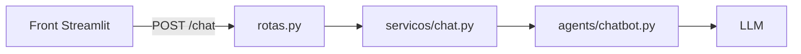

- **Outros canais:** amanhã o mesmo FinBot pode atender WhatsApp ou um app de celular chamando a mesma API.
- **Segurança:** a chave do LLM fica só no servidor; o navegador nunca a vê.
- **Camadas:** a **rota** só traduz HTTP, o **serviço** é a porta única do chat e o **agente** tem a lógica de IA. Quando o miolo mudar (Aulas 3 a 7), a API quase não muda.

### FastAPI e Pydantic

**FastAPI** é um framework para criar APIs em Python. Com **Pydantic**, cada entrada e saída vira uma classe (o **contrato**):

- se faltar um campo, a FastAPI responde `422` sozinha, sem chegar no nosso código;
- a documentação interativa em `/docs` é gerada automaticamente.

### Streamlit

Biblioteca para criar interfaces web **só com Python**. Detalhe importante: **o script inteiro roda de novo a cada interação**. Para guardar algo entre uma interação e outra, usamos `st.session_state`.

### Observabilidade: por que `print` não basta

Num sistema com LLM:

- o comportamento **não é determinístico**: a mesma pergunta pode dar respostas diferentes;
- a falha pode acontecer **no meio do raciocínio** e ainda assim gerar uma resposta plausível;
- monitoramento tradicional (tempo de resposta, erro HTTP) não mostra **onde o agente errou**.

Precisamos ver a **cadeia completa**. É isso que um **trace** registra:

| Termo | O que é |
|---|---|
| **Trace** | Tudo que aconteceu para responder UMA pergunta |
| **Span / observação** | Um passo dentro do trace (um nó do grafo, uma ferramenta) |
| **Generation** | Uma chamada ao LLM: prompt enviado, resposta, tokens, custo, tempo |
| **Session** | Os traces de uma mesma conversa, agrupados |

O **Langfuse** é uma ferramenta open source de observabilidade para LLMs, com plano gratuito na nuvem. Hoje usamos o **tracing**; na Aula 3, o **versionamento de prompts**; na Aula 7, os **evals**.

### Deploy

**Deploy** é colocar o software para rodar num servidor acessível pela internet. Vamos usar duas plataformas gratuitas que publicam direto do GitHub:

| | Render | Streamlit Community Cloud |
|---|---|---|
| Hospeda | a API (FastAPI) | o front (Streamlit) |
| Atualiza | a cada `git push` | a cada `git push` |
| Segredos | Environment Variables | Secrets |
| Limitação grátis | dorme após 15 min sem uso; a 1ª chamada leva ~1 min | dorme após dias sem acesso |

> As chaves vão nos painéis das plataformas, **nunca no GitHub**. É o mesmo princípio do `.env`.

---

## Parte 2 — Mão na massa

> **Onde trabalhar:** continue na mesma pasta `finbot` aberta no VS Code desde a Aula 1; não crie outro repositório nem outra pasta para esta aula. Abra o terminal integrado em **Terminal → Novo Terminal** (atalho ``Ctrl+` ``). No Windows, use **PowerShell**. Antes dos comandos, confira que o terminal está na pasta do projeto (`Get-Location` no PowerShell ou `pwd` no Linux/Mac) e ative o ambiente virtual: `.venv\Scripts\Activate.ps1` no PowerShell ou `source .venv/bin/activate` no Linux/Mac. Se abrir um terminal novo, ative o ambiente nele também.
>
> **Como criar/alterar arquivos:** use o painel **Explorer/Explorador** do VS Code. Abra as pastas do caminho indicado no título ou no comentário `# caminho/do/arquivo.py`; para arquivo novo, clique com o botão direito na pasta → **New File/Novo Arquivo**, digite o nome completo e cole o bloco de código. Salve com `Ctrl+S`. Quando um arquivo já existe e só muda um trecho, o bloco mostra esse trecho: o que você deve acrescentar fica entre os comentários `↓↓↓ NOVO` e `↑↑↑ fim do novo ↑↑↑` (ou logo abaixo de `↓ linha nova`), e o marcador diz depois de qual linha colar, e o restante serve para você achar o lugar no arquivo.

### Passo 1 — Novas dependências

> ✂️ **Como copiar:** o bloco mostra um trecho do arquivo. Acrescente no seu arquivo só o que está entre `↓↓↓ NOVO` e `↑↑↑ fim do novo ↑↑↑` (ou a linha logo abaixo de `↓ linha nova`). O próprio marcador diz **depois de qual linha** colar: procure essa linha no seu arquivo (`Ctrl+F`). As outras linhas já existem e servem para você achar o lugar. Ao colar, deixe o cursor **no começo da linha** (coluna 1, sem espaços antes), para o VS Code não mudar o recuo.

📄 Arquivo `requirements.txt` (trecho alterado na Aula 2):

```text
langchain-mistralai>=1.0
pydantic-settings>=2.6
# ↓↓↓ NOVO: cole logo abaixo de "pydantic-settings>=2.6" ↓↓↓
# Aula 2 — API e observabilidade
fastapi>=0.115       # framework para criar a API (rotas, validação, /docs)
uvicorn>=0.30        # servidor que "liga" a API e atende os pedidos HTTP
langfuse>=4.0        # registra cada conversa (traces) no painel do Langfuse
# ↑↑↑ fim do novo ↑↑↑
```

> ✂️ **Como copiar:** o bloco mostra um trecho do arquivo. Acrescente no seu arquivo só o que está entre `↓↓↓ NOVO` e `↑↑↑ fim do novo ↑↑↑` (ou a linha logo abaixo de `↓ linha nova`). O próprio marcador diz **depois de qual linha** colar: procure essa linha no seu arquivo (`Ctrl+F`). As outras linhas já existem e servem para você achar o lugar. Ao colar, deixe o cursor **no começo da linha** (coluna 1, sem espaços antes), para o VS Code não mudar o recuo.

📄 Arquivo `requirements-dev.txt` (trecho alterado na Aula 2):

```text
# Só para desenvolver e testar no computador (não vai para o Render)
-r requirements.txt
pytest>=8.0
# ↓ linha nova: cole logo abaixo de "pytest>=8.0"
httpx>=0.27          # usado pelo TestClient da FastAPI para chamar a API nos testes
```

Nesta aula, o `requirements-dev.txt` continua incluindo apenas as dependências da aplicação e dos testes. A dependência do front será instalada separadamente, a partir de `frontend/requirements.txt`, depois que esse arquivo for criado no Passo 8.

```bash
pip install -r requirements-dev.txt
```

### Passo 2 — Novas configurações

> ✂️ **Como copiar:** o bloco mostra um trecho do arquivo. Acrescente no seu arquivo só o que está entre `↓↓↓ NOVO` e `↑↑↑ fim do novo ↑↑↑` (ou a linha logo abaixo de `↓ linha nova`). O próprio marcador diz **depois de qual linha** colar: procure essa linha no seu arquivo (`Ctrl+F`). As outras linhas já existem e servem para você achar o lugar. Ao colar, deixe o cursor **no começo da linha** (coluna 1, sem espaços antes), para o VS Code não mudar o recuo.

📄 Arquivo `app/config/settings.py` (trecho alterado na Aula 2):

```python
    mistral_api_key: SecretStr | None = None

    # ↓↓↓ NOVO: cole logo abaixo de "mistral_api_key: SecretStr | None = None" ↓↓↓
    # Langfuse (observabilidade e prompts)
    # Chave pública: identifica o projeto no Langfuse (pode ser texto comum).
    langfuse_public_key: str | None = None
    # Chave secreta: SecretStr esconde o valor em print() e em mensagens de erro.
    langfuse_secret_key: SecretStr | None = None
    # Servidor do Langfuse (projeto criado nos EUA usa https://us.cloud.langfuse.com).
    langfuse_host: str = "https://cloud.langfuse.com"

    # Endereço da API, usado pelo front em Streamlit.
    # No computador é a API local; na nuvem, aponta para a API publicada no Render.
    api_url: str = "http://127.0.0.1:8000"
    # ↑↑↑ fim do novo ↑↑↑

    @property
    def modelo(self) -> str:
        return self.llm_modelo or MODELOS_PADRAO[self.llm_provedor]

    # ↓↓↓ NOVO: cole logo abaixo de "return self.llm_modelo or MODELOS_PADRAO[self.llm_provedor]" ↓↓↓
    # @property permite usar o método como se fosse um campo: settings.langfuse_ativo
    @property
    def langfuse_ativo(self) -> bool:
        """Diz se o Langfuse está configurado: só liga com as DUAS chaves preenchidas."""
        # get_secret_value() revela o texto guardado no SecretStr; sem chave, usa "" (vazio).
        segredo = self.langfuse_secret_key.get_secret_value() if self.langfuse_secret_key else ""
        # bool(...) dá True só se a chave pública E a secreta tiverem conteúdo.
        return bool(self.langfuse_public_key and segredo)
    # ↑↑↑ fim do novo ↑↑↑


settings = Settings()
```

As variáveis do Langfuse e `API_URL` já estão previstas nos arquivos `.env.example` e `.env`, criados na Aula 1. Agora, abra o `.env` no Explorer e preencha `LANGFUSE_PUBLIC_KEY`, `LANGFUSE_SECRET_KEY` e, se o projeto estiver na região dos EUA, ajuste `LANGFUSE_HOST`. Não é necessário alterar o `.env.example` nem copiar linhas entre os arquivos.

### Passo 3 — Conta no Langfuse

1. Crie uma conta em [cloud.langfuse.com](https://cloud.langfuse.com) → crie uma **organização** e um **projeto** `finbot`.
2. **Settings → API Keys → Create new API keys**.
3. Cole no `.env`:

```env
LANGFUSE_PUBLIC_KEY=pk-lf-...
LANGFUSE_SECRET_KEY=sk-lf-...
LANGFUSE_HOST=https://cloud.langfuse.com
```

> Se o seu projeto foi criado na região dos EUA, o host é `https://us.cloud.langfuse.com`; ele aparece na tela das chaves.

### Passo 4 — Observabilidade (`app/llm/observabilidade.py`)

> 🎯 **Para que serve no projeto:** Este arquivo liga o FinBot ao Langfuse. Ele funciona como a "caixa-preta" do projeto: cada vez que o chat responde, registra o que foi enviado ao LLM, o que voltou, quantos tokens foram gastos e quanto tempo levou. Os outros arquivos não falam direto com o Langfuse: só chamam as funções `callbacks()` e `rastrear()` daqui. Assim, se um dia trocarmos a ferramenta de observabilidade, só este arquivo muda.

```python
# app/llm/observabilidade.py
"""Aula 2 — Observabilidade com Langfuse.

Cada pergunta vira um TRACE: a árvore com tudo o que aconteceu (chamadas ao LLM,
ferramentas, busca em documentos), com entrada, saída, tokens e tempo de cada passo.
Sem chaves no .env, tudo continua funcionando, só não registra.
"""
import os
from contextlib import contextmanager  # transforma uma função em um bloco "with ...:"

from app.config.settings import settings

# O SDK do Langfuse lê as credenciais destas variáveis de ambiente.
# Aqui copiamos os valores do .env (que já estão em settings) para o ambiente do programa.
# setdefault só grava se a variável ainda não existir: não sobrescreve o que já veio do sistema.
if settings.langfuse_ativo:
    os.environ.setdefault("LANGFUSE_PUBLIC_KEY", settings.langfuse_public_key)
    os.environ.setdefault("LANGFUSE_SECRET_KEY", settings.langfuse_secret_key.get_secret_value())
    os.environ.setdefault("LANGFUSE_HOST", settings.langfuse_host)
    # Ambiente que aparece no filtro Environment do Langfuse: "local" no seu computador.
    # No Render, a variável já vem do render.yaml ("producao") e o setdefault não a substitui.
    os.environ.setdefault("LANGFUSE_TRACING_ENVIRONMENT", "local")


def cliente_langfuse():
    """Devolve o cliente do Langfuse (na Aula 3 ele será usado para buscar os prompts)."""
    # O import fica dentro da função: a biblioteca só é carregada quando for usada de fato.
    from langfuse import get_client
    return get_client()


def callbacks() -> list:
    """Lista de callbacks para o LangChain/LangGraph enviarem cada passo ao Langfuse."""
    # Sem as chaves, devolve lista vazia: o chat funciona normalmente, só não registra nada.
    if not settings.langfuse_ativo:
        return []
    from langfuse.langchain import CallbackHandler
    # O CallbackHandler é avisado a cada passo (início e fim da chamada ao LLM)
    # e envia entrada, saída, tokens e tempo para o painel do Langfuse.
    return [CallbackHandler()]


@contextmanager
def rastrear(sessao: str, usuario: str, nome: str = "chat"):
    """Agrupa os traces por sessão e usuário (aba Sessions do Langfuse).

    Uso:
        with rastrear("sessao-123", "aluno1"):
            ...  # tudo o que rodar aqui dentro fica marcado com essa sessão e esse usuário
    """
    if not settings.langfuse_ativo:
        yield  # sem Langfuse: apenas executa o bloco "with", sem marcar nada
        return
    from langfuse import propagate_attributes
    # propagate_attributes "carimba" sessão, usuário e nome em todo trace criado dentro do bloco.
    with propagate_attributes(session_id=sessao, user_id=usuario, trace_name=nome):
        yield  # neste ponto roda o código que está dentro do "with rastrear(...)"
```

**Como funciona:** o LangChain aceita **callbacks**, funções avisadas a cada passo. O `CallbackHandler` do Langfuse é um callback que envia cada passo para o painel. O `rastrear()` marca a sessão e o usuário, para agrupar os traces da mesma conversa. **Sem chaves, nada quebra:** só não registra.

### Passo 5 — O agente de conversa (`app/agents/chatbot.py`)

Crie a pasta `app/agents/` com `__init__.py` vazio e o arquivo:

> 🎯 **Para que serve no projeto:** É o "cérebro" do FinBot nesta aula: o agente que monta as mensagens (regras + histórico + pergunta) e chama o LLM. Na analogia do restaurante, é a **cozinha**. Ele não sabe nada de HTTP nem de tela: recebe o histórico e a pergunta e devolve a resposta. Nas próximas aulas, ele vai ganhar memória, ferramentas e colegas especialistas.

```python
# app/agents/chatbot.py
"""Agente de conversa geral: LLM + prompt de sistema (sem ferramentas).
"""
# Tipos de mensagem do LangChain (os "papéis" da Aula 1):
# SystemMessage = regras do bot, HumanMessage = usuário, AIMessage = resposta do modelo.
from langchain_core.messages import AIMessage, BaseMessage, HumanMessage, SystemMessage

from app.llm import fabrica        # cria o modelo do provedor escolhido no .env
from app.prompts import catalogo   # carrega o prompt de sistema (app/prompts/sistema.md)


def responder(historico: list[BaseMessage], pergunta: str, callbacks: list | None = None) -> AIMessage:
    """Monta [sistema + histórico + pergunta] e chama o modelo."""
    # O LLM não tem memória: a cada pergunta enviamos regras + conversa anterior + pergunta nova.
    mensagens = (
        [SystemMessage(catalogo.carregar("sistema"))]
        + historico[-10:]  # janela de contexto: só as 10 últimas (economiza tokens)
        + [HumanMessage(pergunta)]
    )
    # invoke() envia as mensagens ao LLM e devolve um AIMessage.
    # Os callbacks (Langfuse) vão em config; "or []" troca None por lista vazia.
    return fabrica.criar_modelo().invoke(mensagens, config={"callbacks": callbacks or []})
```

### Passo 6 — A camada de serviço (`app/servicos/chat.py`)

Crie `app/servicos/` com `__init__.py` vazio:

> 🎯 **Para que serve no projeto:** É a **porta única de entrada** do chat. A API (e, no futuro, qualquer outro canal, como WhatsApp) conversa só com este arquivo, nunca direto com o agente. Ele guarda o histórico de cada sessão e chama o agente. Por enquanto, o histórico fica num dicionário na memória do programa; na Aula 3 ele vai para o MongoDB, e a API nem percebe a troca.

```python
# app/servicos/chat.py
"""Camada de serviço: a ÚNICA porta de entrada do chat.

A API (e qualquer outro canal no futuro: WhatsApp, terminal...) chama estas funções.
Assim, quando o "miolo" muda de aula para aula, a API não precisa mudar.
"""
from langchain_core.messages import AIMessage, HumanMessage

from app.agents.chatbot import responder
from app.llm.observabilidade import callbacks, rastrear

# Memória provisória: some quando a API reinicia (na Aula 3 vai para o MongoDB).
# É um dicionário: a chave é o id da sessão e o valor é a lista de mensagens dela.
# O "_" no início do nome indica que é de uso interno deste arquivo.
_memoria: dict[str, list] = {}


def perguntar(pergunta: str, sessao: str, usuario: str = "anonimo") -> dict:
    """Recebe uma pergunta, chama o agente e guarda a troca no histórico da sessão."""
    # setdefault pega a lista da sessão; se a sessão for nova, cria uma lista vazia.
    historico = _memoria.setdefault(sessao, [])
    # Tudo dentro do "with" fica registrado no Langfuse com essa sessão e esse usuário.
    with rastrear(sessao, usuario):
        resposta = responder(historico, pergunta, callbacks=callbacks())
    # Guarda a pergunta e a resposta para a próxima chamada lembrar da conversa.
    historico += [HumanMessage(pergunta), AIMessage(resposta.content)]
    # Devolve um dicionário simples; a API transforma isso em JSON.
    return {"resposta": resposta.content}


def historico(sessao: str) -> list[dict]:
    """Devolve as mensagens da sessão em formato simples (papel + conteúdo) para a API."""
    # m.type é "human" para o usuário e "ai" para o modelo; traduzimos para user/assistant.
    # .get(sessao, []) devolve lista vazia se a sessão não existir (em vez de dar erro).
    return [
        {"papel": "user" if m.type == "human" else "assistant", "conteudo": m.content}
        for m in _memoria.get(sessao, [])
    ]
```

**Por que a memória está num dicionário?** É provisório, para mostrar o problema: reinicie a API e a conversa some. Com várias cópias do servidor, cada uma teria uma memória diferente. Na Aula 3 a memória vai para o MongoDB.

### Passo 7 — Schemas, rotas e aplicação

Crie `app/api/` com `__init__.py` vazio.

> 🎯 **Para que serve no projeto:** Define o **contrato** da API: o formato exato do que o front pode enviar e do que a API devolve. É o **cardápio** da analogia do garçom. A FastAPI usa essas classes para recusar pedidos errados (erro 422) e para montar a documentação em `/docs`.

```python
# app/api/schemas.py
"""Modelos de entrada e saída da API (Pydantic).

Eles são o CONTRATO: a FastAPI valida o que chega (erro 422 se faltar campo)
e gera a documentação automática em /docs.
"""
from pydantic import BaseModel, Field


class Pergunta(BaseModel):
    """O que o front ENVIA para POST /chat."""
    # min_length=1 recusa mensagem vazia (422); examples aparece como exemplo no /docs.
    mensagem: str = Field(min_length=1, examples=["O que é CDI?"])
    # Sem valor padrão = campo obrigatório: se faltar, a FastAPI responde 422.
    sessao: str = Field(examples=["sessao-123"])
    # Com valor padrão = campo opcional: se não vier, vale "anonimo".
    usuario: str = "anonimo"


class Resposta(BaseModel):
    """O que a API DEVOLVE em POST /chat."""
    resposta: str


class Mensagem(BaseModel):
    """Uma mensagem do histórico, devolvida em GET /sessoes/{sessao}/mensagens."""
    papel: str      # "user" (pessoa) ou "assistant" (FinBot)
    conteudo: str   # o texto da mensagem
```

> 🎯 **Para que serve no projeto:** Define os **endereços (rotas)** da API: o que acontece quando chega um `GET /saude`, um `POST /chat` etc. É o **garçom**: recebe o pedido HTTP, repassa para a camada de serviço e devolve a resposta em JSON. As rotas não têm lógica de IA; só traduzem HTTP.

```python
# app/api/rotas.py
"""Rotas (endpoints) da API. Cada função = um endereço + um método HTTP."""
from fastapi import APIRouter

from app.api.schemas import Mensagem, Pergunta, Resposta
from app.config.settings import settings
from app.servicos import chat

# O router junta as rotas deste arquivo; depois ele é ligado à aplicação em app/main.py.
router = APIRouter()


# @router.get("/saude") = quando chegar um GET no endereço /saude, rode esta função.
@router.get("/saude")
def saude():
    """Usada para saber se a API está no ar (e para 'acordar' o Render)."""
    # Um dicionário devolvido aqui vira JSON na resposta.
    return {"status": "ok", "provedor": settings.llm_provedor, "modelo": settings.modelo}


# response_model=Resposta: a FastAPI confere a saída e a documenta no /docs.
@router.post("/chat", response_model=Resposta)
def perguntar(p: Pergunta):
    """Recebe a pergunta (JSON validado pelo schema Pergunta) e devolve a resposta."""
    # A rota só traduz HTTP: quem faz o trabalho é a camada de serviço.
    return chat.perguntar(p.mensagem, p.sessao, p.usuario)


# {sessao} no endereço vira o parâmetro "sessao" da função (ex.: /sessoes/abc/mensagens).
@router.get("/sessoes/{sessao}/mensagens", response_model=list[Mensagem])
def mensagens(sessao: str):
    """Devolve o histórico de mensagens de uma sessão."""
    return chat.historico(sessao)
```

> 🎯 **Para que serve no projeto:** É o **ponto de partida** da API: cria a aplicação FastAPI e liga as rotas a ela. É este arquivo que o `uvicorn` executa, tanto no seu computador quanto no Render.

```python
# app/main.py
"""Ponto de entrada da API.

Local:   uvicorn app.main:app --reload        -> http://127.0.0.1:8000/docs
Render:  uvicorn app.main:app --host 0.0.0.0 --port $PORT
"""
from fastapi import FastAPI

from app.api.rotas import router

# Cria a aplicação. title e description aparecem no topo da página /docs.
# O uvicorn procura esta variável: "app.main:app" = arquivo app/main.py, variável app.
app = FastAPI(title="FinBot API", description="Chat educacional de investimentos — FATEC / PLN")
# Liga as rotas de app/api/rotas.py à aplicação.
app.include_router(router)
```

Rode a API:

```bash
uvicorn app.main:app --reload
```

> Se abrir só `http://127.0.0.1:8000`, aparece `{"detail":"Not Found"}`. É normal: a API não tem página na raiz, só nas rotas.

Abra **http://127.0.0.1:8000/docs** → `POST /chat` → **Try it out** → envie:

```json
{"mensagem": "O que é CDI?", "sessao": "teste1"}
```

Teste também `{"mensagem": "", "sessao": "x"}` e veja o **422**. O Pydantic barrou antes de chegar no LLM.

> `--reload` reinicia a API sozinha quando você salva um arquivo `.py`. **Mudou o `.env`? Pare (Ctrl+C) e suba de novo.** Só use no desenvolvimento.

### Passo 8 — O front em Streamlit

Crie `frontend/requirements.txt` (o Streamlit Cloud instala **só** este arquivo, que fica ao lado do app):

```text
# Dependências SÓ do front (o Streamlit Cloud usa este arquivo, que fica ao lado do app)
streamlit>=1.40
requests>=2.32
```

Como o arquivo de dependências do front acabou de ser criado, instale agora esses pacotes no mesmo ambiente virtual:

```bash
pip install -r frontend/requirements.txt
```

E `frontend/streamlit_app.py`:

> 🎯 **Para que serve no projeto:** É a **tela do chat** que o usuário vê no navegador. O front não fala com o LLM nem guarda chaves: só envia a pergunta para a API (`POST /chat`) e mostra a resposta. Por isso ele pode ser publicado separado da API, no Streamlit Cloud.

```python
# frontend/streamlit_app.py
"""Front do FinBot em Streamlit. Ele NÃO fala com o LLM: só chama a API.

Local:   streamlit run frontend/streamlit_app.py
Nuvem:   Streamlit Community Cloud (API_URL nos Secrets aponta para a API no Render)
"""
import os
import uuid       # gera identificadores aleatórios (usado para criar o id da sessão)

import requests   # faz pedidos HTTP para a API
import streamlit as st


def config(nome: str, padrao: str) -> str:
    """Lê de variável de ambiente ou dos Secrets do Streamlit Cloud."""
    try:
        # 1º tenta a variável de ambiente; se não houver, procura nos Secrets; senão, usa o padrão.
        return os.getenv(nome) or st.secrets.get(nome, padrao)
    except Exception:  # sem arquivo de secrets (rodando local)
        return padrao


# rstrip("/") tira a barra do final, para não virar "...com//chat" ao juntar com o caminho.
API_URL = config("API_URL", "http://127.0.0.1:8000").rstrip("/")
TEMPO_LIMITE = 120  # segundos: a API grátis do Render pode levar ~1 min para "acordar"


def api(metodo: str, caminho: str, **kwargs):
    """Chama a API (ex.: api("POST", "/chat", json={...})) e devolve o JSON da resposta."""
    # **kwargs repassa argumentos extras ao requests, como json={...} com o corpo do pedido.
    resposta = requests.request(metodo, f"{API_URL}{caminho}", timeout=TEMPO_LIMITE, **kwargs)
    # Se a API respondeu com erro (4xx ou 5xx), levanta uma exceção em vez de seguir.
    resposta.raise_for_status()
    return resposta.json()


# Configuração e cabeçalho da página.
st.set_page_config(page_title="FinBot", page_icon="💬")
st.title("💬 FinBot")
st.caption("Chat educacional sobre investimentos — não é recomendação de investimento.")

# st.session_state guarda valores entre um clique e outro (o script roda de novo a cada interação)
# Na primeira execução, cria um id curto de sessão (8 caracteres) e a lista de mensagens.
if "sessao" not in st.session_state:
    st.session_state.sessao = str(uuid.uuid4())[:8]
    st.session_state.mensagens = []
usuario = "aluno1"  # fixo por enquanto; na Aula 3 o usuário poderá ser escolhido na tela


def mostrar(m: dict):
    """Desenha uma mensagem no chat, com o balão do usuário ou do assistente."""
    with st.chat_message(m["papel"]):
        st.markdown(m["conteudo"])


# Como o script roda de novo a cada interação, redesenhamos toda a conversa guardada.
for m in st.session_state.mensagens:
    mostrar(m)

# st.chat_input mostra a caixa de texto; ":=" guarda o que foi digitado em "pergunta"
# e o if só entra quando o usuário enviou algo.
if pergunta := st.chat_input("Pergunte sobre CDI, Tesouro, FIIs, ações..."):
    # Mostra a pergunta na tela na hora, antes de esperar a resposta.
    st.session_state.mensagens.append({"papel": "user", "conteudo": pergunta})
    mostrar(st.session_state.mensagens[-1])
    # Enquanto a API responde, aparece "Pensando..." na tela.
    with st.spinner("Pensando..."):
        try:
            r = api("POST", "/chat", json={"mensagem": pergunta, "sessao": st.session_state.sessao, "usuario": usuario})
            # "agente" e "fontes" só existem nas próximas aulas; .get() evita erro se não vierem.
            m = {"papel": "assistant", "conteudo": r["resposta"], "agente": r.get("agente"), "fontes": r.get("fontes", [])}
        except Exception as erro:
            # Se a API estiver fora do ar ou der erro, mostra o aviso no chat em vez de travar.
            m = {"papel": "assistant", "conteudo": f"⚠️ Erro ao falar com a API: {erro}"}
    st.session_state.mensagens.append(m)
    mostrar(m)
```

Com a API rodando num terminal, abra **outro terminal** (ative o venv!) e rode:

```bash
streamlit run frontend/streamlit_app.py
```

### Passo 9 — Ver os traces no Langfuse

Converse um pouco e abra o Langfuse → **Tracing**. Clique num trace e encontre:

- o prompt de sistema e o histórico **exatamente** como foram enviados;
- os tokens de entrada e saída, e o tempo da chamada;
- em **Sessions**, a conversa inteira agrupada.
- no filtro **Environment** (à esquerda, na lista de traces), de onde veio cada conversa: `local` (seu computador) ou `producao` (a API publicada no Render, a partir do Passo 12).

**Exercício:** faça 6 perguntas na mesma sessão e veja os tokens de entrada crescerem. É a janela de contexto `historico[-10:]` em ação.

### Passo 10 — Testes

> 🎯 **Para que serve no projeto:** São os **testes automáticos** desta aula. Usando um modelo falso (sem gastar tokens), eles conferem que a API está no ar, responde, valida a entrada e mantém o histórico de cada sessão separado. Rode sempre que mudar algo, para saber se nada quebrou.

```python
# tests/test_aula2.py
"""Aula 2 — a API responde, valida a entrada e lembra da conversa da sessão.

As fixtures vêm de tests/conftest.py:
- api: um cliente de teste que chama a API sem precisar ligar o servidor;
- falso: um modelo falso no lugar do LLM (não gasta tokens e sempre responde igual).
"""


def test_saude(api):
    """A rota /saude responde com status ok."""
    assert api.get("/saude").json()["status"] == "ok"


def test_chat_responde(api):
    """POST /chat devolve 200 e a resposta do modelo (aqui, o modelo falso)."""
    r = api.post("/chat", json={"mensagem": "Oi!", "sessao": "s1"})
    assert r.status_code == 200
    assert "resposta de teste" in r.json()["resposta"]


def test_chat_envia_o_historico_ao_modelo(api, falso):
    """Na 2ª pergunta, a 1ª vai junto: é assim que o FinBot "lembra" da conversa."""
    api.post("/chat", json={"mensagem": "Meu nome é Ana", "sessao": "s2"})
    api.post("/chat", json={"mensagem": "Qual é meu nome?", "sessao": "s2"})
    # falso.vistas guarda as mensagens que o modelo recebeu na última chamada.
    textos = [m.content for m in falso.vistas]
    assert "Meu nome é Ana" in textos  # a 1ª pergunta foi junto na 2ª chamada


def test_sessoes_nao_se_misturam(api):
    """Cada sessão tem seu próprio histórico: a conversa A não vê a conversa B."""
    api.post("/chat", json={"mensagem": "pergunta A", "sessao": "A"})
    api.post("/chat", json={"mensagem": "pergunta B", "sessao": "B"})
    conteudos = [m["conteudo"] for m in api.get("/sessoes/A/mensagens").json()]
    assert "pergunta A" in conteudos and "pergunta B" not in conteudos


def test_mensagem_vazia_da_erro_422(api):
    """Mensagem vazia é barrada pelo schema (min_length=1) antes de chegar ao LLM."""
    assert api.post("/chat", json={"mensagem": "", "sessao": "x"}).status_code == 422
```

```bash
pytest -v
```

### Passo 11 — Commit e push (antes do deploy)

```bash
git add .
git commit -m "Aula 2: API FastAPI, front Streamlit, Langfuse e primeiro deploy"
git push
```

A tag `aula-2` fica para o fim da aula (Passo 14), depois que tudo estiver publicado.

### Passo 12 — Deploy da API no Render

Crie `render.yaml` na raiz. É a "receita" do serviço:

```yaml
# Blueprint do Render: New + > Blueprint > escolha este repositório.
# As chaves (sync: false) são pedidas na tela do Render, nunca ficam no GitHub.
services:
  - type: web                   # serviço web: fica no ar respondendo pedidos HTTP
    name: finbot-api            # nome no painel (vira parte da URL)
    runtime: python
    plan: free                  # plano gratuito: "dorme" depois de um tempo sem uso
    buildCommand: pip install -r requirements.txt                    # instala as dependências
    startCommand: uvicorn app.main:app --host 0.0.0.0 --port $PORT   # liga a API
    healthCheckPath: /saude     # o Render chama esta rota para saber se a API subiu
    autoDeploy: true            # cada git push na main publica de novo
    envVars:                    # variáveis de ambiente (o .env do servidor)
      - key: PYTHON_VERSION
        value: "3.12.8"
      - key: LLM_PROVEDOR
        value: groq
      - key: GROQ_API_KEY
        sync: false             # secreta: você digita o valor no painel do Render
      - key: LANGFUSE_PUBLIC_KEY
        sync: false
      - key: LANGFUSE_SECRET_KEY
        sync: false
      - key: LANGFUSE_TRACING_ENVIRONMENT
        value: producao         # separa os traces do Render dos locais (filtro Environment)
      - key: LANGFUSE_HOST
        value: https://cloud.langfuse.com
```

Envie o `render.yaml` para o GitHub: o Render lê este arquivo **direto do repositório**, então ele precisa estar lá antes do próximo passo.

```bash
git add render.yaml
git commit -m "Aula 2: render.yaml para o deploy no Render"
git push
```

1. Crie conta em [render.com](https://render.com) entrando **com o GitHub**.
2. No canto superior direito, clique em **+ New** e, no menu que abre, escolha **Blueprint** (ele não aparece nos cartões da página "Create a new Service").

   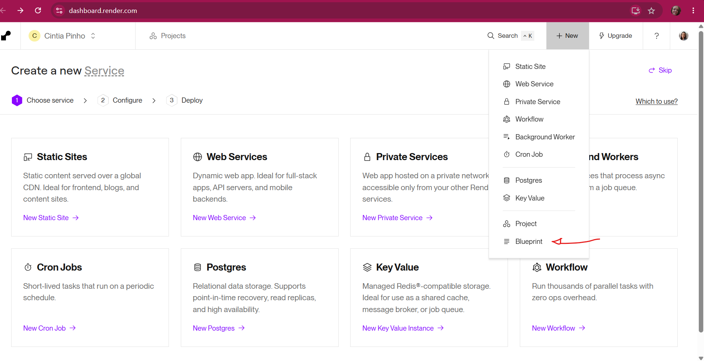

3. Na tela **Connect a repository**, encontre o repositório do seu projeto na lista (use a busca, se precisar) e clique em **Connect** ao lado dele. Se o repositório não aparecer, clique em **Configure account**, à direita, e libere o acesso do Render a ele no GitHub.

   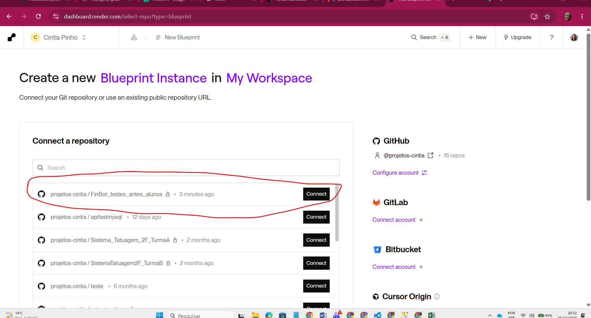

4. Na tela **"You are deploying from a Blueprint for..."**, preencha:
   - **Blueprint Name** (obrigatório): um nome para identificar o projeto no Render, por exemplo `finbot`.
   - **Branch**: deixe `main`.
   - **Blueprint Path**: deixe em branco. O Render usa o `render.yaml` da raiz do repositório.

   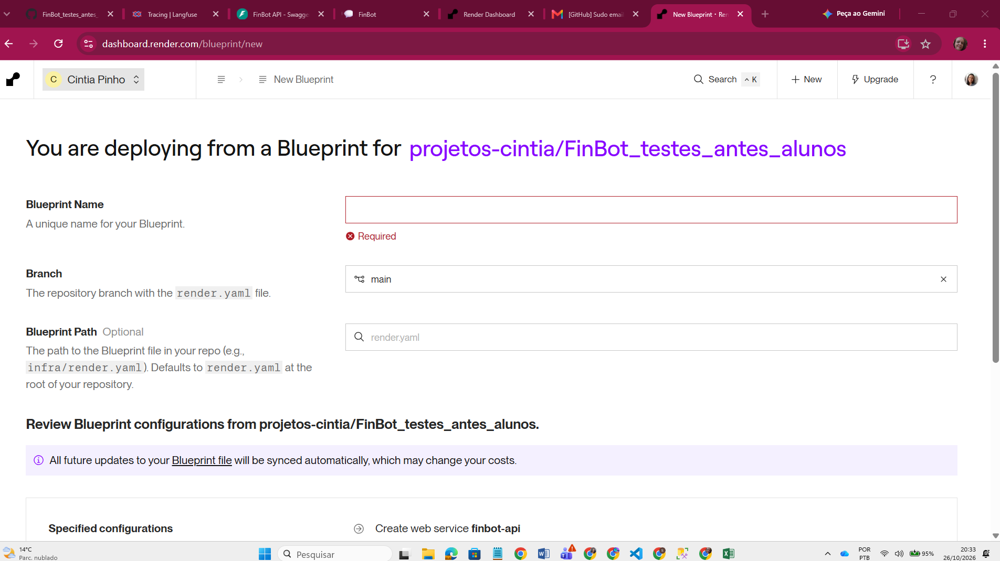

5. Role a página para baixo. Em **Specified configurations** deve aparecer **Create web service finbot-api**: é o Render confirmando que leu o seu `render.yaml`. Logo abaixo aparecem as variáveis marcadas como secretas (`sync: false`), cada uma com um campo **Enter value** vazio. Preencha cada campo com o valor da linha de mesmo nome no seu `.env`:

   | Key (no Render) | Value: copie do `.env` |
   |---|---|
   | `GROQ_API_KEY` | o valor depois de `GROQ_API_KEY=` (começa com `gsk_`) |
   | `LANGFUSE_PUBLIC_KEY` | o valor depois de `LANGFUSE_PUBLIC_KEY=` (começa com `pk-lf-`) |
   | `LANGFUSE_SECRET_KEY` | o valor depois de `LANGFUSE_SECRET_KEY=` (começa com `sk-lf-`) |

   Cole **só o valor**: sem o nome da variável, sem o `=`, sem aspas e sem espaços no começo ou no fim. As outras variáveis do `render.yaml` (`LLM_PROVEDOR`, `LANGFUSE_HOST`, `PYTHON_VERSION`) já têm valor no arquivo e por isso não aparecem aqui. Depois, clique em **Deploy Blueprint**.

   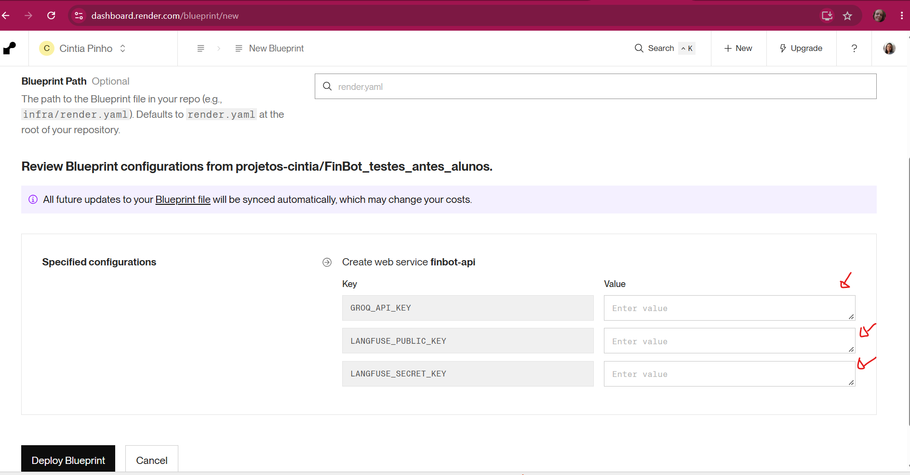

   > Se aparecer um erro dizendo que o `render.yaml` não foi encontrado, ele ainda não está no GitHub: volte e faça o `git add`, `git commit` e `git push` do início deste passo.
   >
   > Se o seu projeto do Langfuse for da região dos EUA, depois do deploy troque o valor de `LANGFUSE_HOST` em **Environment** no painel do serviço para `https://us.cloud.langfuse.com`.
6. O Render abre a página do Blueprint. Os dois ✔ verdes indicam que ele **leu o `render.yaml`** (o "Sync") e **criou o serviço** `finbot-api`. Isso ainda não quer dizer que a API está no ar: clique em **finbot-api** (o link roxo) para acompanhar a instalação.

   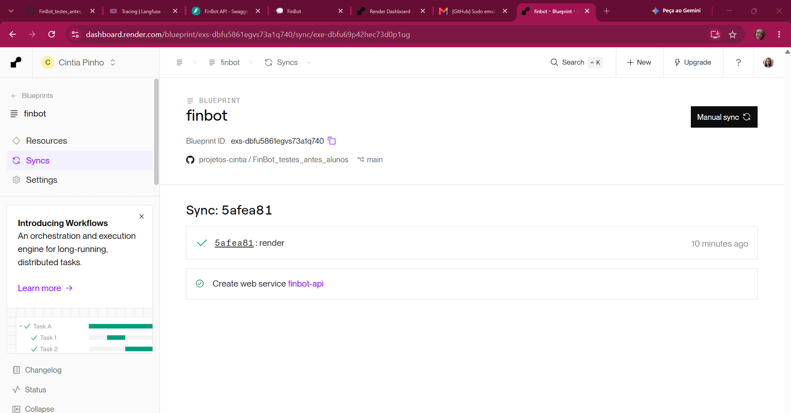

7. Na página do serviço, aguarde o build (de 1 a 3 minutos; os detalhes aparecem em **Logs**, no menu à esquerda). Quando terminar, aparece o selo verde **Live** ao lado do commit: a API está no ar. Logo abaixo fica a **URL pública** da sua API (algo como `https://finbot-api-xxxx.onrender.com`). Copie essa URL: ela vai ser usada no Passo 13.

   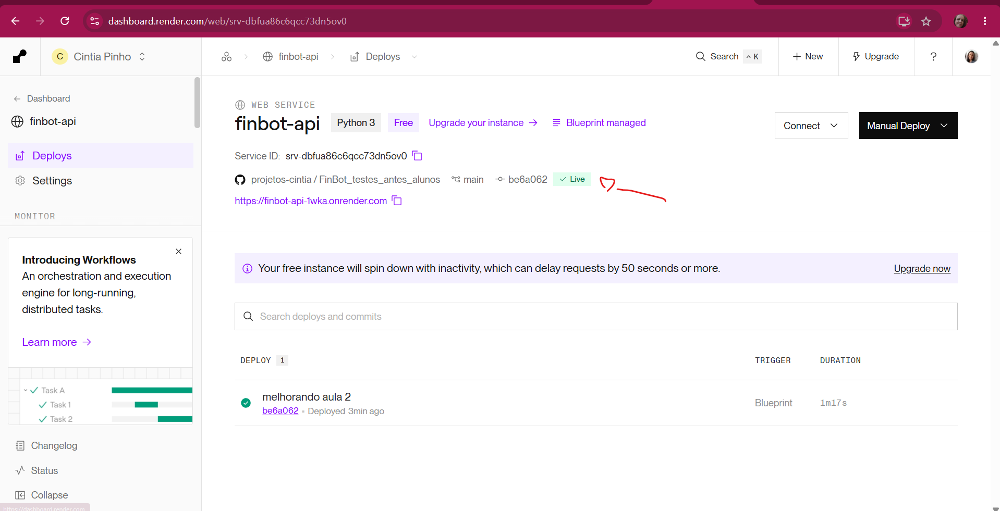

   Se o status for **Failed**, abra **Logs** e leia as últimas linhas: costuma ser uma dependência faltando no `requirements.txt` ou uma chave preenchida errada.

8. Abra a URL com `/docs` no final (ex.: `https://finbot-api-xxxx.onrender.com/docs`) e teste `GET /saude` e `POST /chat`, como você fez no computador no Passo 7. A página deve ser igual à do seu computador, agora num endereço público:

   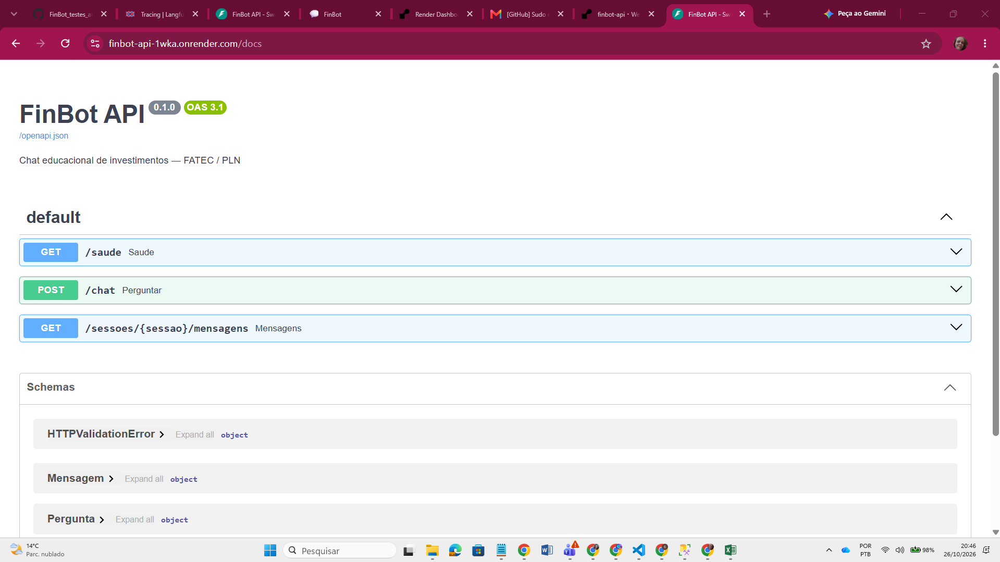

   O aviso roxo "Your free instance will spin down with inactivity" é normal no plano grátis: depois de um tempo sem uso, a API "dorme", e a primeira pergunta demora cerca de 1 minuto.

> Se o nome `finbot-api` já existir, o Render acrescenta um sufixo. Copie a URL exata do painel.

**Por que `--host 0.0.0.0 --port $PORT`?** No servidor, a API precisa aceitar conexões de fora (`0.0.0.0`) na porta que o Render escolher (`$PORT`).

### Passo 13 — Deploy do front no Streamlit Community Cloud

1. Acesse [share.streamlit.io](https://share.streamlit.io) e entre com o GitHub (a mesma conta onde está o repositório do projeto).
2. Na página **My apps**, clique em **Create app**, no canto superior direito (ou em **Create your first app now**, no meio da tela, se for o seu primeiro app).

   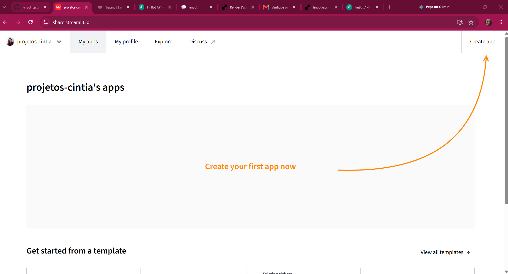

3. Na tela **What would you like to do?**, escolha **Deploy a public app from GitHub** → **Deploy now**. "Public" quer dizer que o **endereço do app** fica aberto para qualquer pessoa usar; o código continua no seu repositório.

   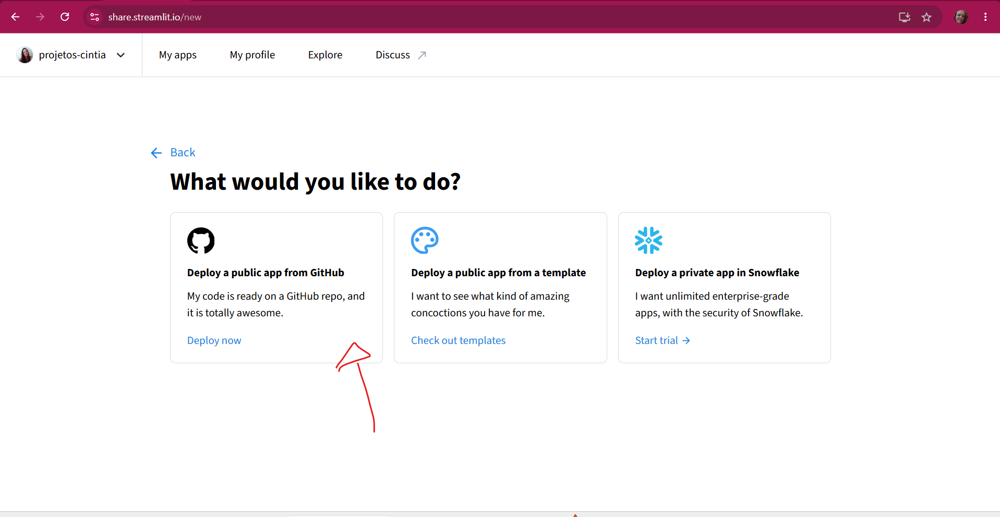

4. Na tela **Deploy an app**, preencha:
   - **Repository**: o repositório do seu projeto (ex.: `seu-usuario/finbot`);
   - **Branch**: `main`;
   - **Main file path**: `frontend/streamlit_app.py`;
   - **App URL** (opcional): o endereço do seu app. O Streamlit sugere um nome aleatório; troque por um fácil de lembrar, como `finbot-seunome`, e confira se aparece **Domain is available**.

   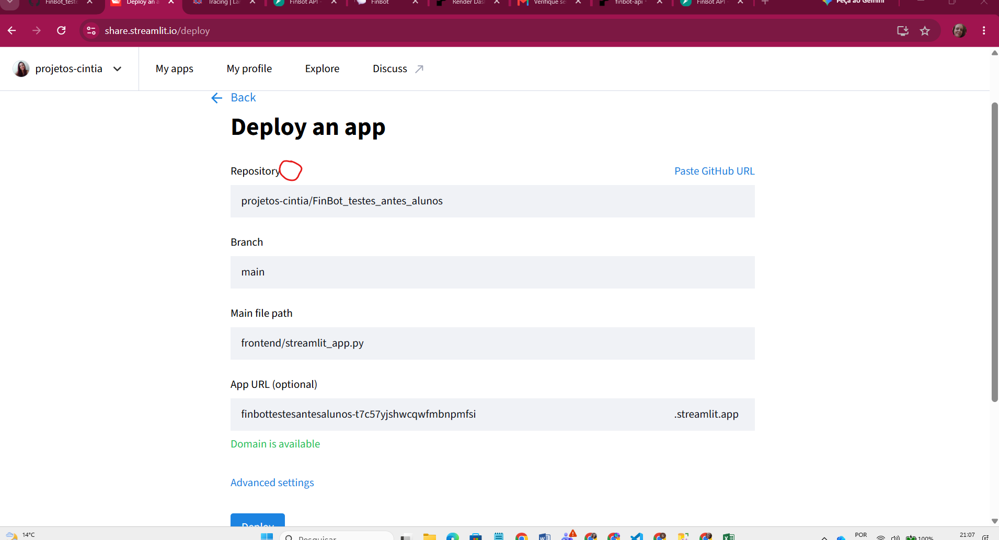

   > **O seu repositório não aparece na lista?** Se ele for **privado** (com cadeado no GitHub), o Streamlit, por padrão, só enxerga os repositórios públicos. Para liberar, clique no **ícone de interrogação (?)** ao lado da palavra **Repository** e escolha a opção de permitir o acesso a repositórios privados. O GitHub abre uma tela de autorização: clique em **Authorize**. Ao voltar, o repositório aparece na lista. Essa permissão é dada **pelo Streamlit**: procurar nas configurações do GitHub não resolve.
5. **Antes de clicar em Deploy**, abra **Advanced settings** e, no campo **Secrets**, cole a linha abaixo, trocando o endereço pela URL da **sua** API no Render (a que você copiou no Passo 12):

```toml
API_URL = "https://finbot-api-XXXX.onrender.com"
```

   É assim que o front publicado sabe onde está a API. **Não pule este passo.**

6. **Deploy**. Em ~2 minutos você terá `https://SEU-APP.streamlit.app`.

#### Apareceu "⚠️ Erro ao falar com a API ... 127.0.0.1 ... Connection refused"?

É o que acontece quando o Secret `API_URL` fica de fora: o app abre normalmente, mas toda pergunta volta com este erro.

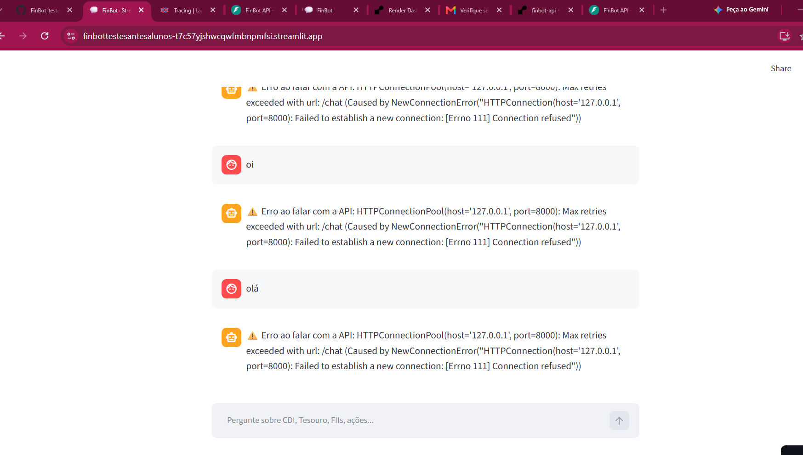

**Por quê?** Sem o Secret, o front usa o endereço padrão `http://127.0.0.1:8000`, que no seu computador é a API local. Mas no Streamlit Cloud, `127.0.0.1` é o **próprio servidor do Streamlit**, onde não existe API nenhuma, e por isso a conexão é recusada.

**Como corrigir (não precisa refazer o deploy):**

1. No app aberto, clique em **Manage app** (canto inferior direito). Se não achar, use [share.streamlit.io](https://share.streamlit.io) → **My apps** → **⋮** ao lado do app.
2. Clique em **⋮ → Settings** e, no menu à esquerda de **App settings**, em **Secrets**.
3. Cole a linha com a URL da sua API e clique em **Save changes**:

   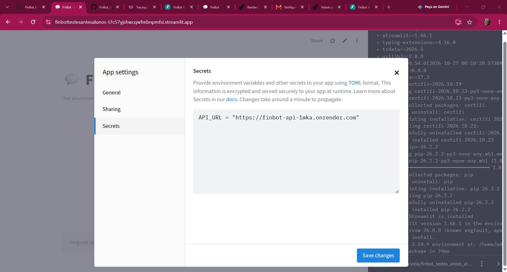

4. Aguarde cerca de 1 minuto (o app reinicia sozinho), recarregue a página com **F5** e faça uma pergunta. As mensagens de erro antigas somem, porque a página recarregada começa uma conversa nova.

> A 1ª pergunta depois de um tempo parado demora (~1 min) porque a API grátis "dorme". Por isso o front espera até 120 s.

**Confira no Langfuse:** converse um pouco pelo app publicado e abra **Tracing**. Na coluna **Environment** (role a tabela para a direita, se precisar), as conversas do app publicado aparecem como `producao`, e as feitas no seu computador, como `local`. Use o filtro **Environment**, à esquerda, para ver só um dos dois. Conversas feitas antes de configurar o ambiente aparecem como `default`.

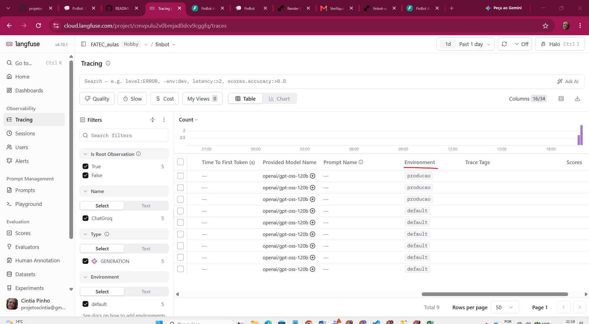

**Teste o ciclo completo:** mude uma regra em `app/prompts/sistema.md`, faça commit e push, aguarde o Render republicar e veja a mudança no app.

### Passo 14 — Os links do projeto no README

Agora o FinBot tem endereços públicos. Registre-os no `README.md`: assim, qualquer pessoa que abrir o seu repositório no GitHub encontra o app, e você não perde os links.

Abra o `README.md` e cole a seção abaixo logo depois do primeiro parágrafo (a descrição do projeto). Depois, troque cada `COLE_AQUI...` pelo link correspondente:

```markdown
## Links do projeto

| O quê | Link |
|---|---|
| Chat publicado (Streamlit Cloud) | COLE_AQUI_O_LINK_DO_APP_NO_STREAMLIT |
| API publicada (Render) | COLE_AQUI_O_LINK_DA_API_NO_RENDER |
| Documentação da API | COLE_AQUI_O_LINK_DA_API_NO_RENDER/docs |

No plano gratuito, a API "dorme" depois de um tempo sem uso: a primeira pergunta pode demorar cerca de 1 minuto.
```

Onde encontrar cada link:

| Link | Onde copiar |
|---|---|
| App no Streamlit | a barra de endereço do navegador com o app aberto (termina em `.streamlit.app`) |
| API no Render | a página do serviço `finbot-api` no Render, logo abaixo do nome (termina em `.onrender.com`) |
| Documentação | o mesmo link da API, com `/docs` no final |

Exemplo de linha preenchida:

```markdown
| Chat publicado (Streamlit Cloud) | https://finbot-seunome.streamlit.app |
```

> Coloque **só** links públicos. Os painéis do Render, do Langfuse e do Streamlit só abrem com o seu login, e as chaves do `.env` **nunca** vão para o README.

Salve e envie, criando também a tag desta aula:

```bash
git add README.md
git commit -m "Aula 2: links do projeto publicado no README"
git push
git tag aula-2
git push --tags
```

---

## ✅ Checklist da aula

- [ ] `/docs` funcionando localmente e o `422` testado
- [ ] Chat no Streamlit falando com a API local
- [ ] Traces e sessões aparecendo no Langfuse
- [ ] API publicada no Render e front no Streamlit Cloud
- [ ] Links do app, da API e do `/docs` no `README.md`
- [ ] Commit e tag `aula-2` no GitHub

## 🚀 Para ir além

- Acrescente `GET /sessoes` listando as sessões em memória.
- No Langfuse, abra um trace e responda: quanto tempo foi rede e quanto foi o LLM?
- Pesquise **CORS** e por que ele seria necessário se o front fosse um site em JavaScript (no Streamlit não é, porque a chamada sai do servidor do Streamlit).

## 📁 Estrutura do projeto ao final da aula

Confira no painel **Explorer/Explorador** do VS Code se a estrutura agora inclui os arquivos da API, do front e dos testes da Aula 2. Os arquivos das aulas anteriores continuam na mesma pasta.

```text
finbot/
├── .env                         # local: credenciais; não publicar
├── .env.example
├── .gitignore
├── README.md
├── requirements.txt
├── requirements-dev.txt
├── render.yaml
├── aulas/
│   ├── aula-01.md
│   ├── aula-02.md
│   ├── aula-03.md
│   ├── aula-04.md
│   ├── aula-05.md
│   ├── aula-06.md
│   ├── aula-07.md
│   └── problemas-comuns.md
├── app/
│   ├── __init__.py
│   ├── main.py
│   ├── config/
│   │   ├── __init__.py
│   │   └── settings.py
│   ├── llm/
│   │   ├── __init__.py
│   │   ├── fabrica.py
│   │   └── observabilidade.py
│   ├── prompts/
│   │   ├── __init__.py
│   │   ├── catalogo.py
│   │   └── sistema.md
│   ├── agents/
│   │   ├── __init__.py
│   │   └── chatbot.py
│   ├── servicos/
│   │   ├── __init__.py
│   │   └── chat.py
│   └── api/
│       ├── __init__.py
│       ├── schemas.py
│       └── rotas.py
├── frontend/
│   ├── requirements.txt
│   └── streamlit_app.py
├── scripts/
│   └── chat_terminal.py
└── tests/
    ├── conftest.py
    ├── test_aula1.py
    └── test_aula2.py
```

> A pasta `.venv/` existe no seu computador, mas é ignorada pelo Git. Não a envie ao GitHub.
