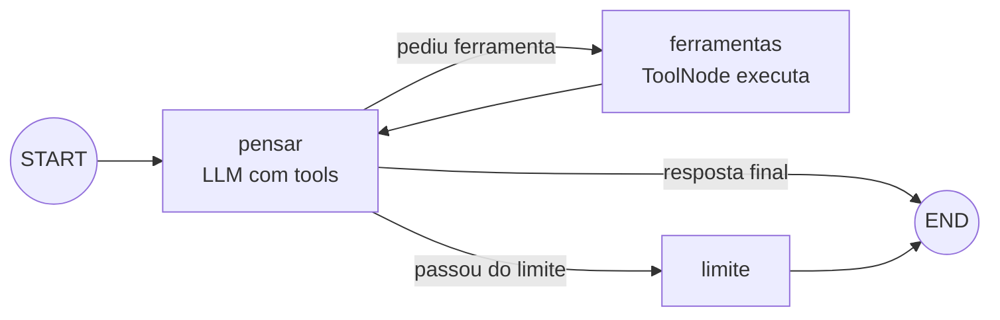
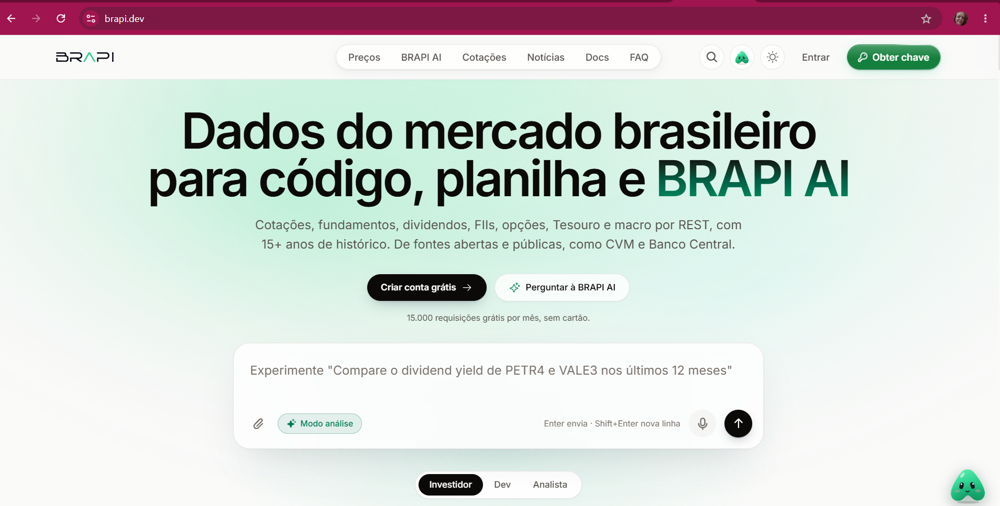
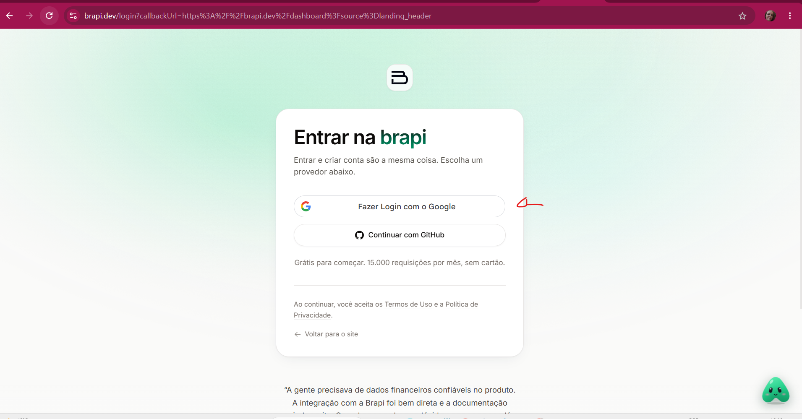
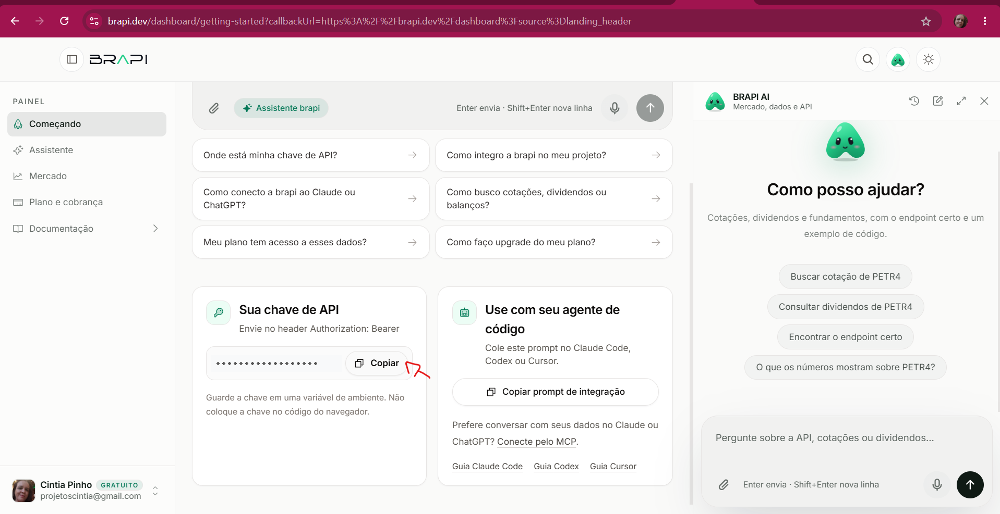
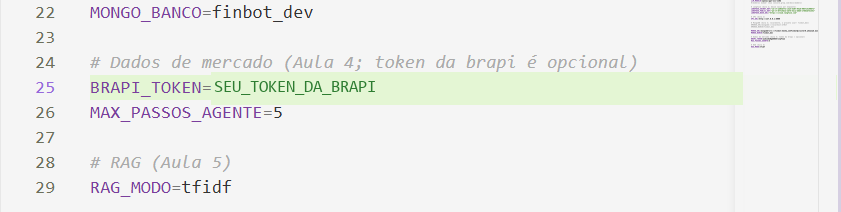
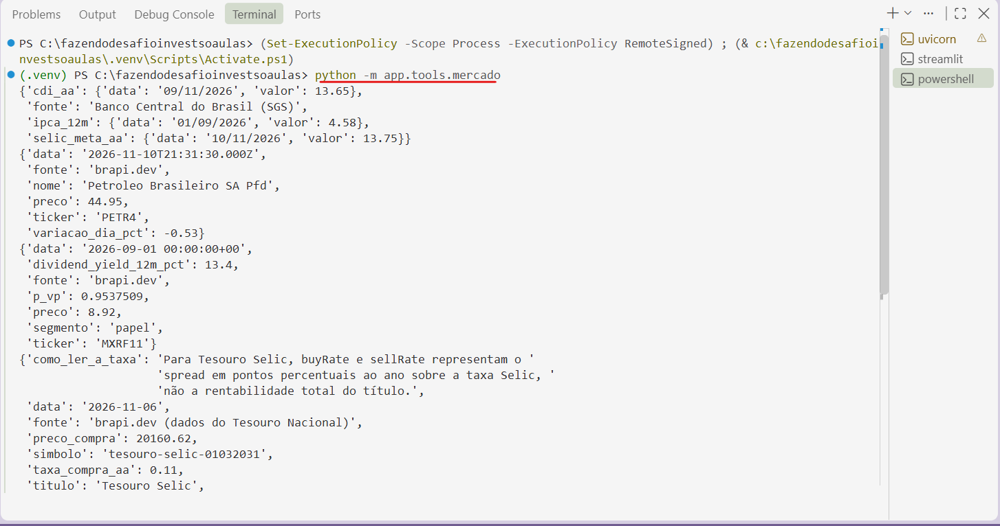
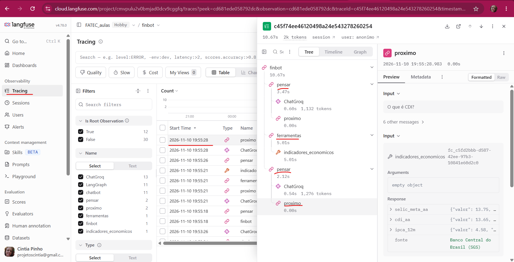
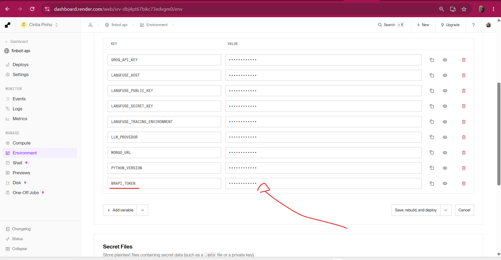

# Aula 4 — Ferramentas (tools) e o loop do agente

> **Ao final desta aula** o FinBot deixa de "chutar" e passa a consultar dados **reais e atuais**: Selic, CDI e IPCA do Banco Central; ações, FIIs e Tesouro Direto pela brapi. O chatbot vira um **agente**.
>
> 🛠️ Deu erro? Consulte [Problemas comuns](problemas-comuns.md).

## Sumário

- Conceitos: LLM aumentado, tool-calling, o loop do agente, qualidade da descrição, guardrails
- As APIs gratuitas: Banco Central (SGS) e brapi
- Ferramentas com `@tool`
- O loop `pensar ⇄ ferramentas` com guardrail
- Langfuse, testes, commit e deploy

---

## Antes de começar: o FinBot da Aula 3 rodando

Antes de acrescentar coisas novas, confirme que o projeto está funcionando **como terminou a Aula 3**. Assim, se algo der errado hoje, você sabe que o problema é da Aula 4, e não de algo que já vinha quebrado.

**1. Abra o projeto e ative o ambiente virtual.** No VS Code, abra a pasta do projeto (**File → Open Folder**) e um terminal (**Terminal → New Terminal**). Depois:

```powershell
.\.venv\Scripts\Activate.ps1      # Linux/Mac: source .venv/bin/activate
```

O terminal deve mostrar `(.venv)` no começo da linha.

**2. Traga as últimas mudanças do GitHub**, caso tenha mexido no projeto em outro computador (ou o Streamlit tenha feito algum commit):

```powershell
git pull
```

**3. Confira as bibliotecas e os testes:**

```powershell
pip install -r requirements-dev.txt
pytest -v
```

Os testes das Aulas 1, 2 e 3 devem passar (`passed`). Se algum falhar, resolva antes de seguir.

**4. Rode a API e a tela, em dois terminais** (abra o segundo no **+** do painel de terminais e ative o `.venv` nele também):

```powershell
# Terminal 1: a API (documentação em http://127.0.0.1:8000/docs)
uvicorn app.main:app --reload

# Terminal 2: a tela do chat (abre no navegador)
streamlit run frontend/streamlit_app.py
```

**5. Teste o que a Aula 3 entregou:**

- no Streamlit, a barra lateral mostra **Seu usuário**, **Meu perfil** e as **Conversas**;
- faça uma pergunta, pare a API (`Ctrl+C` no Terminal 1), suba de novo e clique na conversa: o histórico continua lá (memória no MongoDB);
- no Langfuse, a conversa aparece em **Tracing**, com o ambiente `local`.

| Se aparecer... | Provável causa | Veja |
|---|---|---|
| `401 Invalid API Key` | uma `GROQ_API_KEY` antiga nas variáveis do Windows, com prioridade sobre o `.env` | Aula 1, "Se aparecer `401 Invalid API Key`" |
| `ServerSelectionTimeoutError` ou `The DNS query name does not exist` | `MONGO_URL` errado no `.env`, ou a rede bloqueando o Atlas | Aula 3, Passo 1 e a tabela de erros do Passo 3 |
| `ModuleNotFoundError` | o `.venv` não está ativado neste terminal, ou faltou o `pip install` | itens 1 e 3 acima |
| `Erro ao falar com a API` no Streamlit | a API do Terminal 1 não está rodando | item 4 acima |

Deixe os dois terminais abertos: com o `--reload`, a API reinicia sozinha a cada arquivo `.py` salvo durante a aula. **Mudou o `.env`?** Pare a API (`Ctrl+C`) e suba de novo.

---

## Parte 1 — Conceitos

### LLM aumentado

O bloco básico de qualquer sistema de agentes:

```
Agente = LLM (raciocínio) + Ferramentas (ação) + Recuperação (conhecimento) + Memória (contexto)
```

Até agora tínhamos **LLM + memória**. Hoje entram as **ferramentas**; na Aula 5, a **recuperação** (RAG).

### Tool-calling: o modelo NÃO executa nada

Quando damos ferramentas ao modelo (`bind_tools`), ele pode responder de duas formas:

1. **texto**, a resposta final;
2. **um pedido de ferramenta:** um JSON com o nome e os argumentos.

```python
AIMessage(content="", tool_calls=[{"name": "cotacao_acao", "args": {"ticker": "PETR4"}, "id": "call_1"}])
```

**Quem executa é o nosso código.** O resultado volta para o modelo como uma `ToolMessage`, e ele decide: pede outra ferramenta ou responde. A decisão é do modelo; a execução é nossa.

### O loop do agente

O que chamamos de "agente" é, na prática, este laço:

```python
while True:
    decisao = modelo.invoke(estado)          # o modelo decide SE e QUAL ferramenta chamar
    if not decisao.tool_calls:
        break                                # resposta final
    resultado = executar(decisao.tool_calls) # NOSSO código executa
    estado.append(resultado)                 # o resultado volta para o contexto
```

No LangGraph, viram **dois nós e uma aresta condicional**:



### Qualidade da ferramenta = qualidade do prompt

O modelo decide com base **somente** no nome, na descrição (docstring) e nos argumentos da ferramenta:

| ❌ Descrição vaga | ✅ Descrição precisa |
|---|---|
| `"Busca dados de mercado."` | `"Retorna a cotação atual de UMA ação da B3: preço, variação do dia e horário. ticker: código em maiúsculas, ex. PETR4. Use apenas para ações; para FIIs use indicadores_fii."` |

Descrição ambígua gera chamada errada com a mesma frequência que prompt ruim gera resposta errada.

### Guardrails: no código, não no prompt

| No prompt | No código |
|---|---|
| "Não chame ferramentas mais de 5 vezes." | `if passos >= MAX_PASSOS: return "limite"` |
| Frágil: o modelo pode ignorar | Robusto: regra determinística |

> 👩‍🏫 **Um caso real, da preparação deste curso.** Quando eu, professora Cíntia, estava montando o FinBot, a ferramenta que busca a Selic tinha outro nome: `taxas_bcb`. Ao perguntar "Quanto está a Selic hoje?", o modelo `openai/gpt-oss-120b` (o que usamos no Groq) pedia a ferramenta com o nome **um pouco diferente**: `taxa​s_bcb`. Aquele `​` é um **caractere invisível** (*zero-width space*, um "espaço de largura zero") enfiado no meio da palavra. Na tela, parecia tudo igual, mas para o computador eram nomes diferentes.
>
> **Por que isso acontece?** É um efeito da **tokenização**: o modelo não lê palavras inteiras, e sim pedaços (os *tokens*, que vimos na Aula 1). Ao "montar" o nome `taxas` em pedaços, ele acabou inserindo um token invisível entre eles. Como não existia ferramenta com aquele nome, o Groq recusava o pedido (erro `400 tool_use_failed`), e a API do FinBot quebrava com erro 500.
>
> **Você não vai ver esse erro**, porque o código desta aula já vem com as duas correções que fiz, e que são as duas lições do caso:
> 1. **No código (um guardrail):** um erro de ferramenta não derruba mais a API. O agente tenta de novo, lembrando ao modelo os nomes certos e, se falhar outra vez, responde com uma mensagem amigável. Foram os `print` no terminal que me mostraram a causa real. Você vai ver esse trecho no Passo 4 (`app/agents/base.py`).
> 2. **No nome da ferramenta:** trocar `taxas_bcb` por `indicadores_economicos` resolveu. Nomes de ferramentas devem ser simples, descritivos e fáceis de "tokenizar". Um nome ruim causa erro tanto quanto uma descrição ruim.

Outro guardrail: **ferramenta nunca quebra o agente.** Se a API externa cair, a ferramenta devolve `{"erro": "..."}` e o modelo explica ao usuário que o dado não está disponível.

### As APIs gratuitas

| Fonte | Dados | Precisa de cadastro? |
|---|---|---|
| [Banco Central — SGS](https://dadosabertos.bcb.gov.br) | Séries históricas: 432 = meta Selic, 4389 = CDI anualizado, 13522 = IPCA 12 meses | Não |
| [brapi.dev](https://brapi.dev/docs) | Ações, FIIs, Tesouro Direto | Não, para: PETR4, VALE3, ITUB4, MGLU3 · MXRF11, HGLG11 · 3 títulos do Tesouro. Para os demais, **sim**: precisa de um token grátis (veja abaixo) |

#### O que funciona sem token na brapi (e o que não funciona)

Sem cadastro, a brapi libera só **alguns ativos de demonstração**. Qualquer outro responde com erro:

| Tipo | Funciona sem token | Exemplos que **não** funcionam sem token |
|---|---|---|
| Ações | `PETR4`, `VALE3`, `ITUB4`, `MGLU3` | qualquer outra: `BBAS3`, `WEGE3`, `BBDC4`, `ABEV3`... |
| Fundos imobiliários (FIIs) | `MXRF11`, `HGLG11` | qualquer outro: `KNRI11`, `XPML11`, `VISC11`... |
| Tesouro Direto | 3 títulos: Tesouro Selic 2031, Prefixado 2037 e IPCA+ 2060 | os demais vencimentos (ex.: IPCA+ 2035) |
| Selic, CDI e IPCA | **sempre** (vêm do Banco Central, que não pede cadastro) | — |

Pedindo um ativo fora da lista, a brapi responde `{"error": true, "message": "Token de autenticação não fornecido", "code": "MISSING_TOKEN"}`. **O FinBot não quebra:** a ferramenta devolve um aviso (ex.: *"ação BBAS3 não encontrada (sem token só PETR4, VALE3, ITUB4, MGLU3)"*) e o modelo explica ao usuário que aquele dado não está disponível.

> **Quer liberar todos os ativos?** Basta um token **gratuito** da brapi: o passo a passo para criar está no **Passo 1** da Parte 2. O código já usa o token quando ele existe (Passo 2).
>
> Esta lista de ativos de demonstração é a da época em que o curso foi preparado (testada em novembro de 2026) e pode mudar. Se um dos exemplos acima deixar de funcionar, confira na [documentação da brapi](https://brapi.dev/docs).

Teste no navegador:

- https://api.bcb.gov.br/dados/serie/bcdata.sgs.432/dados/ultimos/1?formato=json
- https://brapi.dev/api/v2/stocks/quote?symbols=PETR4

---

## Parte 2 — Mão na massa

> **Onde trabalhar:** continue na mesma pasta `finbot` aberta no VS Code desde a Aula 1; os arquivos criados nas aulas anteriores devem continuar nela. Abra o terminal integrado em **Terminal → Novo Terminal** (atalho ``Ctrl+` ``). No Windows, use **PowerShell**. Confira que está na pasta do projeto (`Get-Location` no PowerShell ou `pwd` no Linux/Mac) e ative o ambiente virtual: `.venv\Scripts\Activate.ps1` no PowerShell ou `source .venv/bin/activate` no Linux/Mac. Ative-o novamente sempre que abrir outro terminal.
>
> **Como criar/alterar arquivos:** use o painel **Explorer/Explorador** do VS Code. Abra as pastas do caminho indicado no título ou no comentário `# caminho/do/arquivo.py`; para arquivo novo, clique com o botão direito na pasta → **New File/Novo Arquivo**, digite o nome completo e cole o bloco de código. Salve com `Ctrl+S`. Quando um arquivo já existe e só muda um trecho, o bloco mostra esse trecho: o que você deve acrescentar fica entre os comentários `↓↓↓ NOVO` e `↑↑↑ fim do novo ↑↑↑` (ou logo abaixo de `↓ linha nova`), e o marcador diz depois de qual linha colar, e o restante serve para você achar o lugar no arquivo.

### Passo 1 — Dependências e configuração

> ✂️ **Como copiar:** o bloco mostra um trecho do arquivo. Acrescente no seu arquivo só o que está entre `↓↓↓ NOVO` e `↑↑↑ fim do novo ↑↑↑` (ou a linha logo abaixo de `↓ linha nova`). O próprio marcador diz **depois de qual linha** colar: procure essa linha no seu arquivo (`Ctrl+F`). As outras linhas já existem e servem para você achar o lugar. Ao colar, deixe o cursor **no começo da linha** (coluna 1, sem espaços antes), para o VS Code não mudar o recuo.

📄 Arquivo `requirements.txt` (trecho alterado na Aula 4):

```text
langgraph-checkpoint-mongodb>=0.3
pymongo>=4.10
# ↓↓↓ NOVO: cole logo abaixo de "pymongo>=4.10" ↓↓↓
# Aula 4 — ferramentas que chamam APIs
requests>=2.32  # faz pedidos HTTP às APIs de dados de mercado
# ↑↑↑ fim do novo ↑↑↑
```

Depois de salvar o `requirements.txt`, **instale as bibliotecas novas** (com o `.venv` ativado):

```bash
pip install -r requirements-dev.txt
```

O `requirements-dev.txt` inclui o `requirements.txt` (pela linha `-r requirements.txt`), então este comando instala tudo de uma vez. Sem ele, aparece `ModuleNotFoundError` quando o código novo tentar importar a biblioteca. No Render, a instalação é automática a cada deploy.

> ✂️ **Como copiar:** o bloco mostra um trecho do arquivo. Acrescente no seu arquivo só o que está entre `↓↓↓ NOVO` e `↑↑↑ fim do novo ↑↑↑` (ou a linha logo abaixo de `↓ linha nova`). O próprio marcador diz **depois de qual linha** colar: procure essa linha no seu arquivo (`Ctrl+F`). As outras linhas já existem e servem para você achar o lugar. Ao colar, deixe o cursor **no começo da linha** (coluna 1, sem espaços antes), para o VS Code não mudar o recuo.

📄 Arquivo `app/config/settings.py` (trecho alterado na Aula 4):

```python
    mongo_banco: str = "finbot"

    # ↓↓↓ NOVO: cole logo abaixo de "mongo_banco: str = "finbot"" ↓↓↓
    # Dados de mercado
    # Token da brapi.dev (opcional): sem ele, só alguns ativos funcionam.
    brapi_token: SecretStr | None = None
    max_passos_agente: int = 5  # guardrail: no máximo 5 voltas no loop de tools
    # ↑↑↑ fim do novo ↑↑↑

    @property
    def modelo(self) -> str:
```

As variáveis `BRAPI_TOKEN` e `MAX_PASSOS_AGENTE` já estão no `.env.example` e no `.env` desde a Aula 1. Mantenha `MAX_PASSOS_AGENTE=5`; não é necessário alterar o `.env.example`.

#### Criar o token gratuito da brapi

Sem token, a brapi só libera alguns ativos de demonstração (veja a tabela na Parte 1). Com um token **gratuito**, o FinBot consulta qualquer ação, FII ou título do Tesouro. Leva uns 3 minutos.

> **E o Banco Central?** Não precisa de nada: a API do Banco Central (Selic, CDI e IPCA) é **pública**, sem cadastro nem token. O token é só da **brapi**.


1. Acesse [brapi.dev](https://brapi.dev) e clique em **Obter chave** (botão verde, no canto superior direito) ou em **Criar conta grátis** (no meio da página). Os dois levam ao cadastro. Se já tiver conta, use **Entrar**.

   

   Repare na frase logo abaixo do botão: **15.000 requisições grátis por mês, sem cartão**. É o plano gratuito, mais do que suficiente para o curso.
2. Na tela **Entrar na brapi**, escolha **Fazer Login com o Google** ou **Continuar com GitHub**. Não existe um cadastro separado: como a própria tela diz, **entrar e criar conta são a mesma coisa**. Na primeira vez, a conta é criada automaticamente, já no plano gratuito, sem cartão.

   
3. Você cai no **painel** da brapi (tela **Começando**). Role um pouco para baixo até o quadro **Sua chave de API** e clique em **Copiar**. A chave aparece escondida (`••••••`), mas o botão copia o valor completo.

   

   Repare no aviso logo abaixo da chave, **"Guarde a chave em uma variável de ambiente"**: é exatamente o que fazemos com o `.env`. E no selo **GRATUITO** ao lado do seu nome, no canto inferior esquerdo: é o plano grátis. O assistente à direita (BRAPI AI) não é necessário para o curso.
4. No VS Code, abra o `.env` e, na linha `BRAPI_TOKEN=`, cole o token **depois do `=`**, sem aspas e sem espaços:

```env
BRAPI_TOKEN=SEU_TOKEN_DA_BRAPI
```

   No `.env`, a linha fica na seção **Dados de mercado**, logo acima de `MAX_PASSOS_AGENTE`:

   

5. Salve (**Ctrl+S**). Por enquanto é só isso: o token ainda **não é usado** por nenhum código. Quem vai lê-lo é o `http.py` (Passo 2), e o teste fica para o **final do Passo 3**, depois de criar as ferramentas.

> ⏳ **Ainda não teste nada aqui.** Os arquivos `app/utils/http.py` e `app/tools/mercado.py` só serão criados nos Passos 2 e 3. Se rodar `python -m app.tools.mercado` agora, vai dar erro de módulo não encontrado.

> 🔒 **O token é uma credencial, como a chave da Groq:** fica só no `.env` (que não vai para o GitHub) e, no Passo 8, no **Environment** do Render. Nunca o coloque no código nem em prints.
>
> **Não quer criar agora?** Pode deixar `BRAPI_TOKEN=` vazio: o FinBot funciona com os ativos de demonstração e avisa quando um ativo não está disponível.
>
> O plano gratuito tem **15.000 consultas por mês** (valor da época em que o curso foi preparado), suficiente para o curso. Os nomes dos botões do site podem mudar; se não achar, procure por "token" ou "API key" no painel.


### Passo 2 — Chamadas HTTP (`app/utils/http.py`)

> 🎯 **Para que serve no projeto:** É a **função única** para buscar dados em APIs externas (Banco Central e brapi.dev). Centralizar aqui garante que toda chamada tenha tempo limite, os cabeçalhos certos e o token da brapi (quando houver), sem repetir esse código em cada ferramenta.

```python
# app/utils/http.py
"""Chamadas HTTP com tempo limite e cabeçalhos padrão."""
import requests

from app.config.settings import settings


def get_json(url: str, params: dict | None = None):
    # User-Agent identifica quem está chamando (algumas APIs recusam pedidos sem ele).
    headers = {"User-Agent": "FinBot-FATEC/1.0"}
    # Se houver token da brapi, ele vai no cabeçalho Authorization (só para a brapi.dev).
    token = settings.brapi_token.get_secret_value() if settings.brapi_token else ""
    if token and "brapi.dev" in url:
        headers["Authorization"] = f"Bearer {token}"
    # timeout=15: desiste em 15 s se a API não responder, em vez de travar o chat.
    resposta = requests.get(url, params=params, headers=headers, timeout=15)
    resposta.raise_for_status()  # erro HTTP (404, 500...) vira exceção
    return resposta.json()  # converte o JSON da resposta em dicionário/lista do Python
```

**`timeout=15`:** sem ele, uma API lenta trava o agente para sempre. **`raise_for_status()`:** transforma 404/500 em exceção, para não seguirmos com dados errados.

### Passo 3 — As ferramentas (`app/tools/mercado.py`)

Crie `app/tools/` com `__init__.py` vazio:

> 🎯 **Para que serve no projeto:** São as **ferramentas (tools)** do FinBot: funções que buscam dados reais de mercado, como Selic, CDI, IPCA, cotações, FIIs e Tesouro Direto. O LLM não sabe os números de hoje; com as ferramentas, ele pede o dado e o nosso código busca. É isso que permite ao FinBot responder com valores atuais, em vez de chutar.

```python
# app/tools/mercado.py
"""Aula 4 — Ferramentas (tools) de dados de mercado em tempo real.

O que o modelo vê de cada ferramenta: o NOME, a DESCRIÇÃO (docstring) e os ARGUMENTOS.
A descrição é a única instrução que ele tem para decidir quando chamar:
descrição vaga = chamada errada. Por isso as docstrings abaixo são detalhadas.

Fontes gratuitas:
- Banco Central (SGS): Selic, CDI, IPCA. Sem cadastro.
- brapi.dev: sem token funcionam PETR4, VALE3, ITUB4, MGLU3; FIIs MXRF11, HGLG11; 3 títulos do Tesouro.
"""
from datetime import date, timedelta
from functools import wraps  # preserva nome e docstring ao "embrulhar" uma função

from langchain_core.tools import tool

from app.utils.http import get_json

# Endereços das APIs; {codigo} é trocado pelo número da série do Banco Central.
BCB = "https://api.bcb.gov.br/dados/serie/bcdata.sgs.{codigo}/dados"
BRAPI = "https://brapi.dev/api/v2"
# Códigos das séries do Banco Central: 432 = meta Selic, 4389 = CDI, 13522 = IPCA 12 meses.
SERIES_BCB = {"selic_meta_aa": 432, "cdi_aa": 4389, "ipca_12m": 13522}


# Decorador: "embrulha" a ferramenta num try/except.
def _seguro(funcao):
    """Ferramenta nunca deve quebrar o agente: erro vira uma resposta que o LLM entende."""
    @wraps(funcao)  # mantém nome, docstring e argumentos (o LLM precisa deles)
    def envolvida(*args, **kwargs):
        try:
            return funcao(*args, **kwargs)
        except Exception as erro:
            # Em vez de quebrar, devolve um dicionário de erro que o LLM consegue explicar ao usuário.
            return {"erro": f"dado indisponível no momento ({erro})"}
    return envolvida


def buscar_taxas() -> dict:
    """Função comum (sem @tool) para reaproveitar no simulador da Aula 7.

    Pedimos os dados ATÉ HOJE (dataFinal). Pedindo só "o último registro", a meta Selic
    vinha com data futura, porque o Banco Central publica a meta para cada dia em que ela vale.
    """
    hoje = date.today()
    periodo = {
        "formato": "json",
        "dataInicial": (hoje - timedelta(days=120)).strftime("%d/%m/%Y"),  # o IPCA é mensal e sai com atraso
        "dataFinal": hoje.strftime("%d/%m/%Y"),
    }
    taxas = {}
    # Para cada série, busca os dados do período e fica com o último valor publicado.
    for nome, codigo in SERIES_BCB.items():
        ultimo = get_json(BCB.format(codigo=codigo), periodo)[-1]  # {"data": "21/10/2026", "valor": "14.90"}
        taxas[nome] = {"valor": float(ultimo["valor"]), "data": ultimo["data"]}
    taxas["fonte"] = "Banco Central do Brasil (SGS)"
    return taxas


# @tool transforma a função em ferramenta que o LLM pode pedir; @_seguro protege contra erros.
@tool
@_seguro
def indicadores_economicos() -> dict:
    """Retorna as taxas de juros e inflação ATUAIS do Brasil: meta da Selic (% ao ano),
    CDI anualizado (% ao ano) e IPCA acumulado em 12 meses (%), com a data de referência.
    Use quando o usuário perguntar sobre Selic, CDI, juros, inflação ou rendimento de renda fixa hoje."""
    return buscar_taxas()


@tool
@_seguro
def cotacao_acao(ticker: str) -> dict:
    """Retorna a cotação atual de UMA ação da B3: preço em reais, variação do dia (%) e horário.
    ticker: código da ação em maiúsculas, ex.: "PETR4", "VALE3", "ITUB4", "MGLU3".
    Use apenas para ações (códigos terminados em 3 ou 4). Para fundos imobiliários use indicadores_fii."""
    # Pede a cotação à brapi.dev; upper() aceita "petr4" ou "PETR4".
    dados = get_json(f"{BRAPI}/stocks/quote", {"symbols": ticker.upper()})
    # Pega o 1º resultado com segurança: se "results" vier vazio, usa {} e .get devolve None.
    item = (dados.get("results") or [{}])[0].get("data")
    if not item:
        return {"erro": f"ação {ticker} não encontrada (sem token só PETR4, VALE3, ITUB4, MGLU3)"}
    # Devolve só os campos úteis, com nomes em português e a fonte do dado.
    return {
        "ticker": ticker.upper(),
        "nome": item.get("longName") or item.get("shortName"),
        "preco": item.get("regularMarketPrice"),
        "variacao_dia_pct": item.get("regularMarketChangePercent"),
        "data": item.get("regularMarketTime"),
        "fonte": "brapi.dev",
    }


@tool
@_seguro
def indicadores_fii(ticker: str) -> dict:
    """Retorna indicadores de UM fundo imobiliário (FII): preço da cota, P/VP,
    dividend yield dos últimos 12 meses (%) e segmento, com a data de referência.
    ticker: código do FII terminado em 11, ex.: "MXRF11", "HGLG11"."""
    # Pede os indicadores do FII à brapi.dev.
    dados = get_json(f"{BRAPI}/fii/indicators", {"symbols": ticker.upper()})
    fiis = dados.get("fiis") or []
    if not fiis:
        return {"erro": f"FII {ticker} não encontrado (sem token só MXRF11 e HGLG11)"}
    f = fiis[0]
    dy = f.get("dividendYield12m")
    if dy is not None and dy < 1.5:  # a API devolve FRAÇÃO (0.1266 = 12,66%): convertemos para %
        dy = round(dy * 100, 2)
    return {
        "ticker": ticker.upper(),
        "preco": f.get("price"),
        "p_vp": f.get("priceToNav"),
        "dividend_yield_12m_pct": dy,
        "segmento": f.get("segmentType"),
        "data": f.get("asOfDate"),
        "fonte": "brapi.dev",
    }


@tool
@_seguro
def tesouro_direto(simbolo: str) -> dict:
    """Retorna taxa e preço de compra atuais de UM título do Tesouro Direto.
    simbolo: identificador em minúsculas, um destes:
      "tesouro-selic-01032031" (Tesouro Selic),
      "tesouro-prefixado-com-juros-semestrais-01012037" (Prefixado),
      "tesouro-ipca-com-juros-semestrais-15082060" (IPCA+).
    O campo como_ler_a_taxa explica o que a taxa significa para aquele título."""
    # Pede os dados do título à brapi.dev (os símbolos do Tesouro são em minúsculas).
    dados = get_json(f"{BRAPI}/treasury/indicators", {"symbols": simbolo.lower()})
    resultados = dados.get("results") or []
    if not resultados:
        return {"erro": f"título {simbolo} não encontrado"}
    t = resultados[0]
    return {
        "titulo": t.get("bondType"),
        "simbolo": t.get("symbol"),
        "vencimento": t.get("maturityDate"),
        "taxa_compra_aa": t.get("buyRate"),
        "preco_compra": t.get("buyPrice"),
        # rateInfo pode não vir: "or {}" evita erro ao fazer .get().
        "como_ler_a_taxa": (t.get("rateInfo") or {}).get("description"),
        "data": t.get("baseDate"),
        "fonte": "brapi.dev (dados do Tesouro Nacional)",
    }


# Lista com todas as ferramentas de mercado; é ela que entregamos ao agente.
FERRAMENTAS_MERCADO = [indicadores_economicos, cotacao_acao, indicadores_fii, tesouro_direto]


if __name__ == "__main__":
    # python -m app.tools.mercado  -> testa as APIs sem LLM
    from pprint import pprint
    pprint(indicadores_economicos.invoke({}))
    pprint(cotacao_acao.invoke({"ticker": "PETR4"}))
    pprint(indicadores_fii.invoke({"ticker": "MXRF11"}))
    pprint(tesouro_direto.invoke({"simbolo": "tesouro-selic-01032031"}))
```

**O que observar:**

- `@tool` transforma a função numa ferramenta do LangChain: nome, descrição e o **schema** dos argumentos saem da assinatura e da docstring.
- `@_seguro` usa `@wraps`. Sem ele, a ferramenta perderia nome e argumentos, e o modelo não saberia como chamá-la.
- `buscar_taxas()` é uma função comum, separada da ferramenta, para reaproveitar na Aula 7.

Teste sem LLM nenhum:

```bash
python -m app.tools.mercado
```

> **Surpresas dos dados reais (aconteceram neste projeto):**
> - A meta Selic vinha com **data futura**, porque o BCB publica a meta para cada dia em que ela vale. Por isso pedimos os dados **até hoje** (`dataFinal`).
> - O dividend yield vem como **fração** (`0.1266`), não em % como sugeria a documentação. Por isso multiplicamos por 100.
> - O Banco Central às vezes demora e dá `Read timed out`. O `@_seguro` transforma isso em `{"erro": ...}` e o agente segue.
>
> **Lição:** sempre rode a ferramenta sozinha (`python -m app.tools.mercado`) e **olhe os dados** antes de entregá-los ao LLM.

#### Teste as ferramentas sozinhas, sem o LLM

Antes de ligar as ferramentas ao agente, confira se elas buscam os dados de verdade. O arquivo tem, no final, um bloco `if __name__ == "__main__":` que chama as quatro ferramentas. No terminal, com o `.venv` ativado:

```bash
python -m app.tools.mercado
```

O terminal mostra quatro dicionários, um por ferramenta, nesta ordem:



| Ferramenta | O que conferir no resultado |
|---|---|
| `indicadores_economicos` | `selic_meta_aa`, `cdi_aa` e `ipca_12m`, cada um com `valor` e `data`. A data da Selic deve ser **hoje ou antes** (não uma data futura) |
| `cotacao_acao` (`PETR4`) | `preco`, `variacao_dia_pct` e `nome` preenchidos |
| `indicadores_fii` (`MXRF11`) | `dividend_yield_12m_pct` **em %** (ex.: `13.4`), e não em fração (`0.134`) |
| `tesouro_direto` (Tesouro Selic) | `taxa_compra_aa`, `preco_compra` e o texto `como_ler_a_taxa`, que explica que no Tesouro Selic a taxa é um **adicional** sobre a Selic |

Todos trazem o campo **`fonte`** (Banco Central ou brapi): é ele que o FinBot vai citar nas respostas. Os **valores** mudam a cada dia; o que importa é a **estrutura** vir preenchida.

> Apareceu `{'erro': 'dado indisponível no momento (...)'}` em algum? A ferramenta não quebrou: o `@_seguro` transformou a falha em um aviso. As causas mais comuns são o Banco Central demorando (`Read timed out`: rode de novo) ou, na brapi, um ativo que exige token (veja "O que funciona sem token na brapi", na Parte 1).

> 🔑 **Criou o token da brapi no Passo 1?** Agora dá para conferir se ele funciona. Peça a cotação de uma ação **fora** da lista de demonstração, como `BBAS3`:
>
> ```bash
> python -c "from app.tools.mercado import cotacao_acao; print(cotacao_acao.invoke({'ticker': 'BBAS3'}))"
> ```
>
> Com o token, vêm `preco` e `nome` preenchidos. Sem ele, aparece um aviso de ativo indisponível (`MISSING_TOKEN`).

### Passo 4 — O motor do agente (`app/agents/base.py`)

> 🎯 **Para que serve no projeto:** É o **motor de todos os agentes** do projeto: o loop em que o LLM pensa, pede uma ferramenta, recebe o resultado e pensa de novo, até responder. Fica num arquivo próprio porque será reaproveitado: na Aula 6, cada especialista é criado com esta mesma função.

```python
# app/agents/base.py
"""Aula 4 — O motor de qualquer agente: o LOOP de tool-calling.

        ┌──────────┐  pediu ferramenta?  ┌──────────────┐
  ──▶  │  pensar   │ ──────── sim ─────▶ │ ferramentas  │
        └──────────┘ ◀─── resultado ──── └──────────────┘
             │ não (resposta final) ou passou do limite
             ▼
            FIM

- O LLM NÃO executa nada: ele devolve um pedido (nome da ferramenta + argumentos).
- Quem executa é o nosso código (ToolNode). O resultado volta para o LLM.
- Guardrail em CÓDIGO: no máximo MAX_PASSOS voltas. Regra no prompt o modelo pode ignorar;
  um "if" no código, não.

Agente = LLM + Ferramentas + Memória.
"""
import json
from typing import Annotated, TypedDict

from langchain_core.messages import AIMessage, AnyMessage, SystemMessage
from langgraph.graph import END, START, StateGraph
from langgraph.graph.message import add_messages
from langgraph.prebuilt import ToolNode

from app.config.settings import settings
from app.llm import fabrica
from app.llm.observabilidade import config_prompt
from app.prompts import catalogo
from app.utils.mensagens import turno_atual


# Estado do agente: as mensagens, o perfil do usuário e quantas voltas o loop já deu.
class EstadoAgente(TypedDict, total=False):
    messages: Annotated[list[AnyMessage], add_messages]  # add_messages = ACRESCENTA, não substitui
    perfil: str
    passos: int  # contador de voltas, usado pelo guardrail


def criar_agente(nome: str, nome_prompt: str, ferramentas: list, checkpointer=None):
    """Monta e compila o grafo de um agente com ferramentas."""

    # Nomes das ferramentas em texto (usado no lembrete se o modelo errar o nome).
    nomes_validos = ", ".join(f.name for f in ferramentas)

    # Nó "pensar": o LLM lê a conversa e decide se responde ou se pede uma ferramenta.
    def pensar(estado: EstadoAgente) -> dict:
        prompt = catalogo.obter(nome_prompt)
        sistema = SystemMessage(prompt.compile(perfil=estado.get("perfil", "não informado")))
        # temperatura=0.1: respostas mais estáveis; bind_tools mostra as ferramentas ao modelo.
        modelo = fabrica.criar_modelo(temperatura=0.1).bind_tools(ferramentas)
        # Histórico limpo + tudo do turno atual (inclusive resultados de ferramentas).
        mensagens = [sistema] + turno_atual(estado["messages"])
        try:
            resposta = modelo.invoke(mensagens, config=config_prompt(prompt))
        except Exception as erro:
            print(f"[{nome}] 1ª tentativa falhou: {erro}")  # aparece no terminal do uvicorn
            # Guardrail: o modelo pode errar o nome da ferramenta (caso real: "taxa\u200bs_bcb")
            # e o provedor recusa o pedido. Tentamos UMA vez de novo, lembrando os nomes certos.
            # Se o erro não for de ferramenta, não há o que corrigir: deixa o erro subir.
            if "tool" not in str(erro).lower():
                raise
            lembrete = SystemMessage(f"Atenção: use SOMENTE estas ferramentas, com o nome exato: {nomes_validos}.")
            try:
                resposta = modelo.invoke(mensagens + [lembrete], config=config_prompt(prompt))
            except Exception as erro2:
                print(f"[{nome}] 2ª tentativa falhou: {erro2}")
                aviso = "Tive um problema ao consultar os dados agora. Pode repetir a pergunta?"
                resposta = AIMessage(content=aviso)
        # Marca qual agente respondeu e soma 1 no contador de voltas.
        resposta.name = nome
        return {"messages": [resposta], "passos": estado.get("passos", 0) + 1}

    # Aresta condicional: decide para onde ir depois de "pensar".
    def proximo(estado: EstadoAgente) -> str:
        # Se a última mensagem não pediu ferramenta (tool_calls vazio), é a resposta final.
        ultima = estado["messages"][-1]
        if not getattr(ultima, "tool_calls", None):
            return END                      # resposta final
        if estado.get("passos", 0) >= settings.max_passos_agente:
            return "limite"                 # guardrail
        return "ferramentas"

    # Nó "limite": responde com um aviso quando o loop passa do número máximo de voltas.
    def limite(estado: EstadoAgente) -> dict:
        aviso = "Não consegui concluir a consulta em poucos passos. Pode reformular a pergunta?"
        return {"messages": [AIMessage(content=aviso, name=nome)]}

    # Monta o grafo: pensar -> (ferramentas -> pensar)... até a resposta final ou o limite.
    g = StateGraph(EstadoAgente)
    g.add_node("pensar", pensar)
    g.add_node("ferramentas", ToolNode(ferramentas))  # ToolNode executa as ferramentas pedidas pelo LLM
    g.add_node("limite", limite)
    g.add_edge(START, "pensar")
    # Depois de "pensar", a função proximo() escolhe o caminho: ferramentas, limite ou END.
    g.add_conditional_edges("pensar", proximo, ["ferramentas", "limite", END])
    g.add_edge("ferramentas", "pensar")     # o resultado volta para o LLM
    g.add_edge("limite", END)
    return g.compile(checkpointer=checkpointer, name=nome)


def fontes_do_turno(mensagens: list[AnyMessage]) -> list[str]:
    """Junta o campo 'fonte' dos resultados das ferramentas usadas neste turno."""
    fontes = set()
    # Percorre as mensagens e olha só os resultados de ferramentas (type == "tool").
    for m in mensagens:
        if m.type != "tool":
            continue
        # O resultado da ferramenta vem como texto JSON; se não for JSON, pula.
        try:
            conteudo = json.loads(m.content)
        except (TypeError, ValueError):
            continue
        # O resultado pode ser um item ou uma lista de itens: tratamos os dois casos.
        itens = conteudo if isinstance(conteudo, list) else [conteudo]
        fontes.update(i["fonte"] for i in itens if isinstance(i, dict) and i.get("fonte"))
    return sorted(fontes)  # set evita repetidas; sorted devolve em ordem alfabética
```

Este arquivo é o coração do curso: **qualquer** agente daqui em diante é `criar_agente(nome, prompt, ferramentas)`.

### Passo 5 — O grafo vira um agente com ferramentas

> ✂️ **Como copiar:** o bloco mostra um trecho do arquivo. Acrescente no seu arquivo só o que está entre `↓↓↓ NOVO` e `↑↑↑ fim do novo ↑↑↑` (ou a linha logo abaixo de `↓ linha nova`). O próprio marcador diz **depois de qual linha** colar: procure essa linha no seu arquivo (`Ctrl+F`). As outras linhas já existem e servem para você achar o lugar. Ao colar, deixe o cursor **no começo da linha** (coluna 1, sem espaços antes), para o VS Code não mudar o recuo. As linhas depois de `APAGUE` aparecem comentadas: apague-as do seu arquivo. A linha `# ...` indica um trecho do arquivo que foi pulado.

📄 Arquivo `app/agents/grafo.py` (trecho alterado na Aula 4):

```python
Grafo = NÓS (funções) + ARESTAS (quem vem depois) + ESTADO (o "bastão" que passa de nó em nó).

# APAGUE do seu arquivo a(s) linha(s) abaixo (aqui aparecem comentadas):
# Aula 3:   START ─▶ chatbot ─▶ END        (+ checkpointer = memória de curto prazo)
# ↓ linha nova: cole logo abaixo de "Grafo = NÓS (funções) + ARESTAS (quem vem depois) + ESTAD..."
Aulas 4 e 5: um AGENTE ÚNICO com ferramentas (pensar ⇄ ferramentas), ver app/agents/base.py.
"""
from functools import lru_cache
# ... (parte do arquivo que não muda)
from langgraph.graph.message import add_messages

# ↓ linha nova: cole logo abaixo de "from langgraph.graph.message import add_messages"
from app.agents.base import criar_agente, fontes_do_turno
from app.agents.chatbot import no_chatbot
from app.llm.observabilidade import callbacks, rastrear
from app.repository import checkpointer, conversas, perfis
# ↓ linha nova: cole logo abaixo de "from app.repository import checkpointer, conversas, perfis"
from app.tools.mercado import FERRAMENTAS_MERCADO
from app.utils.mensagens import conversa_limpa

# ... (parte do arquivo que não muda)
# ---------- Montagem ----------
def montar_grafo(memoria=None):
    # APAGUE do seu arquivo a(s) linha(s) abaixo (aqui aparecem comentadas):
    # g = StateGraph(EstadoChat)
    # g.add_node("chatbot", no_chatbot)
    # g.add_edge(START, "chatbot")
    # g.add_edge("chatbot", END)
    # return g.compile(checkpointer=memoria)
    # ↓↓↓ NOVO: cole logo abaixo de "def montar_grafo(memoria=None):" ↓↓↓
    # O grafo agora é o agente com ferramentas (o loop pensar ⇄ ferramentas de base.py).
    return criar_agente("finbot", "sistema", FERRAMENTAS_MERCADO, checkpointer=memoria)
    # ↑↑↑ fim do novo ↑↑↑


    # ... (parte do arquivo que não muda)

    final = estado["messages"][-1]
    # APAGUE do seu arquivo a(s) linha(s) abaixo (aqui aparecem comentadas):
    # return {"resposta": final.content, "agente": "conversa", "fontes": []}
    # ↓↓↓ NOVO: cole logo abaixo de "final = estado["messages"][-1]" ↓↓↓
    # Posição da última pergunta do usuário: as fontes são só deste turno.
    ultima_pergunta = max(i for i, m in enumerate(estado["messages"]) if isinstance(m, HumanMessage))
    fontes = fontes_do_turno(estado["messages"][ultima_pergunta:])
    return {"resposta": final.content, "agente": "finbot", "fontes": fontes}
    # ↑↑↑ fim do novo ↑↑↑


```

E o prompt de sistema ganha uma regra:

Abra `app/prompts/sistema.md` e acrescente esta regra **logo abaixo** de "- Se não souber, diga que não sabe.":

```markdown
- Para qualquer valor ATUAL (Selic, CDI, IPCA, cotação, FII, Tesouro), chame uma ferramenta. Nunca chute números.
```

> 📤 **Envie a mudança para o Langfuse.** Desde a Aula 3, o FinBot lê o prompt **do Langfuse** (a versão com o rótulo `production`); o arquivo `.md` é só a reserva. Editar só o arquivo **não muda o app**. Depois de salvar, rode:
>
> ```bash
> python -m scripts.publicar_prompts --forcar
> ```
>
> O `--forcar` cria uma **versão nova** (já marcada como `production`) para cada prompt cujo texto mudou; os que não mudaram ficam como estão. Sem ele, o script só cria prompts **novos** e ignora os que já existem. Confira no Langfuse, em **Prompts**: a versão nova aparece com `production` e `latest`.
>
> ⚠️ Se você editou esse prompt **direto no site do Langfuse** (como no experimento da Aula 3), o `--forcar` publica o texto do **arquivo** por cima, e a edição feita no site deixa de valer. Para manter, copie para o `.md` o que você mudou no site antes de rodar o comando.

Para mostrar as chamadas de ferramenta do turno atual, `utils/mensagens.py` ganha `turno_atual()`:

> ✂️ **Como copiar:** o bloco mostra um trecho do arquivo. Acrescente no seu arquivo só o que está entre `↓↓↓ NOVO` e `↑↑↑ fim do novo ↑↑↑` (ou a linha logo abaixo de `↓ linha nova`). O próprio marcador diz **depois de qual linha** colar: procure essa linha no seu arquivo (`Ctrl+F`). As outras linhas já existem e servem para você achar o lugar. Ao colar, deixe o cursor **no começo da linha** (coluna 1, sem espaços antes), para o VS Code não mudar o recuo.

📄 Arquivo `app/utils/mensagens.py` (trecho alterado na Aula 4):

```python
    ]
    return limpas[-limite:]


# ↓↓↓ NOVO: cole logo abaixo de "return limpas[-limite:]" ↓↓↓
def turno_atual(mensagens: list[AnyMessage], limite: int = 10) -> list[AnyMessage]:
    """Histórico limpo + TUDO desde a última pergunta (inclusive chamadas de ferramenta deste turno)."""
    # Posição da última pergunta (0 se não houver nenhuma).
    ultima = max((i for i, m in enumerate(mensagens) if isinstance(m, HumanMessage)), default=0)
    # Antes da pergunta: só a conversa limpa. Depois dela: tudo, para o agente ver os resultados das ferramentas.
    return conversa_limpa(mensagens[:ultima], limite) + list(mensagens[ultima:])
# ↑↑↑ fim do novo ↑↑↑
```

### Passo 6 — Teste e observe no Langfuse

```bash
uvicorn app.main:app --reload
streamlit run frontend/streamlit_app.py
```

Pergunte e depois **abra o trace** de cada pergunta.

**Onde olhar no Langfuse:** no menu da esquerda, clique em **Tracing**. Cada pergunta gera várias linhas na tabela (uma por passo); clique na **mais recente** para abrir o trace. À direita aparece a aba **Tree** (árvore), que mostra o **loop do agente** passo a passo, na ordem em que aconteceu:



| Na árvore (Tree) | O que é | No código |
|---|---|---|
| `finbot` | a pergunta inteira (o trace), com o tempo total | o grafo do agente |
| `pensar` → `ChatGroq` | o LLM lendo a conversa e **decidindo**: responder ou pedir uma ferramenta | o nó `pensar` de `base.py` |
| `proximo` | a decisão do caminho (0 segundos: é só um `if`) | a função `proximo()` |
| `ferramentas` → `indicadores_economicos` | o **nosso código** executando a ferramenta pedida | o `ToolNode` |
| o segundo `pensar` | o LLM lendo o **resultado da ferramenta** e escrevendo a resposta final | o loop voltando ao `pensar` |

Clique em cada passo para ver, à direita, a **entrada** e a **saída**. No `indicadores_economicos`, por exemplo, aparecem os valores da Selic, do CDI e do IPCA e a **fonte** (Banco Central). Repare também no **tempo** de cada passo: a ferramenta costuma demorar mais que o próprio LLM, porque espera a resposta da API do Banco Central.

Teste estas perguntas e confira o que cada trace mostra:

1. "Quanto está a Selic hoje?" → veja `pensar` → `indicadores_economicos` → `pensar`.
2. "Compare PETR4 e VALE3" → o modelo pede **duas** ferramentas de uma vez?
3. "E o MXRF11?" (na mesma conversa) → o modelo entende pelo histórico que é um FII?
4. "Qual a cotação da BBAS3?" → sem token da brapi, o que acontece? A ferramenta devolveu `erro`, e o modelo explicou ou inventou?
5. "O que é CDI?" → chamou ferramenta sem necessidade? Ajuste a docstring de `indicadores_economicos` e compare.

### Passo 7 — Testes

> 🎯 **Para que serve no projeto:** São os **testes** desta aula: conferem as ferramentas (com APIs falsas, sem internet), o loop de tool-calling, o guardrail que limita os passos e a recuperação quando o modelo erra o nome da ferramenta.

```python
# tests/test_aula4.py
"""Aula 4 — ferramentas e o loop de tool-calling."""
# A fixture falso também troca as APIs de mercado por respostas fixas (sem internet).
from app.agents import grafo
from app.config.settings import settings
from app.tools import mercado


# O LLM escolhe a ferramenta pela descrição: ela precisa ser longa e clara.
def test_ferramentas_tem_descricao_e_argumentos():
    for f in mercado.FERRAMENTAS_MERCADO:
        assert len(f.description) > 80, f"descrição curta demais em {f.name}"
    assert mercado.cotacao_acao.args["ticker"]["type"] == "string"


# As ferramentas leem e convertem os dados das APIs (aqui, respostas falsas).
def test_ferramenta_le_api(falso):
    assert mercado.indicadores_economicos.invoke({})["cdi_aa"]["valor"] == 14.9
    assert mercado.cotacao_acao.invoke({"ticker": "petr4"})["preco"] == 38.45
    assert mercado.indicadores_fii.invoke({"ticker": "MXRF11"})["dividend_yield_12m_pct"] == 12.4  # fração virou %


# Se a API cair, a ferramenta devolve {"erro": ...} em vez de quebrar.
def test_ferramenta_nao_quebra_se_api_falhar(falso, monkeypatch):
    def sem_internet(*a, **k):
        raise ConnectionError("sem internet")
    # monkeypatch troca get_json por uma função que sempre falha.
    monkeypatch.setattr(mercado, "get_json", sem_internet)
    assert "erro" in mercado.indicadores_economicos.invoke({})


# O modelo pede a ferramenta, recebe o dado e responde com ele, citando a fonte.
def test_loop_pede_ferramenta_e_responde_com_o_dado(falso):
    falso.ferramenta = "cotacao_acao"  # o modelo falso vai pedir esta ferramenta
    saida = grafo.executar("Quanto está a PETR4?", sessao="m1")
    assert falso.chamadas == ["tool:cotacao_acao", "resposta"]
    assert "38.45" in saida["resposta"]
    assert saida["fontes"] == ["brapi.dev"]


def test_guardrail_limita_as_voltas(falso, monkeypatch):
    """Com limite de 1 passo, o agente pede a ferramenta e o código o interrompe."""
    from langchain_core.messages import HumanMessage

    from app.agents.base import criar_agente
    monkeypatch.setattr(settings, "max_passos_agente", 1)
    agente = criar_agente("teste", "sistema", mercado.FERRAMENTAS_MERCADO)
    saida = agente.invoke({"messages": [HumanMessage("Selic?")]})
    assert "poucos passos" in saida["messages"][-1].content


def test_nome_de_ferramenta_inventado_tenta_de_novo(falso, monkeypatch):
    """Simula o erro real do Groq: 'attempted to call tool taxa_bcb which was not in request.tools'."""
    original = falso.invoke
    falhas = {"n": 0}

    def invoke_com_erro(self, mensagens, config=None):
        if falhas["n"] == 0 and getattr(self, "_ferramentas", None):
            falhas["n"] += 1
            raise RuntimeError("Error code: 400 - tool call validation failed: attempted to call tool 'taxa_bcb'")
        return original.__func__(self, mensagens, config)

    monkeypatch.setattr(type(falso), "invoke", invoke_com_erro)
    from langchain_core.messages import HumanMessage

    from app.agents.base import criar_agente
    agente = criar_agente("teste", "sistema", mercado.FERRAMENTAS_MERCADO)
    saida = agente.invoke({"messages": [HumanMessage("Selic?")]})
    assert falhas["n"] == 1                                   # errou uma vez...
    assert "tool:indicadores_economicos" in falso.chamadas                 # ...tentou de novo e usou a ferramenta certa
    assert saida["messages"][-1].content.startswith("resposta de teste")  # e respondeu, sem erro 500


def test_taxas_pedem_dados_ate_hoje(falso, monkeypatch):
    """A meta Selic vinha com data futura; agora pedimos o período até hoje."""
    from datetime import date
    pedidos = []

    def registra(url, params=None):
        pedidos.append(params)
        return [{"data": "21/10/2026", "valor": "15.00"}]
    monkeypatch.setattr(mercado, "get_json", registra)
    mercado.buscar_taxas()
    assert pedidos[0]["dataFinal"] == date.today().strftime("%d/%m/%Y")
```

Rode os testes (com o `.venv` ativado):

```bash
pytest -v
```

Todos devem aparecer como `PASSED`, **inclusive os das aulas anteriores** (`test_aula1.py` a `test_aula4.py`). No final, o resumo mostra algo como `== XX passed in 2.31s ==`, sem nenhum `failed`. Se um teste de aula anterior quebrar, é sinal de que alguma mudança desta aula afetou o que já funcionava: leia a mensagem do `FAILED` e confira o trecho alterado.

> Os testes **não** gastam tokens nem precisam de internet: o `conftest.py` troca o LLM, o MongoDB e as APIs de mercado por versões falsas.

### Passo 8 — Commit e deploy

```bash
git add .
git commit -m "Aula 4: ferramentas e loop de tool-calling"
git tag aula-4
git push
git push --tags
```

Atualize o `render.yaml`:

> ✂️ **Como copiar:** o bloco mostra um trecho do arquivo. Acrescente no seu arquivo só o que está entre `↓↓↓ NOVO` e `↑↑↑ fim do novo ↑↑↑` (ou a linha logo abaixo de `↓ linha nova`). O próprio marcador diz **depois de qual linha** colar: procure essa linha no seu arquivo (`Ctrl+F`). As outras linhas já existem e servem para você achar o lugar. Ao colar, deixe o cursor **no começo da linha** (coluna 1, sem espaços antes), para o VS Code não mudar o recuo.

📄 Arquivo `render.yaml` (trecho alterado na Aula 4):

```yaml
      - key: MONGO_URL
        sync: false
      # ↓↓↓ NOVO: cole no FINAL do arquivo, logo abaixo do bloco "- key: MONGO_URL" ↓↓↓
      # Token da brapi.dev (opcional; libera mais ativos).
      - key: BRAPI_TOKEN
        sync: false
      # ↑↑↑ fim do novo ↑↑↑
```

Se criou o token da brapi (Passo 1), cadastre também no Render: serviço `finbot-api` → **Environment** → **Edit** → preencha `BRAPI_TOKEN` com o mesmo valor do `.env` → **Save, rebuild, and deploy**. Sem isso, o app publicado continua só com os ativos de demonstração.



A lista deve ficar com o `BRAPI_TOKEN` no final, junto das variáveis das aulas anteriores (`GROQ_API_KEY`, `LANGFUSE_...`, `MONGO_URL`...). Os valores aparecem escondidos (`••••••`): confira só os **nomes**, que precisam estar escritos exatamente assim, em maiúsculas. Depois, clique em **Save, rebuild, and deploy** e espere o selo **Live**.

---

## ✅ Checklist da aula

- [ ] `python -m app.tools.mercado` mostra dados reais
- [ ] O agente chama a ferramenta certa e cita a data do dado
- [ ] No trace, o loop `pensar → ferramentas → pensar` está visível
- [ ] Guardrail testado (`MAX_PASSOS_AGENTE=1` no `.env`)
- [ ] App no ar atualizado; tag `aula-4` no GitHub

## 🚀 Para ir além

- Nova ferramenta `historico_acao(ticker, periodo)` com `/api/v2/stocks/historical` da brapi.
- **Cache:** guarde a resposta do Banco Central por 1 hora no Mongo. Por que isso reduz custo e latência?
- Ferramenta de **dólar** (série SGS 1) e uma pergunta que exija duas ferramentas: "Quanto rende a Selic em dólares?".

## 📁 Estrutura do projeto ao final da aula

Confira no painel **Explorer/Explorador** do VS Code se os arquivos novos estão nos caminhos abaixo. Arquivos de configuração existentes, como `requirements.txt`, `.env.example`, `settings.py`, `grafo.py`, `mensagens.py` e `render.yaml`, foram atualizados, não duplicados.

```text
finbot/
├── .env                         # local: credenciais; não publicar
├── .env.example
├── .gitignore
├── README.md
├── requirements.txt
├── requirements-dev.txt
├── render.yaml
├── aulas/
│   ├── aula-01.md
│   ├── aula-02.md
│   ├── aula-03.md
│   ├── aula-04.md
│   ├── aula-05.md
│   ├── aula-06.md
│   ├── aula-07.md
│   └── problemas-comuns.md
├── app/
│   ├── __init__.py
│   ├── main.py
│   ├── config/
│   │   ├── __init__.py
│   │   └── settings.py
│   ├── llm/
│   │   ├── __init__.py
│   │   ├── fabrica.py
│   │   └── observabilidade.py
│   ├── prompts/
│   │   ├── __init__.py
│   │   ├── catalogo.py
│   │   └── sistema.md
│   ├── agents/
│   │   ├── __init__.py
│   │   ├── chatbot.py
│   │   ├── grafo.py
│   │   └── base.py
│   ├── servicos/
│   │   ├── __init__.py
│   │   └── chat.py
│   ├── api/
│   │   ├── __init__.py
│   │   ├── schemas.py
│   │   └── rotas.py
│   ├── repository/
│   │   ├── __init__.py
│   │   ├── mongo.py
│   │   ├── checkpointer.py
│   │   ├── perfis.py
│   │   └── conversas.py
│   ├── tools/
│   │   ├── __init__.py
│   │   └── mercado.py
│   └── utils/
│       ├── __init__.py
│       ├── mensagens.py
│       └── http.py
├── frontend/
│   ├── requirements.txt
│   └── streamlit_app.py
├── scripts/
│   ├── chat_terminal.py
│   └── publicar_prompts.py
└── tests/
    ├── conftest.py
    ├── test_aula1.py
    ├── test_aula2.py
    ├── test_aula3.py
    └── test_aula4.py
```

> A pasta `.venv/` existe no seu computador, mas é ignorada pelo Git. Não a envie ao GitHub.
