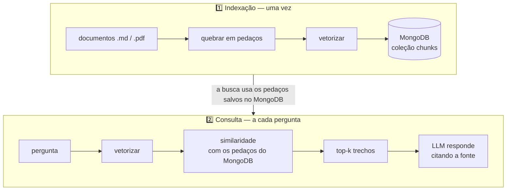
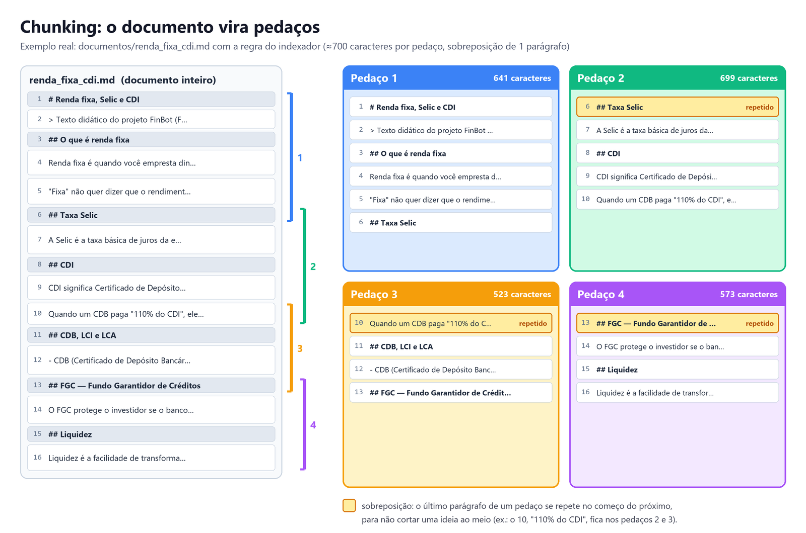
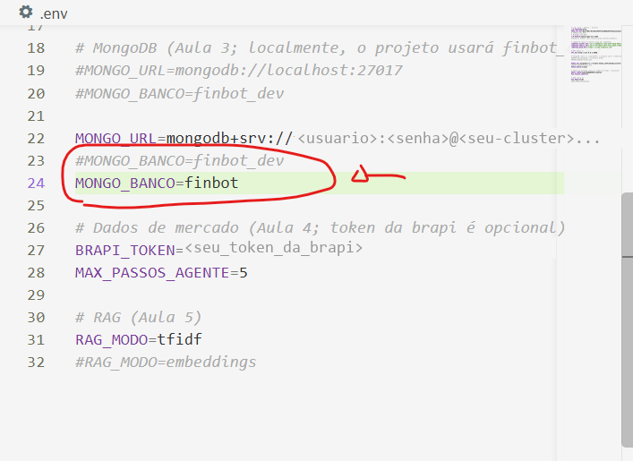
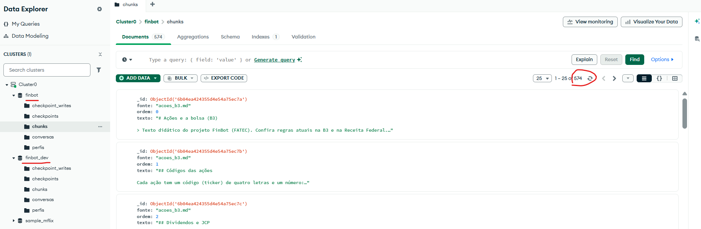
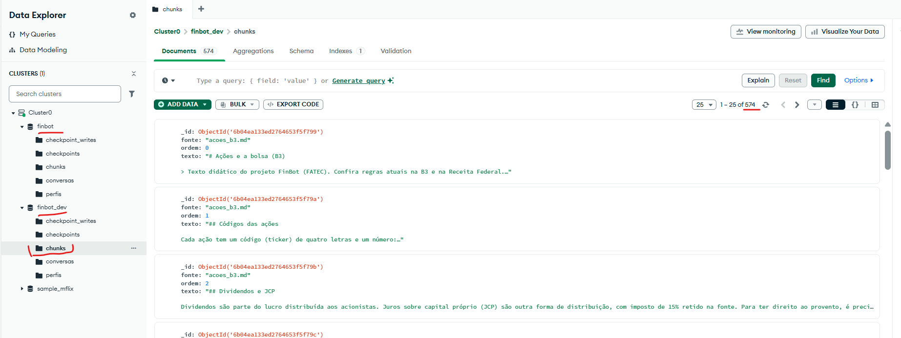
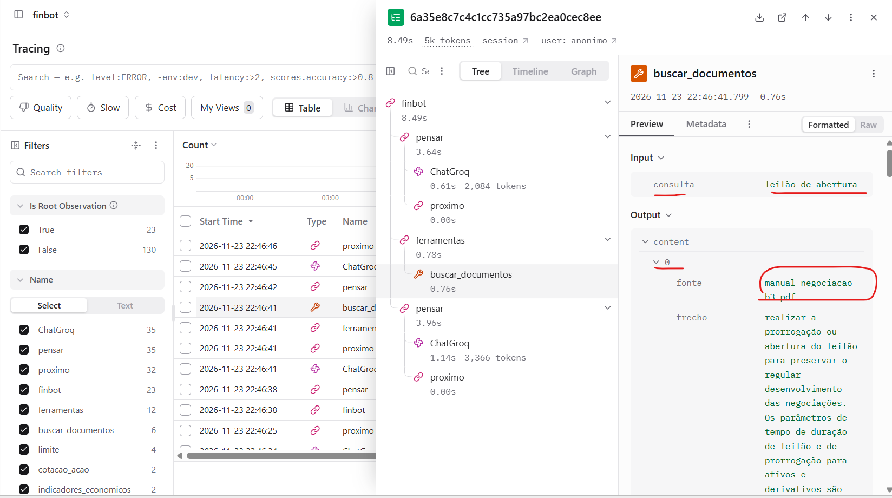

# Aula 5 — RAG: o agente consulta documentos

> **Ao final desta aula** o FinBot responde sobre regras e conceitos (imposto, Tesouro, FIIs) **com base em documentos**, citando a fonte. A busca vira mais uma ferramenta do agente.
>
> 🛠️ Deu erro? Consulte [Problemas comuns](problemas-comuns.md).

## Sumário

- Conceitos: RAG, chunking, vetores (TF-IDF × embeddings), similaridade de cosseno
- Indexação: ler, quebrar e guardar no Mongo
- Busca e ferramenta `buscar_documentos`
- Experimentos: TF-IDF × embeddings, documentos da B3
- Testes, commit e deploy

---

## Antes de começar: o FinBot da Aula 4 rodando

Antes de acrescentar coisas novas, confirme que o projeto está funcionando **como terminou a Aula 4**. Assim, se algo der errado hoje, você sabe que o problema é da Aula 5, e não de algo que já vinha quebrado.

**1. Abra o projeto e ative o ambiente virtual.** No VS Code, abra a pasta do projeto (**File → Open Folder**) e um terminal (**Terminal → New Terminal**). Depois:

```powershell
.\.venv\Scripts\Activate.ps1      # Linux/Mac: source .venv/bin/activate
```

O terminal deve mostrar `(.venv)` no começo da linha.

**2. Traga as últimas mudanças do GitHub**, caso tenha mexido no projeto em outro computador (ou o Streamlit tenha feito algum commit):

```powershell
git pull
```

**3. Confira as bibliotecas e os testes:**

```powershell
pip install -r requirements-dev.txt
pytest -v
```

Os testes das Aulas 1 a 4 devem passar (`passed`). Se algum falhar, resolva antes de seguir.

**4. Rode a API e a tela, em dois terminais** (abra o segundo no **+** do painel de terminais e ative o `.venv` nele também):

```powershell
# Terminal 1: a API (documentação em http://127.0.0.1:8000/docs)
uvicorn app.main:app --reload

# Terminal 2: a tela do chat (abre no navegador)
streamlit run frontend/streamlit_app.py
```

**5. Teste o que a Aula 4 entregou:**

- no Streamlit, pergunte "Quanto está a Selic hoje?": a resposta traz o valor do dia e cita o **Banco Central**;
- pergunte a cotação de `PETR4`: a resposta cita a **brapi**;
- no Langfuse, o trace dessa pergunta mostra a ferramenta chamada (`indicadores_economicos` ou `cotacao_acao`).

| Se aparecer... | Provável causa | Veja |
|---|---|---|
| `401 Invalid API Key` | uma `GROQ_API_KEY` antiga nas variáveis do Windows, com prioridade sobre o `.env` | Rode `$env:GROQ_API_KEY = $null` no terminal e suba a API de novo. Para apagar de vez: `[Environment]::SetEnvironmentVariable("GROQ_API_KEY", $null, "User")` e feche e abra o VS Code |
| `ServerSelectionTimeoutError` ou `The DNS query name does not exist` | `MONGO_URL` errado no `.env`, ou a rede bloqueando o Atlas | Aula 3, Passo 1 e a tabela de erros do Passo 3 |
| `MISSING_TOKEN` numa cotação | o ativo exige o token da brapi | Aula 4, "Criar o token gratuito da brapi" |
| `ModuleNotFoundError` | o `.venv` não está ativado neste terminal, ou faltou o `pip install` | itens 1 e 3 acima |
| `Erro ao falar com a API` no Streamlit | a API do Terminal 1 não está rodando | item 4 acima |

Deixe os dois terminais abertos: com o `--reload`, a API reinicia sozinha a cada arquivo `.py` salvo durante a aula. **Mudou o `.env`?** Pare a API (`Ctrl+C`) e suba de novo.

---

## Parte 1 — Conceitos

### O que é RAG

**RAG** (*Retrieval-Augmented Generation*, ou **Geração Aumentada por Recuperação**) é uma técnica em que, **antes** de o LLM responder, o sistema **busca** em um conjunto de documentos os trechos mais relacionados à pergunta e **entrega esses trechos** ao modelo, junto com a pergunta. O modelo responde **com base no que leu**, e não só no que "lembra" do treinamento.

O nome vem do artigo de Patrick Lewis e colegas (Facebook AI Research), publicado em 2020, que propôs combinar um modelo de linguagem com uma busca em uma base de textos. A ideia central: o conhecimento que o modelo traz do treino é **fixo e difícil de conferir**; o que vem dos documentos pode ser **atualizado, conferido e citado**.

#### Uma comparação: prova com consulta

Pense em duas provas:

- **Prova sem consulta:** o aluno responde só com o que memorizou. Se não estudou aquele ponto, ou se a regra mudou depois que ele estudou, pode errar, e às vezes erra com muita confiança.
- **Prova com consulta:** o aluno pode abrir a apostila. Ele procura a página certa, lê o trecho e responde com base nele, podendo dizer "está na página 12".


Um LLM sem RAG faz **prova sem consulta**. Com RAG, faz **prova com consulta**: a busca acha "a página certa" e o modelo lê antes de responder. Repare que, na prova com consulta, ainda é preciso **saber procurar**: se o aluno abrir a página errada, a resposta sai errada. Por isso boa parte desta aula é sobre **buscar bem** (pedaços, vetores, similaridade).

#### Os três problemas que o RAG resolve no FinBot

| Problema do LLM sozinho | Exemplo no FinBot | Como o RAG ajuda |
|---|---|---|
| **Data de corte:** o modelo não sabe o que mudou depois do treino | uma alíquota de imposto que mudou recentemente | basta atualizar o documento e reindexar; não é preciso treinar o modelo de novo |
| **Alucinação:** sem a informação, o modelo inventa com confiança | perguntar o limite do FGC e receber um valor errado, dito com certeza | o modelo responde a partir do trecho encontrado e, se não achar nada, diz que não encontrou |
| **Conhecimento privado:** o modelo não conhece os seus documentos | o material da disciplina, as regras internas de uma empresa | os documentos são seus: o modelo lê só o que você colocou na pasta `documentos/` |

E um ganho extra: como sabemos **de qual arquivo** veio cada trecho, o FinBot pode **citar a fonte** (`[impostos_investimentos.md]`), e o usuário pode conferir.

#### O que cada letra significa no nosso código


| Letra | Significado | Onde está no FinBot |
|---|---|---|
| **R** (*Retrieval*, recuperação) | buscar os trechos mais parecidos com a pergunta | `app/rag/busca.py` (Passo 4) |
| **A** (*Augmented*, aumentada) | acrescentar esses trechos ao que o modelo recebe | a ferramenta `buscar_documentos` devolve os trechos para o agente (Passo 6) |
| **G** (*Generation*, geração) | o LLM escreve a resposta usando os trechos | o loop do agente da Aula 4, que já existe |

#### Ferramentas (Aula 4) × RAG (Aula 5)

As duas técnicas entregam ao modelo uma informação que ele não tem, mas para tipos de pergunta diferentes:

| | Ferramentas de mercado (Aula 4) | RAG (Aula 5) |
|---|---|---|
| **Serve para** | **números que mudam** o tempo todo | **textos e regras** que explicam conceitos |
| **Exemplo de pergunta** | "Quanto está a Selic hoje?" | "Como funciona a tabela regressiva do imposto de renda?" |
| **De onde vem a informação** | uma API, consultada na hora | documentos que você escolheu, indexados antes |
| **Fonte citada** | Banco Central, brapi | o nome do arquivo, ex.: `[impostos_investimentos.md]` |

No FinBot as duas convivem: o agente decide se chama uma ferramenta de mercado, a busca nos documentos, as duas ou nenhuma.

> **Fonte:** LEWIS, Patrick et al. *Retrieval-Augmented Generation for Knowledge-Intensive NLP Tasks*. Advances in Neural Information Processing Systems (NeurIPS), 2020. Disponível em: https://arxiv.org/abs/2005.11401.

### As duas fases



### Chunking (quebrar em pedaços)

Não mandamos o documento inteiro: seria caro e dilui a informação. Quebramos em **pedaços** (*chunks*):

- **muito grande:** o pedaço mistura assuntos e a busca fica imprecisa;
- **muito pequeno:** perde o contexto ("15%" de quê?);
- **sobreposição:** repetir o fim de um pedaço no começo do próximo evita cortar uma ideia ao meio.

Usamos ~700 caracteres, respeitando os parágrafos.

Veja como fica um dos documentos desta aula, o `renda_fixa_cdi.md` (Passo 2), quebrado pelo código do Passo 3. Os 16 parágrafos viram **4 pedaços**:



- Cada pedaço junta parágrafos **inteiros** até chegar perto de 700 caracteres. Nenhuma frase é cortada no meio.
- Os parágrafos em amarelo (**repetido**) são a **sobreposição**: o último parágrafo de um pedaço volta no começo do próximo. O parágrafo 10, que explica "110% do CDI", está nos pedaços 2 e 3. Assim, uma pergunta sobre CDB acha o pedaço 3 já com essa explicação.
- Repare no pedaço 1: ele termina no título `## Taxa Selic`, mas o texto sobre a Selic ficou no pedaço 2. É um limite real da regra simples. Melhorias possíveis: quebrar sempre **antes** dos títulos ou aumentar a sobreposição.
- Na busca, cada pedaço vira um **registro** na coleção `chunks` do MongoDB e recebe a sua própria nota de semelhança.

### Texto vira vetor

Para comparar textos, transformamos cada um num **vetor** (lista de números).

**TF-IDF** (*Term Frequency – Inverse Document Frequency*): cada posição do vetor é uma palavra. O peso é alto quando a palavra aparece muito **neste** pedaço e pouco nos **outros**. "o", "de", "para" valem quase nada (*stopwords*); "regressiva" vale muito.

- ✅ simples, rápido, roda offline, ótimo para entender a ideia;
- ❌ não entende sinônimos: "quanto rende" não casa com "rendimento".

**Embeddings:** uma rede neural transforma o texto num vetor de **significado** (ex.: 384 números). Textos com sentido parecido ficam próximos, mesmo com palavras diferentes.

- ✅ entende sinônimos e paráfrases;
- ❌ precisa baixar um modelo e usa mais memória.

### Similaridade de cosseno

Mede o **ângulo** entre dois vetores: 1 = mesma direção (mesmo assunto), 0 = nada em comum.

```math
\text{similaridade}(a, b) = \frac{a \cdot b}{\|a\| \, \|b\|}
```

Pegamos os **k** pedaços com maior similaridade (*top-k*, aqui k = 3).

### RAG clássico × RAG agêntico

| RAG clássico | RAG agêntico (o nosso) |
|---|---|
| O código **sempre** busca a pergunta crua e cola o resultado no prompt | A busca é uma **ferramenta**: o agente decide **se** busca e **o que** busca |
| Simples e previsível | Pode reformular a consulta, buscar duas vezes ou não buscar ("oi") |

### Agente único: o limite começa a aparecer

Nosso agente agora tem 5 ferramentas e um prompt que mistura regras de mercado e de documentos. Funciona, mas a cada aula o prompt cresce e as regras de um assunto passam a atrapalhar o outro. Guarde essa sensação: ela é a motivação da Aula 6.

---

## Parte 2 — Mão na massa

> **Onde trabalhar:** continue na mesma pasta `finbot` aberta no VS Code desde a Aula 1; os arquivos criados nas aulas anteriores devem continuar nela. Abra o terminal integrado em **Terminal → Novo Terminal** (atalho ``Ctrl+` ``). No Windows, use **PowerShell**. Confira que está na pasta do projeto (`Get-Location` no PowerShell ou `pwd` no Linux/Mac) e ative o ambiente virtual: `.venv\Scripts\Activate.ps1` no PowerShell ou `source .venv/bin/activate` no Linux/Mac. Ative-o novamente sempre que abrir outro terminal.
>
> **Como criar/alterar arquivos:** use o painel **Explorer/Explorador** do VS Code. Abra as pastas do caminho indicado no título ou no comentário `# caminho/do/arquivo.py`; para arquivo novo, clique com o botão direito na pasta → **New File/Novo Arquivo**, digite o nome completo e cole o bloco de código. Salve com `Ctrl+S`. Quando um arquivo já existe e só muda um trecho, o bloco mostra esse trecho: o que você deve acrescentar fica entre os comentários `↓↓↓ NOVO` e `↑↑↑ fim do novo ↑↑↑` (ou logo abaixo de `↓ linha nova`), e o marcador diz depois de qual linha colar, e o restante serve para você achar o lugar no arquivo.

### Passo 1 — Dependências e configuração

> ✂️ **Como copiar:** o bloco mostra um trecho do arquivo. Acrescente no seu arquivo só o que está entre `↓↓↓ NOVO` e `↑↑↑ fim do novo ↑↑↑` (ou a linha logo abaixo de `↓ linha nova`). O próprio marcador diz **depois de qual linha** colar: procure essa linha no seu arquivo (`Ctrl+F`). As outras linhas já existem e servem para você achar o lugar. Ao colar, deixe o cursor **no começo da linha** (coluna 1, sem espaços antes), para o VS Code não mudar o recuo.

📄 Arquivo `requirements.txt` (trecho alterado na Aula 5):

```text
# Aula 4 — ferramentas que chamam APIs
requests>=2.32  # faz pedidos HTTP às APIs de dados de mercado
# ↓↓↓ NOVO: cole logo abaixo de "requests>=2.32  # faz pedidos HTTP às APIs de dados de mercado" ↓↓↓
# Aula 5 — RAG
numpy>=1.26  # contas com vetores (listas de números)
scikit-learn>=1.5  # TF-IDF: transforma texto em vetores de palavras
pypdf>=5.0  # lê o texto de arquivos PDF
# fastembed>=0.5   # descomente para RAG_MODO=embeddings (pesado para o plano grátis)
# ↑↑↑ fim do novo ↑↑↑
```

Depois de salvar o `requirements.txt`, **instale as bibliotecas novas** (com o `.venv` ativado):

```bash
pip install -r requirements-dev.txt
```

O `requirements-dev.txt` inclui o `requirements.txt` (pela linha `-r requirements.txt`), então este comando instala tudo de uma vez. Sem ele, aparece `ModuleNotFoundError` quando o código novo tentar importar a biblioteca. No Render, a instalação é automática a cada deploy.

> ✂️ **Como copiar:** o bloco mostra um trecho do arquivo. Acrescente no seu arquivo só o que está entre `↓↓↓ NOVO` e `↑↑↑ fim do novo ↑↑↑` (ou a linha logo abaixo de `↓ linha nova`). O próprio marcador diz **depois de qual linha** colar: procure essa linha no seu arquivo (`Ctrl+F`). As outras linhas já existem e servem para você achar o lugar. Ao colar, deixe o cursor **no começo da linha** (coluna 1, sem espaços antes), para o VS Code não mudar o recuo.

📄 Arquivo `app/config/settings.py` (trecho alterado na Aula 5):

```python
    max_passos_agente: int = 5  # guardrail: no máximo 5 voltas no loop de tools

    # ↓↓↓ NOVO: cole logo abaixo de "max_passos_agente: int = 5  # guardrail: no máximo 5 volt..." ↓↓↓
    # RAG
    # Como transformar texto em vetores: "tfidf" (leve, padrão) ou "embeddings" (mais preciso, mais pesado).
    rag_modo: Literal["tfidf", "embeddings"] = "tfidf"
    # ↑↑↑ fim do novo ↑↑↑

    @property
    def modelo(self) -> str:
```

A variável `RAG_MODO` já está prevista no `.env.example` e no `.env` desde a Aula 1. Mantenha `RAG_MODO=tfidf` durante esta aula; só altere o valor no `.env` se seguir a etapa opcional de embeddings. Não é necessário alterar `.env.example`.

### Passo 2 — Os documentos

Crie a pasta `documentos/` na raiz com os 5 textos abaixo. São textos didáticos escritos para o curso (clique em cada um para abrir e copiar):

<details>
<summary>📄 <code>documentos/renda_fixa_cdi.md</code></summary>

```markdown
# Renda fixa, Selic e CDI

> Texto didático do projeto FinBot (FATEC). Confira regras e números atuais nas fontes oficiais.

## O que é renda fixa

Renda fixa é quando você empresta dinheiro para alguém (governo, banco ou empresa) e recebe juros por isso. As regras de remuneração são combinadas no momento da aplicação. Exemplos: CDB, LCI, LCA, Tesouro Direto e debêntures.

"Fixa" não quer dizer que o rendimento é sempre o mesmo valor. Quer dizer que a forma de calcular é conhecida desde o início: pode ser uma taxa prefixada (ex.: 12% ao ano), atrelada à inflação (IPCA + 6% ao ano) ou atrelada ao CDI (ex.: 100% do CDI).

## Taxa Selic

A Selic é a taxa básica de juros da economia brasileira. A meta da Selic é definida pelo Copom (Comitê de Política Monetária do Banco Central) em reuniões que acontecem a cada 45 dias, aproximadamente. Quando a inflação está alta, o Copom tende a subir a Selic para desestimular o consumo e o crédito.

## CDI

CDI significa Certificado de Depósito Interbancário. É a taxa dos empréstimos de curtíssimo prazo entre bancos. Na prática, o CDI anda muito próximo da Selic, geralmente um pouco abaixo (cerca de 0,10 ponto percentual).

Quando um CDB paga "110% do CDI", ele rende 10% a mais do que o CDI. Se o CDI está em 14% ao ano, esse CDB rende cerca de 15,4% ao ano antes do imposto.

## CDB, LCI e LCA

- CDB (Certificado de Depósito Bancário): você empresta para o banco. Tem imposto de renda pela tabela regressiva.
- LCI (Letra de Crédito Imobiliário) e LCA (Letra de Crédito do Agronegócio): também emitidas por bancos, mas isentas de imposto de renda para pessoa física. Costumam ter prazo mínimo de carência.

## FGC — Fundo Garantidor de Créditos

O FGC protege o investidor se o banco quebrar. Ele cobre até R$ 250 mil por CPF por instituição financeira, com um teto total de R$ 1 milhão a cada 4 anos. CDB, LCI, LCA e poupança têm cobertura do FGC. Tesouro Direto não tem FGC porque a garantia é do próprio governo federal.

## Liquidez

Liquidez é a facilidade de transformar o investimento em dinheiro sem perder valor. Um CDB com liquidez diária pode ser resgatado em qualquer dia útil. Um CDB com vencimento em 3 anos e sem liquidez diária só devolve o dinheiro no vencimento.
```

</details>

<details>
<summary>📄 <code>documentos/tesouro_direto.md</code></summary>

```markdown
# Tesouro Direto

> Texto didático do projeto FinBot (FATEC). Confira regras e números atuais no site do Tesouro Direto.

## O que é

O Tesouro Direto é um programa do Tesouro Nacional, em parceria com a B3, que permite a pessoas físicas comprar títulos públicos pela internet. Ao comprar um título, você empresta dinheiro ao governo federal e recebe juros. O investimento mínimo é baixo, por volta de R$ 30, porque é possível comprar frações de um título.

## Tipos de títulos

- Tesouro Selic: acompanha a taxa Selic. É o título com menor oscilação e costuma ser usado como reserva de emergência. A taxa exibida é um pequeno adicional (spread) sobre a Selic.
- Tesouro Prefixado: a taxa é definida na compra (ex.: 13% ao ano). Se levado até o vencimento, você sabe exatamente quanto vai receber.
- Tesouro IPCA+: paga a inflação (IPCA) mais uma taxa fixa (ex.: IPCA + 7% ao ano). Protege o poder de compra no longo prazo.
- Versões "com juros semestrais": pagam parte dos juros a cada seis meses, em vez de tudo no vencimento.
- Tesouro Renda+ e Tesouro Educa+: pensados para aposentadoria e educação; pagam uma renda mensal depois de uma data definida.

## Marcação a mercado

Antes do vencimento, o preço de um título muda todos os dias conforme as taxas de juros do mercado. Isso se chama marcação a mercado. Se os juros sobem, o preço de títulos prefixados e IPCA+ cai; se os juros caem, o preço sobe. Quem vende antes do vencimento pode ganhar ou perder. O Tesouro Selic quase não sofre esse efeito.

## Custos e imposto

- Imposto de renda: segue a tabela regressiva da renda fixa (de 22,5% a 15% sobre o lucro, conforme o prazo).
- IOF: cobrado apenas em resgates com menos de 30 dias.
- Taxa de custódia da B3: cobrada anualmente sobre o valor investido; consulte o percentual atual e as isenções no site do Tesouro Direto.

## Como comprar

É preciso ter conta em uma corretora ou banco habilitado. A compra é feita pelo site ou aplicativo da instituição, ou pelo portal do Tesouro Direto.
```

</details>

<details>
<summary>📄 <code>documentos/fundos_imobiliarios.md</code></summary>

```markdown
# Fundos imobiliários (FIIs)

> Texto didático do projeto FinBot (FATEC). Confira regras atuais na B3 e na Receita Federal.

## O que é um FII

Um fundo de investimento imobiliário junta o dinheiro de muitos investidores para aplicar no mercado imobiliário. O investidor compra cotas do fundo na bolsa (B3), como se fosse uma ação. Os códigos terminam em 11, por exemplo MXRF11 e HGLG11.

## Tipos de FII

- Tijolo: são donos de imóveis físicos (galpões logísticos, shoppings, lajes corporativas) e recebem aluguéis.
- Papel: investem em títulos de dívida do setor imobiliário, como CRI (Certificado de Recebíveis Imobiliários). Os rendimentos costumam acompanhar CDI ou IPCA.
- Híbridos: misturam tijolo e papel.
- Fundos de fundos (FoF): compram cotas de outros FIIs.

## Rendimentos

A maioria dos FIIs distribui rendimentos todo mês. Pela regra desses fundos, eles devem distribuir pelo menos 95% do lucro apurado em regime de caixa a cada semestre.

## Indicadores importantes

- Dividend yield (DY): quanto o fundo pagou de rendimentos em relação ao preço da cota. Um DY de 12% em 12 meses significa que, para cada R$ 100 em cotas, foram pagos cerca de R$ 12 no período.
- P/VP (preço sobre valor patrimonial): compara o preço da cota na bolsa com o valor dos ativos do fundo por cota. P/VP abaixo de 1 indica que a cota está sendo negociada abaixo do valor patrimonial; acima de 1, acima dele.
- Vacância: percentual dos imóveis sem inquilino (em fundos de tijolo).

## Imposto

Para pessoa física, os rendimentos mensais podem ser isentos de imposto de renda desde que o fundo cumpra requisitos da lei (como ter cotas negociadas em bolsa e um número mínimo de cotistas) e o investidor não tenha uma participação grande no fundo. Já o lucro na venda das cotas paga 20% de imposto de renda. As regras podem mudar; confira a legislação atual.

## Riscos

O preço das cotas oscila na bolsa. Há risco de vacância, inadimplência de inquilinos ou de devedores (nos fundos de papel) e risco de liquidez em fundos pouco negociados.
```

</details>

<details>
<summary>📄 <code>documentos/acoes_b3.md</code></summary>

```markdown
# Ações e a bolsa (B3)

> Texto didático do projeto FinBot (FATEC). Confira regras atuais na B3 e na Receita Federal.

## O que é a B3

A B3 (Brasil, Bolsa, Balcão) é a bolsa de valores do Brasil, com sede em São Paulo. É onde são negociadas ações, cotas de fundos imobiliários, ETFs, BDRs, contratos futuros e outros ativos. A B3 também faz a custódia (guarda) dos ativos dos investidores.

## O que é uma ação

Uma ação é um pedaço de uma empresa. Quem compra uma ação vira sócio e pode ganhar de duas formas: com a valorização do preço e com a distribuição de lucros (dividendos e juros sobre capital próprio).

## Códigos das ações

Cada ação tem um código (ticker) de quatro letras e um número:
- Final 3: ação ordinária (ON), dá direito a voto. Ex.: VALE3, MGLU3.
- Final 4: ação preferencial (PN), tem preferência no recebimento de dividendos. Ex.: PETR4, ITUB4.
- Final 11: geralmente units, FIIs ou ETFs.

## Como comprar

O investidor precisa de uma conta em uma corretora. As ordens são enviadas pelo home broker. O lote padrão é de 100 ações, mas existe o mercado fracionário (código com F no final, ex.: PETR4F) para comprar de 1 a 99 ações.

## Dividendos e JCP

Dividendos são parte do lucro distribuída aos acionistas. Juros sobre capital próprio (JCP) são outra forma de distribuição, com imposto de 15% retido na fonte. Para ter direito ao provento, é preciso ter a ação na data com ("data de corte").

## Imposto sobre o lucro na venda

- Operações comuns (swing trade): 15% sobre o lucro. Vendas de até R$ 20 mil por mês em ações são isentas.
- Day trade (compra e venda no mesmo dia): 20% sobre o lucro, sem isenção.
- O próprio investidor calcula e paga pelo DARF até o último dia útil do mês seguinte.

## Riscos

Ações são renda variável: o preço muda a cada negociação e não há garantia de retorno. Diversificar entre empresas e setores reduz o risco de um único problema afetar toda a carteira.
```

</details>

<details>
<summary>📄 <code>documentos/impostos_investimentos.md</code></summary>

```markdown
# Impostos nos investimentos

> Texto didático do projeto FinBot (FATEC). Confira a legislação atual na Receita Federal.

## Tabela regressiva do imposto de renda (renda fixa)

Vale para CDB, Tesouro Direto, debêntures comuns e fundos de renda fixa. Quanto mais tempo o dinheiro fica aplicado, menor o imposto sobre o lucro:

- Até 180 dias: 22,5%
- De 181 a 360 dias: 20%
- De 361 a 720 dias: 17,5%
- Acima de 720 dias: 15%

Exemplo: R$ 1.000 rendem R$ 300 em 3 anos. O imposto é 15% de R$ 300 = R$ 45. O valor líquido é R$ 1.255.

O imposto é cobrado só sobre o lucro, nunca sobre o valor investido, e é retido automaticamente pela instituição no resgate.

## IOF

O IOF (Imposto sobre Operações Financeiras) só aparece em resgates feitos antes de 30 dias da aplicação. Começa em 96% do rendimento no primeiro dia e cai até zero no 30º dia.

## Come-cotas

Fundos de investimento abertos (não os FIIs) têm o come-cotas: em maio e novembro, parte do imposto é cobrada antecipadamente, reduzindo a quantidade de cotas do investidor.

## Investimentos isentos para pessoa física

- Poupança
- LCI e LCA
- CRI e CRA
- Debêntures incentivadas (de infraestrutura)
- Rendimentos de FIIs que cumprem os requisitos da lei

## Poupança

A poupança rende 0,5% ao mês mais a TR quando a meta da Selic está acima de 8,5% ao ano. Quando a Selic está em 8,5% ou menos, rende 70% da Selic mais a TR. O rendimento é creditado no "aniversário" da aplicação, uma vez por mês.
```

</details>

**E os PDFs?** O indexador também lê `.pdf` (e `.txt`). Mais adiante, no **Experimento 5 do Passo 7**, você vai colocar nesta mesma pasta dois PDFs públicos da B3 e provar que o FinBot busca neles:

| Arquivo | Link para baixar | Páginas |
|---|---|---|
| 📕 `guia_facil_b3.pdf` | [Guia FÁCIL da B3](https://www.b3.com.br/data/files/91/A5/66/69/ECF8C910F37907C9AC094EA8/Guia-FACIL%20B3.pdf) | 32 |
| 📕 `manual_negociacao_b3.pdf` | [Manual de procedimentos operacionais de negociação da B3](https://www.b3.com.br/data/files/93/D2/40/3B/8AFE961023208E96AC094EA8/Manual%20de%20procedimentos%20operacionais%20de%20negocia%C3%A7%C3%A3o%20da%20B3%20-%20Vers%C3%A3o%2008042019.pdf.pdf) | 143 |

**Ainda não baixe.** Faça a aula primeiro só com os 5 textos acima. No Experimento 5, você baixa os PDFs e compara o antes e o depois. Ao final da aula, a pasta fica assim:

```text
documentos/
├── renda_fixa_cdi.md            ← copiado desta aula (Passo 2)
├── tesouro_direto.md            ← copiado desta aula (Passo 2)
├── fundos_imobiliarios.md       ← copiado desta aula (Passo 2)
├── acoes_b3.md                  ← copiado desta aula (Passo 2)
├── impostos_investimentos.md    ← copiado desta aula (Passo 2)
├── guia_facil_b3.pdf            ← baixado da B3 (Experimento 5)
└── manual_negociacao_b3.pdf     ← baixado da B3 (Experimento 5)
```

> Use documentos públicos e só para estudo. Prefira os textuais: PDF escaneado (imagem) não tem texto para extrair.

### Passo 3 — Indexação (`app/rag/`)

Crie `app/rag/` com `__init__.py` vazio:

> 🎯 **Para que serve no projeto:** A pasta `rag/` implementa a **busca em documentos**. Este arquivo é a matemática da busca: transforma textos em vetores (listas de números) e mede o quanto dois textos se parecem. É ele que permite achar o trecho certo de um documento a partir da pergunta.

```python
# app/rag/vetores.py
"""Aula 5 — Transformar texto em vetores (números) e medir semelhança.

tfidf      -> vetor = peso de cada PALAVRA no texto. Simples, offline, não entende sinônimos.
embeddings -> vetor = SIGNIFICADO do texto (rede neural). "rende" fica perto de "rendimento".
"""
import numpy as np

# Modelo de embeddings multilíngue (entende português).
MODELO_EMBEDDINGS = "sentence-transformers/paraphrase-multilingual-MiniLM-L12-v2"
# Stopwords: palavras muito comuns que não ajudam a diferenciar um texto do outro.
STOPWORDS = """a o as os um uma de da do das dos e em no na nos nas para por com que se ao aos
ou mais como mas seu sua seus suas ele ela isso esse essa este esta qual quais quando onde
quem foi ser sao estao ter tem ha""".split()

# O modelo de embeddings é pesado: carregamos só uma vez e guardamos aqui.
_modelo = None


# Transforma cada texto em um vetor de SIGNIFICADO (uma linha da matriz por texto).
def embeddings(textos: list[str]) -> np.ndarray:
    global _modelo  # "global" permite alterar a variável _modelo de fora da função
    if _modelo is None:
        from fastembed import TextEmbedding  # baixa o modelo (~220 MB) na primeira vez
        _modelo = TextEmbedding(MODELO_EMBEDDINGS)
    return np.array(list(_modelo.embed(textos)))


# Transforma os pedaços E a pergunta em vetores de palavras, com o MESMO vocabulário.
def tfidf(textos: list[str], pergunta: str) -> tuple[np.ndarray, np.ndarray]:
    from sklearn.feature_extraction.text import TfidfVectorizer
    # strip_accents: "ações" = "acoes"; lowercase: tudo minúsculo; stop_words: ignora palavras comuns.
    vetorizador = TfidfVectorizer(strip_accents="unicode", lowercase=True, stop_words=STOPWORDS)
    # fit_transform aprende o vocabulário dos pedaços e gera a matriz (uma linha por pedaço).
    matriz = vetorizador.fit_transform(textos).toarray()
    # transform usa o mesmo vocabulário para gerar o vetor da pergunta.
    return matriz, vetorizador.transform([pergunta]).toarray()[0]


def similaridade_cosseno(vetor: np.ndarray, matriz: np.ndarray) -> np.ndarray:
    """1 = mesmo sentido; 0 = nada em comum. Mede o ÂNGULO entre os vetores, não o tamanho."""
    # Tamanho (norma) de cada vetor; o produto das normas é o divisor da fórmula do cosseno.
    normas = np.linalg.norm(matriz, axis=1) * np.linalg.norm(vetor)
    # matriz @ vetor = produto escalar com cada pedaço; np.where evita divisão por zero.
    return (matriz @ vetor) / np.where(normas == 0, 1, normas)
```

> 🎯 **Para que serve no projeto:** **Prepara os documentos** para a busca: lê os arquivos da pasta `documentos/`, quebra em pedaços (chunks) e grava no MongoDB. Roda uma vez, ou quando os documentos mudarem; não a cada pergunta.

```python
# app/rag/indexador.py
"""Aula 5 — Indexação: documentos -> pedaços (chunks) -> vetores -> MongoDB.

Roda uma vez (ou quando os documentos mudarem):  python -m scripts.indexar
"""
from pathlib import Path

from app.config.settings import settings
from app.rag import vetores
from app.repository import mongo

# Pasta documentos/ na raiz do projeto (parents[2] sobe de app/rag/ até a raiz).
PASTA = Path(__file__).resolve().parents[2] / "documentos"


def colecao():
    # Coleção do MongoDB onde ficam os pedaços (chunks) indexados.
    return mongo.banco()["chunks"]


# Lê todos os arquivos .md, .txt e .pdf da pasta e devolve [{fonte, texto}, ...].
def ler_documentos(pasta: Path = PASTA) -> list[dict]:
    documentos = []
    for arquivo in sorted(pasta.glob("*")):
        if arquivo.suffix in (".md", ".txt"):
            texto = arquivo.read_text(encoding="utf-8")
        elif arquivo.suffix == ".pdf":
            from pypdf import PdfReader
            # O texto tirado de um PDF vem cheio de quebras de linha no meio das frases.
            # " ".join(...split()) junta cada página numa linha só ("or ''" evita erro em página sem texto).
            paginas = [" ".join((pagina.extract_text() or "").split()) for pagina in PdfReader(arquivo).pages]
            # Uma linha em branco entre as páginas: cada página vira pelo menos um parágrafo.
            texto = "\n\n".join(p for p in paginas if p)
        else:
            continue  # outros tipos de arquivo são ignorados
        documentos.append({"fonte": arquivo.name, "texto": texto})
    return documentos


def dividir_paragrafo(paragrafo: str, tamanho: int) -> list[str]:
    """Corta um parágrafo grande demais em partes de até 'tamanho' caracteres, sem cortar palavras.
    Nos .md da aula quase nunca acontece; numa página de PDF, sempre."""
    if len(paragrafo) <= tamanho:
        return [paragrafo]
    partes, atual = [], ""
    for palavra in paragrafo.split():
        # Se a próxima palavra passar do tamanho, fecha a parte atual e começa outra.
        if atual and len(atual) + 1 + len(palavra) > tamanho:
            partes.append(atual)
            atual = palavra
        else:
            atual = f"{atual} {palavra}".strip()
    if atual:
        partes.append(atual)
    return partes


def quebrar_em_chunks(texto: str, tamanho: int = 700, sobreposicao: int = 1) -> list[str]:
    """Junta parágrafos até ~'tamanho' caracteres. O último parágrafo de um pedaço
    se repete no começo do próximo (sobreposição) para não cortar uma ideia ao meio."""
    # Separa o texto em parágrafos (blocos separados por linha em branco);
    # parágrafo maior que 'tamanho' é cortado em partes por dividir_paragrafo.
    paragrafos = [parte for p in texto.split("\n\n") if p.strip()
                  for parte in dividir_paragrafo(p.strip(), tamanho)]
    chunks, atual = [], []
    for paragrafo in paragrafos:
        # Se o próximo parágrafo passar do tamanho, fecha o pedaço atual...
        if atual and len("\n\n".join(atual + [paragrafo])) > tamanho:
            chunks.append("\n\n".join(atual))
            # ...e começa o próximo repetindo o último parágrafo (sobreposição).
            atual = atual[-sobreposicao:] if sobreposicao else []
        atual.append(paragrafo)
    # O que sobrou no final vira o último pedaço.
    if atual:
        chunks.append("\n\n".join(atual))
    return chunks


def indexar(pasta: Path = PASTA) -> int:
    # Um registro por pedaço: de qual arquivo veio, a posição dele e o texto.
    registros = [
        {"fonte": doc["fonte"], "ordem": i, "texto": chunk}
        for doc in ler_documentos(pasta)
        for i, chunk in enumerate(quebrar_em_chunks(doc["texto"]))
    ]
    # No modo embeddings, o vetor de cada pedaço é calculado agora e salvo junto.
    # (No modo tfidf, os vetores são calculados na hora da busca.)
    if settings.rag_modo == "embeddings":
        for registro, vetor in zip(registros, vetores.embeddings([r["texto"] for r in registros])):
            registro["vetor"] = vetor.tolist()

    # Apaga o índice antigo e grava o novo (assim não ficam pedaços repetidos).
    colecao().delete_many({})
    if registros:
        colecao().insert_many(registros)
    return len(registros)  # quantos pedaços foram indexados
```

### Passo 4 — Busca

> 🎯 **Para que serve no projeto:** É o **"R" de RAG** (recuperação): recebe uma consulta e devolve os pedaços de documento mais parecidos com ela. O agente vai usar isso para fundamentar as respostas em documentos, em vez de responder só "de memória".

```python
# app/rag/busca.py
"""Aula 5 — Busca (o "R" de RAG): achar os pedaços mais parecidos com a pergunta."""
import numpy as np

from app.config.settings import settings
from app.rag import vetores
from app.rag.indexador import colecao


# Devolve os k pedaços mais parecidos com a consulta, com a nota de semelhança.
def buscar(consulta: str, k: int = 3) -> list[dict]:
    # Carrega todos os pedaços do MongoDB (para poucos documentos, isso é rápido).
    chunks = list(colecao().find({}, {"_id": 0}))
    if not chunks:
        return []

    # Monta a matriz dos pedaços e o vetor da consulta, conforme o modo escolhido.
    if settings.rag_modo == "embeddings":
        matriz = np.array([c["vetor"] for c in chunks])
        vetor = vetores.embeddings([consulta])[0]
    else:
        matriz, vetor = vetores.tfidf([c["texto"] for c in chunks], consulta)

    # Nota de 0 a 1 para cada pedaço: quanto maior, mais parecido com a consulta.
    notas = vetores.similaridade_cosseno(vetor, matriz)
    # argsort ordena do menor para o maior; [::-1] inverte; [:k] pega os k melhores.
    melhores = np.argsort(notas)[::-1][:k]
    return [
        {"fonte": chunks[i]["fonte"], "trecho": chunks[i]["texto"], "nota": round(float(notas[i]), 3)}
        for i in melhores
        if notas[i] > 0  # descarta pedaços sem nada em comum com a consulta
    ]
```

**Por que o TF-IDF é recalculado a cada busca?** Com poucos documentos é instantâneo e mantém o código simples. Com milhares de documentos, guardaríamos o modelo treinado ou usaríamos embeddings com um índice vetorial (veja "Para ir além").

### Passo 5 — Script de indexação

> 🎯 **Para que serve no projeto:** É um **script de linha de comando** que roda a indexação e faz uma busca de teste. Use para criar (ou recriar) o índice no MongoDB sempre que adicionar ou mudar documentos.

```python
# scripts/indexar.py
"""Aula 5 — Indexa a pasta documentos/ no MongoDB e testa uma busca.

    python -m scripts.indexar

Rode de novo sempre que adicionar ou mudar documentos (inclusive PDFs da B3).
Com MONGO_URL apontando para o Atlas, o índice já fica pronto para o app hospedado.
"""
from app.config.settings import settings
from app.rag.busca import buscar
from app.rag.indexador import indexar

# Indexa os documentos e mostra quantos pedaços foram gravados.
print(f"Modo: {settings.rag_modo} | pedaços indexados: {indexar()}")
# Faz uma busca de teste e mostra o começo de cada trecho encontrado.
for r in buscar("Quanto de imposto pago no CDB depois de 2 anos?"):
    print(f"\n[{r['fonte']}] nota={r['nota']}\n{r['trecho'][:200]}...")
```

```bash
python -m scripts.indexar
```

Veja os pedaços no Atlas (coleção `chunks`) e as **notas** da busca de teste.

#### Indexar também para o app no ar (Render)

O comando acima gravou os pedaços no banco **`finbot_dev`**, o que o seu computador usa (`MONGO_BANCO=finbot_dev` no `.env`). O FinBot no Render usa outro banco, o **`finbot`**, que ainda está sem documentos. O Render não roda o indexador sozinho: quem grava os pedaços lá é você, do seu computador, uma vez.

1. No `.env`, troque temporariamente a linha do banco. O jeito mais seguro é **comentar** a linha do `finbot_dev` com `#` e escrever a do `finbot` logo abaixo; assim fica fácil voltar depois:

   ```env
   #MONGO_BANCO=finbot_dev
   MONGO_BANCO=finbot
   ```

   

2. Salve (**Ctrl+S**) e rode o indexador de novo:

   ```bash
   python -m scripts.indexar
   ```

3. **Volte o `.env` para `MONGO_BANCO=finbot_dev`** (tire o `#` da linha do `finbot_dev` e coloque na do `finbot`) e salve. Se esquecer, os seus testes locais passam a gravar conversas no banco do app no ar.

**Confira no Atlas** (**Browse Collections**): os dois bancos, `finbot_dev` e `finbot`, devem ter a coleção `chunks` com o **mesmo número de documentos**. Clique em `chunks` dentro de cada banco e olhe o total na aba **Documents** (use o botão ↻ para atualizar).

> 🔢 **Quantos documentos?** Agora, com só os 5 `.md` da aula, aparecem **20** pedaços em cada banco. As imagens abaixo foram tiradas **no fim da aula**, depois de colocar os PDFs da B3 (Experimento 5 do Passo 7), por isso mostram **574**. O que importa é o número ser **igual nos dois bancos**.





> 🔁 Repita os 3 passos sempre que **adicionar ou mudar documentos**: o índice do Render não se atualiza com o `git push`.

> ⚠️ Sem rodar o indexador, a coleção `chunks` fica vazia e o agente responde "Não encontrei isso nos documentos" para tudo.

### Passo 6 — A busca vira ferramenta

> 🎯 **Para que serve no projeto:** Transforma a busca em documentos numa **ferramenta do agente**, como as de mercado da Aula 4. Assim, o próprio agente decide quando e o que buscar, e cita a fonte na resposta.

```python
# app/tools/conhecimento.py
"""Aula 5 — A busca em documentos vira uma FERRAMENTA do agente (RAG agêntico).

Por quê ferramenta? O próprio agente decide O QUE buscar (pode reformular a consulta
ou buscar duas vezes), em vez de o código sempre buscar a pergunta crua.
"""
from langchain_core.tools import tool

from app.rag.busca import buscar


# @tool: o agente vê o nome, a docstring e o argumento "consulta" e decide quando buscar.
@tool
def buscar_documentos(consulta: str) -> list[dict]:
    """Busca trechos nos documentos educativos do FinBot sobre renda fixa, CDI, Selic,
    Tesouro Direto, fundos imobiliários (FIIs), ações, B3 e impostos.
    consulta: palavras-chave em português, ex.: "tabela regressiva imposto renda CDB".
    Retorna até 3 trechos com o nome do arquivo de origem no campo "fonte"."""
    resultados = buscar(consulta, k=3)
    # Se nada for encontrado, avisa o agente (em vez de devolver lista vazia).
    return resultados or [{"aviso": "nenhum trecho encontrado"}]
```

> ✂️ **Como copiar:** o bloco mostra um trecho do arquivo. Acrescente no seu arquivo só o que está entre `↓↓↓ NOVO` e `↑↑↑ fim do novo ↑↑↑` (ou a linha logo abaixo de `↓ linha nova`). O próprio marcador diz **depois de qual linha** colar: procure essa linha no seu arquivo (`Ctrl+F`). As outras linhas já existem e servem para você achar o lugar. Ao colar, deixe o cursor **no começo da linha** (coluna 1, sem espaços antes), para o VS Code não mudar o recuo. As linhas depois de `APAGUE` aparecem comentadas: apague-as do seu arquivo. A linha `# ...` indica um trecho do arquivo que foi pulado.

📄 Arquivo `app/agents/grafo.py` (trecho alterado na Aula 5):

```python
from app.llm.observabilidade import callbacks, rastrear
from app.repository import checkpointer, conversas, perfis
# ↓ linha nova: cole logo abaixo de "from app.repository import checkpointer, conversas, perfis"
from app.tools.conhecimento import buscar_documentos
from app.tools.mercado import FERRAMENTAS_MERCADO
from app.utils.mensagens import conversa_limpa
# ... (parte do arquivo que não muda)
# ---------- Montagem ----------
def montar_grafo(memoria=None):
    # APAGUE do seu arquivo a(s) linha(s) abaixo (aqui aparecem comentadas):
    # # O grafo agora é o agente com ferramentas (o loop pensar ⇄ ferramentas de base.py).
    # return criar_agente("finbot", "sistema", FERRAMENTAS_MERCADO, checkpointer=memoria)
    # ↓↓↓ NOVO: cole logo abaixo de "def montar_grafo(memoria=None):" ↓↓↓
    # O agente agora tem as ferramentas de mercado + a busca em documentos.
    return criar_agente("finbot", "sistema", FERRAMENTAS_MERCADO + [buscar_documentos], checkpointer=memoria)
    # ↑↑↑ fim do novo ↑↑↑
# ... (parte do arquivo que não muda)
def executar(pergunta: str, sessao: str, usuario: str = "anonimo") -> dict:
    # ... (parte do arquivo que não muda)
    entrada = {"messages": [HumanMessage(pergunta)], "perfil": perfis.texto_perfil(usuario)}
    # ↓ linha nova: cole logo abaixo de "entrada = {"messages": [HumanMessage(pergunta)], "perfil": ..."
    entrada["passos"] = 0  # zera o contador do guardrail a cada pergunta nova
```

> 🐞 **Um caso real (e uma correção da Aula 4):** testando o FinBot depois da Aula 4, em uma conversa longa, eu perguntei "qual a taxa Selic hoje?" e recebi "Não consegui concluir a consulta em poucos passos". Fui investigar: o **checkpointer** guarda **todo** o estado da sessão no MongoDB, inclusive o contador `passos` do guardrail. Ele ia somando de uma pergunta para a outra e nunca voltava a zero. Na minha sessão, já estava em 8, acima do limite de 5, então **toda** pergunta que precisava de ferramenta caía direto no aviso.
>
> O limite deveria valer **por pergunta**, não pela conversa inteira. A linha `entrada["passos"] = 0` zera o contador a cada pergunta nova. Com 5 ferramentas a partir de agora, o agente vai usar ainda mais voltas, então essa correção chega na hora certa.
>
> **Lição:** tudo o que está no estado do grafo é salvo pelo checkpointer. Um contador que deveria valer só para a pergunta atual precisa ser zerado na entrada.

Abra `app/prompts/sistema.md` e acrescente esta regra **logo abaixo** da regra que começa com "- Para qualquer valor ATUAL":

```markdown
- Para explicar conceitos e regras, chame buscar_documentos e cite a fonte entre colchetes.
```

> 📤 **Envie a mudança para o Langfuse.** Desde a Aula 3, o FinBot lê o prompt **do Langfuse** (a versão com o rótulo `production`); o arquivo `.md` é só a reserva. Editar só o arquivo **não muda o app**. Depois de salvar, rode:
>
> ```bash
> python -m scripts.publicar_prompts --forcar
> ```
>
> O `--forcar` cria uma **versão nova** (já marcada como `production`) para cada prompt cujo texto mudou; os que não mudaram ficam como estão. Sem ele, o script só cria prompts **novos** e ignora os que já existem. Confira no Langfuse, em **Prompts**: a versão nova aparece com `production` e `latest`.
>
> ⚠️ Se você editou esse prompt **direto no site do Langfuse** (como no experimento da Aula 3), o `--forcar` publica o texto do **arquivo** por cima, e a edição feita no site deixa de valer. Para manter, copie para o `.md` o que você mudou no site antes de rodar o comando.

### Passo 7 — Experimentos

1. "Como funciona a tabela regressiva?" → no trace, qual **consulta** o agente mandou para `buscar_documentos`? Foi igual à pergunta?
2. **A busca sozinha, sem o agente (TF-IDF).** O objetivo aqui é ver **só o "R" do RAG**: quais trechos a busca devolve e com que nota. Sem o agente no meio, a pergunta vai direto para a busca, e o resultado é sempre o mesmo.

   Aqui a busca roda no modo **TF-IDF**, o padrão. Confira no `.env`: a linha ativa é `RAG_MODO=tfidf`. Os **embeddings** só entram no item 3.

   No terminal (venv ativo, na raiz do projeto), rode as 3 perguntas, **um comando por vez**. É o mesmo comando nas três linhas; só muda a pergunta, no **final** da linha (role o quadro para o lado para ver):

   ```powershell
   python -c "from app.rag.busca import buscar; [print(r['nota'], r['fonte'], r['trecho'][:50].replace(chr(10), ' ')) for r in buscar('O que acontece com o preço do título quando os juros sobem?')]"
   python -c "from app.rag.busca import buscar; [print(r['nota'], r['fonte'], r['trecho'][:50].replace(chr(10), ' ')) for r in buscar('Ganhar com aluguel de imóveis sem comprar um imóvel')]"
   python -c "from app.rag.busca import buscar; [print(r['nota'], r['fonte'], r['trecho'][:50].replace(chr(10), ' ')) for r in buscar('Posso perder dinheiro saindo antes do prazo no Tesouro?')]"
   ```

   Cada linha da saída é um trecho: **nota**, **arquivo** e o começo do texto. Resultado esperado com TF-IDF (testado com os 5 `.md`):

   | Pergunta | 1º lugar | Nota | Acertou? |
   |---|---|---|---|
   | "O que acontece com o preço do título quando os juros sobem?" | `tesouro_direto.md` (Marcação a mercado) | 0,308 | ✅ a pergunta e o texto usam as **mesmas palavras**: preço, título, juros |
   | "Ganhar com aluguel de imóveis sem comprar um imóvel" | `tesouro_direto.md` (O que é) | 0,148 | ❌ o assunto é **fundos imobiliários**, mas a pergunta não diz "fundo" nem "FII". A palavra "comprar" casou com o texto do Tesouro ("comprar títulos públicos") |
   | "Posso perder dinheiro saindo antes do prazo no Tesouro?" | `tesouro_direto.md` (Marcação a mercado) | 0,223 | ✅ "Tesouro", "antes" e "dinheiro" aparecem no trecho certo |

   O TF-IDF **só pontua palavras iguais**: acerta quando a pergunta usa as palavras do texto e erra quando usa outras. No item 3, você vai ver se os embeddings resolvem a pergunta do aluguel.

   > 💡 **Por que testar sem o agente?** Pelo chat, o agente decide **se** busca e **com quais palavras** (ele pode reformular a consulta, como no item 1). Isso esconde a diferença entre as réguas. E às vezes ele nem busca. Testamos "Quanto rende meu dinheiro no Tesouro?" no chat. A pergunta soa como pedido de **valor atual**, então o agente chamou só a ferramenta `tesouro_direto`, e o campo `fontes` veio sem nenhum `.md`. Sem o RAG, a resposta afirmou que o Tesouro Selic é **isento de IR**. Isso está **errado**: ele segue a tabela regressiva, como diz o `tesouro_direto.md`. **Sem consulta, o modelo erra com toda a confiança.**

3. **Embeddings (opcional): a mesma busca com outra régua.** Rode `pip install fastembed`, coloque `RAG_MODO=embeddings` no `.env` e rode `python -m scripts.indexar` de novo: agora os vetores são calculados pelo modelo e salvos no MongoDB. Na primeira vez, o modelo (~220 MB) é baixado, então demora. Depois, rode **os mesmos 3 comandos** do item 2 e compare com o que você anotou.

   > 🔁 **Quer ver as duas réguas lado a lado, no mesmo terminal?** Depois de indexar com embeddings, os dois modos funcionam: o TF-IDF calcula na hora a partir dos textos e não precisa de índice próprio. Para trocar só no terminal, sem mexer no `.env`:
   >
   > ```powershell
   > $env:RAG_MODO = "tfidf"   # a partir daqui, este terminal usa TF-IDF
   > # ... rode os comandos do item 2 ...
   > $env:RAG_MODO = $null     # volta a valer o que está no .env
   > ```
   >
   > O contrário também funciona: `$env:RAG_MODO = "embeddings"`. Mas só **enquanto o índice tiver os vetores de embeddings**. Quando você volta para `tfidf` e roda `python -m scripts.indexar`, os vetores são apagados. Por isso, **faça toda a comparação antes de reindexar.**

   Resultado esperado (testado com os 5 `.md`):

   | Pergunta | TF-IDF: 1º lugar | Embeddings: 1º lugar | Quem acertou |
   |---|---|---|---|
   | "O que acontece com o preço do título quando os juros sobem?" | ✅ Marcação a mercado (0,308) | ✅ Marcação a mercado (0,719) | as duas |
   | "Ganhar com aluguel de imóveis sem comprar um imóvel" | ❌ Tesouro Direto, O que é (0,148) | ✅ fundos imobiliários: os 3 trechos são de FII (0,367) | só embeddings: entende que "aluguel de imóveis" tem a ver com FII, **mesmo sem palavras iguais** |
   | "Posso perder dinheiro saindo antes do prazo no Tesouro?" | ✅ Marcação a mercado (0,223) | ❌ IOF (0,588) | só TF-IDF: a pergunta repete "Tesouro", "antes" e "dinheiro"; os embeddings entenderam "perder dinheiro antes do prazo" como assunto de **imposto** |

   O que observar:
   - **Quem ficou em 1º lugar.** É o trecho que mais pesa na resposta do FinBot.
   - **Compare a ordem, não a nota.** As duas réguas têm escalas diferentes. Nos embeddings, as notas ficam quase sempre entre 0,3 e 0,7, mesmo para trechos sem relação com a pergunta. Na 3ª pergunta, o 0,588 dos embeddings é o **errado**, e o 0,223 do TF-IDF é o certo.
   - **Dentro de uma régua, olhe a distância entre o 1º e o 2º.** Na 3ª pergunta, o TF-IDF deu 0,223 × 0,162: uma vantagem clara. Os embeddings deram 0,588 × 0,579: praticamente empate, sinal de que a busca não teve certeza.
   - **Cada régua erra num tipo de pergunta.** O TF-IDF erra quando a pergunta usa **palavras diferentes** do texto. Os embeddings podem se confundir quando **assuntos parecidos** se misturam: o modelo é pequeno, para rodar no seu computador. Por isso se testa com perguntas reais antes de escolher a régua.
   - **No chat, a resposta final costuma sair igual nos dois modos.** A régua muda **quais trechos a busca encontra**, não o jeito de o modelo escrever. Quando as duas réguas acham o trecho certo, o modelo recebe o mesmo conteúdo e responde igual. A diferença só aparece na resposta quando **uma régua acha o trecho e a outra não**, como nas perguntas 2 e 3. Por isso este experimento olha a **busca**, e não a resposta do chat.

   > ⚠️ **Ao terminar, volte o `.env` para `RAG_MODO=tfidf`, reinicie a API e rode `python -m scripts.indexar` de novo.** Os testes do Passo 8 e o app no Render usam `tfidf`.
4. **Pergunta fora do assunto (pelo chat, em TF-IDF):** "Qual a capital da França?" → o agente buscou nos documentos? Olhe o campo `fontes` e o trace.

   Resultado no nosso teste: `"A capital da França é Paris."`, com `"fontes": []`. O agente **nem chamou** `buscar_documentos`. No RAG agêntico, **é o agente que decide se busca**: ele reconheceu uma pergunta de conhecimento geral e respondeu direto, **sem inventar fonte**. Se a resposta citasse `[acoes_b3.md]`, aí sim seria um problema.

   > 🪤 **A pegadinha do "capital":** se o agente buscasse, a busca **não** voltaria vazia. Rode o comando do item 2 com `'Qual a capital da França?'`. O TF-IDF devolve 2 trechos de `acoes_b3.md` (nota ~0,10), porque a palavra "capital" aparece em "juros sobre **capital** próprio". O TF-IDF não sabe que é outro sentido da palavra. Notas baixas assim são sinal de que nada relevante foi encontrado.
   >
   > 💬 **Para discutir:** o FinBot deveria responder perguntas fora de investimentos? O prompt `sistema` diz que ele é "um assistente educacional sobre investimentos", mas não proíbe outros assuntos. Para ele recusar, basta acrescentar uma regra no prompt, no Langfuse (sem mexer no código): *"Se a pergunta não for sobre finanças ou investimentos, diga educadamente que só responde sobre esse tema."* Teste de novo e compare.
5. **PDFs oficiais da B3:** veja o passo a passo logo abaixo.

#### Experimento 5 — O FinBot lendo PDFs da B3

Os 5 textos da aula são curtos e foram escritos para o curso. Agora vamos colocar documentos **reais e grandes**: dois PDFs públicos da B3.

| Arquivo (salve com este nome) | O que é | Tamanho |
|---|---|---|
| `guia_facil_b3.pdf` | [Guia FÁCIL da B3](https://www.b3.com.br/data/files/91/A5/66/69/ECF8C910F37907C9AC094EA8/Guia-FACIL%20B3.pdf): o regime que facilita empresas menores a abrirem capital na bolsa | 32 páginas |
| `manual_negociacao_b3.pdf` | [Manual de procedimentos operacionais de negociação da B3](https://www.b3.com.br/data/files/93/D2/40/3B/8AFE961023208E96AC094EA8/Manual%20de%20procedimentos%20operacionais%20de%20negocia%C3%A7%C3%A3o%20da%20B3%20-%20Vers%C3%A3o%2008042019.pdf.pdf): regras do pregão (leilão, circuit breaker, túnel de rejeição, horários) | 143 páginas |

**1. Baixe os dois PDFs para a pasta `documentos/`.** Clique em cada link da tabela, salve o arquivo (**Ctrl+S** no navegador) dentro da pasta `documentos/` do projeto e **renomeie** com o nome da primeira coluna: nomes curtos, sem espaços nem acentos, ficam melhores na citação da fonte. Ou, no terminal, na raiz do projeto:

```powershell
Invoke-WebRequest "https://www.b3.com.br/data/files/91/A5/66/69/ECF8C910F37907C9AC094EA8/Guia-FACIL%20B3.pdf" -OutFile documentos\guia_facil_b3.pdf -UseBasicParsing
Invoke-WebRequest "https://www.b3.com.br/data/files/93/D2/40/3B/8AFE961023208E96AC094EA8/Manual%20de%20procedimentos%20operacionais%20de%20negocia%C3%A7%C3%A3o%20da%20B3%20-%20Vers%C3%A3o%2008042019.pdf.pdf" -OutFile documentos\manual_negociacao_b3.pdf -UseBasicParsing
```

**2. Reindexe:**

```bash
python -m scripts.indexar
```

> 🔁 **Regra do RAG: documento novo = indexar de novo.** Colocar o arquivo na pasta não basta: o FinBot busca na coleção `chunks` do MongoDB, e não na pasta. Enquanto você não rodar o indexador, os PDFs não existem para a busca. Teste: faça uma pergunta da tabela abaixo **antes** de reindexar e veja que o FinBot não encontra nada.

O número de pedaços salta de **20** para **574**: o manual sozinho vira uns 480 pedaços, e o guia, uns 80. Pode levar alguns segundos a mais.

**3. Indexe também no banco do Render.** O comando acima gravou só no `finbot_dev`. Para o FinBot no ar responder sobre os PDFs, repita os 3 passos de "Indexar também para o app no ar (Render)", no Passo 5: comente o `finbot_dev` e ative `MONGO_BANCO=finbot` no `.env`, rode `python -m scripts.indexar` e volte para `finbot_dev`.


Confira no Atlas: agora os **dois** bancos devem mostrar **574** documentos na coleção `chunks`. Se o `finbot` ainda mostrar 20, a indexação de produção não foi feita.


> 🔍 **Por que o `indexador.py` tem a função `dividir_paragrafo`?** O texto que sai de um PDF quase não tem linhas em branco entre os parágrafos. Sem essa função, o manual de 143 páginas virava **2 pedaços**, um deles com **290 mil caracteres**: a busca devolveria o manual quase inteiro para o LLM, estourando o limite de tokens. Com ela, cada página é cortada em partes de até ~700 caracteres, como os `.md`.

**4. Faça perguntas que só os PDFs respondem.** Reinicie a API e pergunte no Streamlit. Se quiser comparar, faça uma delas **antes** de baixar os PDFs: sem eles, a busca não tem de onde tirar a resposta. Depois dos PDFs, a resposta deve citar o PDF entre colchetes.

**Perguntas sobre o Guia FÁCIL** (fonte esperada: `[guia_facil_b3.pdf]`):

| Pergunta | Assunto do trecho encontrado |
|---|---|
| "O que é o regime FÁCIL da B3?" | definição: regime de Facilitação do Acesso a Capital e de Incentivo a Listagens |
| "Quais empresas podem usar o regime FÁCIL?" | a quem se destina o regime |
| "Quais dispensas o FÁCIL oferece para as empresas?" | o que muda nas ofertas e nas obrigações |

**Perguntas sobre o Manual de negociação** (fonte esperada: `[manual_negociacao_b3.pdf]`):

| Pergunta | Assunto do trecho encontrado |
|---|---|
| "O que é o circuit breaker e quando ele é acionado?" | condições de acionamento e interrupção do pregão |
| "O que é o túnel de rejeição de ofertas?" | intervalos de preço em que as ofertas são aceitas |
| "Como funciona o after-market na B3?" | período de negociação em horário estendido |
| "O que é o leilão de abertura?" | regras e duração dos leilões |
| "Qual a diferença entre ordem a mercado e ordem limitada?" | tipos de ordem |
| "O que é uma ordem stop?" | tipos de ordem |
| "O que é a pré-abertura do pregão?" | a fase antes da negociação, para formar um preço justo |
| "O que é o call de fechamento?" | as modalidades de call |
| "O que acontece quando a B3 suspende a negociação de um ativo?" | suspensão e retomada com leilão |

> As tabelas mostram o arquivo que ficou em **1º lugar** na busca, testado com TF-IDF. No chat, o agente pode **reformular** a consulta antes de buscar (RAG agêntico), então os trechos exatos podem variar um pouco, mas a fonte deve ser a mesma.

**Uma pegadinha para discutir com a turma:** pergunte "O que é a oferta direta no FÁCIL?". O Guia FÁCIL tem um capítulo chamado "Oferta direta", mas a busca traz em 1º lugar o **manual**, que também usa "oferta direta" com **outro sentido** (um tipo de oferta no pregão). O TF-IDF só compara **palavras**: "oferta direta" aparece muito no manual e decide a busca. É o limite do TF-IDF da Parte 1. Repita a pergunta com `RAG_MODO=embeddings` (experimento 3) e compare.

E confira que as perguntas antigas continuam achando os textos da aula: "Como funciona a tabela regressiva?" ainda cita `[impostos_investimentos.md]`, e "Até quanto o FGC garante?" cita `[renda_fixa_cdi.md]`.

**5. Comprove no Langfuse.** O passo a passo, com a pergunta "O que é o leilão de abertura?":

1. No Langfuse, abra **Tracing** e clique no trace mais recente, o da sua pergunta.
2. Na árvore do meio, clique em **`buscar_documentos`**, que fica dentro de `ferramentas`.
3. No painel da direita, olhe:
   - **Input → `consulta`:** as palavras que o **agente** mandou para a busca. Repare que não é a pergunta inteira: ele resumiu em `leilão de abertura`.
   - **Output → `content`:** os **3 trechos** encontrados, numerados `0`, `1` e `2` (1º, 2º e 3º lugar). Cada um mostra "3 items" fechado. **Clique na setinha ao lado do `0`** para abrir.
   - Dentro do `0`: **`fonte`** (de qual arquivo veio, aqui `manual_negociacao_b3.pdf`), **`trecho`** (o texto do PDF que o FinBot leu) e **`nota`** (a semelhança com a consulta; role para baixo para ver).



Se o `fonte` for o PDF e o `trecho` falar do assunto da pergunta, está **comprovado**: a resposta veio do documento da B3, e não da "memória" do modelo. Abra também o `1` e o `2` para ver o 2º e o 3º lugar.

> 💡 **Dica:** clique em **Raw**, no canto de cima do painel direito, ao lado de "Formatted". Os 3 trechos aparecem de uma vez em texto, sem abrir um por um.
>
> 🗺️ **O caminho da pergunta na árvore:** `pensar` (o modelo decide buscar) → `ferramentas` → `buscar_documentos` (a busca no MongoDB) → `pensar` (o modelo lê os trechos e escreve a resposta). É o RAG completo: **R**ecuperar, **A**umentar, **G**erar.

> 📌 **Cuidados com documentos reais:**
> - O manual é a **versão de 08/04/2019**. Para estudo de RAG serve bem, mas regras do pregão mudam: para decisões reais, consulte a versão atual no site da B3.
> - Os trechos de PDF trazem "lixo" do layout, como o cabeçalho de cada página (`MANUAL DE PROCEDIMENTOS OPERACIONAIS DA B3 ... 85/143`). Não atrapalha a busca, mas aparece no trace.
> - PDF **escaneado** (foto da página) não tem texto para extrair: o indexador não acha nada nele.
> - Com esses dois PDFs na pasta, os testes do Passo 8 continuam passando (conferido). Se você colocar outros PDFs e algum teste falhar, é porque um PDF "roubou" o 1º lugar de uma busca do teste: leia o `FAILED` para ver qual arquivo veio no lugar.
> - **Render:** para o app no ar responder sobre os PDFs, refaça a indexação para o Render (Passo 5, "Indexar também para o app no ar").

#### `.md` ou PDF: qual é melhor para o RAG?

Agora que a pasta tem os dois formatos, dá para comparar. Os tempos abaixo foram medidos em um computador comum, com os arquivos desta aula; no seu, os números mudam, mas a proporção é parecida.

**Ler o arquivo: o `.md` é muito mais rápido de ler.**

| Arquivo | Tamanho do texto | Tempo para ler o arquivo |
|---|---|---|
| `renda_fixa_cdi.md` | 2.235 caracteres | 0,4 ms |
| `guia_facil_b3.pdf` | 43.985 caracteres | 723 ms |
| `manual_negociacao_b3.pdf` | 282.380 caracteres | 5.546 ms (5,5 s) |

Comparando o mesmo tamanho de texto, ler o PDF foi **cerca de 100 vezes mais lento**. O `.md` já é texto puro: basta abrir. O PDF guarda a página como um **desenho** (cada letra posicionada na folha), e o `pypdf` precisa remontar o texto a partir disso.

**Qualidade: os pedaços do `.md` saem melhores.** Isso pesa mais do que a velocidade:

- no `.md`, parágrafos e títulos (`##`) estão bem marcados, então cada pedaço fala de **um assunto**;
- no PDF, o texto chega sem a separação dos parágrafos e com "lixo" do layout (cabeçalho e número da página no meio do texto). Por isso foi preciso cortar por tamanho com a `dividir_paragrafo`, e um pedaço pode começar no meio de um assunto.

**Buscar: a velocidade depende da QUANTIDADE de pedaços, não do formato.** Depois de indexados, todos os pedaços são **texto no MongoDB**: a busca nem sabe se vieram de um `.md` ou de um PDF.

| Índice | Pedaços | Tempo de uma busca |
|---|---|---|
| só os 5 `.md` | 20 | ~100 ms |
| só os 2 PDFs | 554 | ~160 ms |

Os PDFs deixaram a busca um pouco mais lenta porque são **grandes**, não por serem PDF. O mesmo manual em `.md` daria praticamente o mesmo tempo de busca.

> 💡 **Resumo:** quando puder escolher, prefira texto (`.md`, `.txt`): indexa mais rápido e gera pedaços mais limpos, o que melhora a **qualidade** da busca. O PDF também funciona, e muitas vezes é o único formato disponível. A **velocidade** da busca depende de quantos pedaços existem; com milhares de documentos, a saída é um índice vetorial (veja "Para ir além").

### Passo 8 — Testes

> 🎯 **Para que serve no projeto:** São os **testes** desta aula: conferem a quebra em pedaços, a leitura dos documentos, se a busca acha o documento certo e a ferramenta de busca.

```python
# tests/test_aula5.py
"""Aula 5 — RAG: quebrar, indexar, buscar e usar como ferramenta."""
# Os documentos de teste ficam na pasta documentos/; a fixture falso usa um MongoDB em memória.
from app.rag.busca import buscar
from app.rag.indexador import ler_documentos, quebrar_em_chunks
from app.tools.conhecimento import buscar_documentos


# Nenhum pedaço passa muito do tamanho (a sobreposição pode somar um pouco).
def test_chunks_respeitam_tamanho():
    texto = "\n\n".join(f"Parágrafo {i} " + "x" * 200 for i in range(10))
    chunks = quebrar_em_chunks(texto, tamanho=700)
    assert len(chunks) > 1 and all(len(c) <= 920 for c in chunks)


# Os arquivos da pasta documentos/ são lidos.
def test_le_documentos():
    assert "tesouro_direto.md" in {d["fonte"] for d in ler_documentos()}


# Cada pergunta encontra, em 1º lugar, o documento que trata do assunto.
def test_busca_acha_o_documento_certo(falso):
    assert buscar("tabela regressiva imposto de renda 22,5%")[0]["fonte"] == "impostos_investimentos.md"
    assert buscar("P/VP dividend yield fundo imobiliário")[0]["fonte"] == "fundos_imobiliarios.md"
    assert buscar("FGC 250 mil garantia")[0]["fonte"] == "renda_fixa_cdi.md"


# A ferramenta do agente devolve trechos com a fonte.
def test_ferramenta_de_busca(falso):
    trechos = buscar_documentos.invoke({"consulta": "marcação a mercado"})
    assert trechos[0]["fonte"] == "tesouro_direto.md"
```

Rode os testes (com o `.venv` ativado):

```bash
pytest -v
```

Todos devem aparecer como `PASSED`, **inclusive os das aulas anteriores** (`test_aula1.py` a `test_aula5.py`). No final, o resumo mostra algo como `== XX passed in 2.31s ==`, sem nenhum `failed`. Se um teste de aula anterior quebrar, é sinal de que alguma mudança desta aula afetou o que já funcionava: leia a mensagem do `FAILED` e confira o trecho alterado.

> Os testes **não** gastam tokens nem precisam de internet: o `conftest.py` troca o LLM, o MongoDB e as APIs de mercado por versões falsas.

### Passo 9 — Commit e deploy

```bash
git add .
git commit -m "Aula 5: RAG como ferramenta do agente"
git tag aula-5
git push
git push --tags
```

O Render publica sozinho a cada `git push` e instala as bibliotecas novas (`scikit-learn`, `pypdf`) pelo `requirements.txt`. **Não precisa criar variável nova:** o `RAG_MODO` vale `tfidf` por padrão no `settings.py`. O plano grátis tem pouca memória; embeddings ficam só para rodar localmente.

Antes de testar no ar, confira se fez a **indexação para o Render** (Passo 5, "Indexar também para o app no ar"). Depois, no Streamlit publicado, pergunte "Como funciona a tabela regressiva do imposto de renda?": a resposta deve citar `[impostos_investimentos.md]`.

---

## ✅ Checklist da aula

- [ ] `python -m scripts.indexar` gravou os pedaços no Mongo (dev e produção)
- [ ] O agente cita `[arquivo.md]` nas respostas conceituais
- [ ] Comparou TF-IDF × embeddings em pelo menos uma pergunta
- [ ] App no ar atualizado; tag `aula-5` no GitHub

## 🚀 Para ir além

- **Atlas Vector Search:** crie um índice vetorial no Atlas e troque a busca em Python por `$vectorSearch`. É assim que escala para milhões de pedaços.
- **Busca híbrida:** combine as notas de TF-IDF e embeddings.
- **Avaliação de recuperação:** monte 10 perguntas com o arquivo esperado e meça em quantas o arquivo certo veio no top-3 (*recall@3*).

## 🧩 Desafios: melhorias no chat

Desafios **opcionais**, para resolver depois da aula. A estrutura do projeto abaixo não inclui o que eles criam.

### Desafio 1 — Mostrar a evolução de uma ação

**O problema:** pergunte ao FinBot "Como foi a ação do Banco do Brasil na última semana?". Ele responde que não tem acesso a dados históricos. Ele não está errado: a ferramenta `cotacao_acao` (Aula 4) só busca o preço **de hoje**, e o agente só sabe o que as ferramentas trazem. É a regra "Nunca chute números" funcionando.

**O desafio:** criar uma ferramenta nova, `historico_acao(ticker, periodo)`, que devolva o preço de fechamento **dia a dia**, para o FinBot responder perguntas como "como foi a PETR4 no último mês?".

**Perguntas para testar, antes e depois:**

| Pergunta | Hoje (sem o desafio) | Depois do desafio |
|---|---|---|
| "Como foi a ação do Banco do Brasil na última semana?" | "Não tenho acesso a séries históricas de preços" | Lista o fechamento de cada dia da semana, com a fonte brapi |
| "Quanto estava a PETR4 dois dias atrás?" | "Não disponho de dados históricos" | Mostra o preço de fechamento daquele dia |
| "A VALE3 subiu ou caiu no último mês?" | Só informa o preço de hoje | Compara o primeiro e o último fechamento do mês e diz se subiu ou caiu |
| "Mostre a evolução da ITUB4 nos últimos 3 meses" | Não consegue mostrar a evolução | Resume a evolução com os preços do período |
| "Como foi a MGLU3 no último ano?" | Não tem o dado | Explica que o histórico vai só até 3 meses (limite do plano gratuito da brapi) e oferece o período de 3 meses |

A última linha é importante: o FinBot **não** deve inventar o ano inteiro. A ferramenta devolve um erro claro, e o agente explica o limite.

**Dicas:**

- A brapi tem histórico neste endereço (precisa do token da Aula 4):
  `https://brapi.dev/api/quote/BBAS3?range=5d&interval=1d`
- No plano **gratuito**, o `range` aceita só `1d`, `5d`, `1mo` e `3mo`. Pedindo `1y`, a brapi responde com erro `INVALID_RANGE` (é do plano pago).
- Os preços vêm na lista `results[0]["historicalDataPrice"]`. Cada item tem `date` (data em segundos, formato *timestamp*) e `close` (preço de fechamento).
- Crie a ferramenta em `app/tools/mercado.py`, com `@tool` e `@_seguro`, como as outras. Use a `get_json` do `http.py`: ela já coloca o token.
- Capriche na **docstring**: é por ela que o agente sabe quando usar a ferramenta (Aula 4, "Qualidade da ferramenta = qualidade do prompt").
- Acrescente a ferramenta na lista `FERRAMENTAS_MERCADO`, no fim do arquivo.
- Teste sozinha, sem o LLM, antes de testar no chat.

<details>
<summary>👀 Ver uma solução (tente antes!)</summary>

```python
# Em app/tools/mercado.py, acima de FERRAMENTAS_MERCADO.
# No topo do arquivo, troque "from datetime import date, timedelta" por:
# from datetime import date, datetime, timedelta, timezone

# Períodos liberados no plano gratuito da brapi.
PERIODOS_HISTORICO = {"5d", "1mo", "3mo"}


@tool
@_seguro
def historico_acao(ticker: str, periodo: str = "5d") -> dict:
    """Retorna o preço de fechamento DIA A DIA de UMA ação da B3 em um período passado.
    ticker: código da ação, ex.: "PETR4", "BBAS3".
    periodo: "5d" (última semana), "1mo" (último mês) ou "3mo" (últimos 3 meses).
    Use quando o usuário pedir evolução, histórico ou preço de dias anteriores."""
    # Guardrail: só os períodos que o plano gratuito aceita.
    if periodo not in PERIODOS_HISTORICO:
        return {"erro": f"período {periodo} indisponível; use 5d, 1mo ou 3mo"}
    dados = get_json(f"https://brapi.dev/api/quote/{ticker.upper()}", {"range": periodo, "interval": "1d"})
    # Lista de preços; se vier vazia, avisa o agente em vez de quebrar.
    pontos = (dados.get("results") or [{}])[0].get("historicalDataPrice") or []
    if not pontos:
        return {"erro": f"histórico de {ticker} não encontrado"}
    return {
        "ticker": ticker.upper(),
        "periodo": periodo,
        # "date" vem em segundos (timestamp): convertemos para dd/mm/aaaa.
        "fechamentos": [
            {"data": datetime.fromtimestamp(p["date"], tz=timezone.utc).strftime("%d/%m/%Y"),
             "fechamento": p["close"]}
            for p in pontos
        ],
        "fonte": "brapi.dev",
    }


# E acrescente historico_acao na lista:
FERRAMENTAS_MERCADO = [indicadores_economicos, cotacao_acao, indicadores_fii, tesouro_direto, historico_acao]
```

Teste sem o LLM:

```bash
python -c "from app.tools.mercado import historico_acao; print(historico_acao.invoke({'ticker': 'BBAS3', 'periodo': '5d'}))"
```

O resultado é parecido com este (os valores mudam a cada dia):

```text
{'ticker': 'BBAS3', 'periodo': '5d', 'fechamentos': [{'data': '18/11/2026', 'fechamento': 14.12}, {'data': '19/11/2026', 'fechamento': 14.3}, {'data': '23/11/2026', 'fechamento': 14.29}], 'fonte': 'brapi.dev'}
```

Repare que `5d` são **5 dias corridos**: fim de semana e feriado não têm pregão, então podem vir menos de 5 preços.

</details>

Depois, reinicie a API e pergunte no chat: "Como foi a PETR4 no último mês?". No Langfuse, confira se o agente chamou `historico_acao` e com qual `periodo`.

### Desafio 2 — A evolução da Selic

Faça o mesmo para os juros: uma ferramenta que mostre como a **meta Selic** mudou nos últimos meses.

**Perguntas para testar, antes e depois:**

| Pergunta | Hoje (sem o desafio) | Depois do desafio |
|---|---|---|
| "A Selic subiu ou caiu nos últimos meses?" | Só informa a Selic de hoje | Diz se subiu, caiu ou ficou igual, com as datas das mudanças |
| "Quando foi a última mudança da Selic?" | Não sabe dizer | Informa a data e o valor anterior e o novo |
| "Qual era a Selic há 6 meses?" | Não tem o dado | Informa o valor da época, com a fonte Banco Central |
| "Mostre a evolução da Selic neste ano" | Não consegue mostrar | Lista as mudanças do ano, uma por linha |

**Dica:** a função `buscar_taxas()` já pede ao Banco Central um período (`dataInicial` e `dataFinal`), mas fica só com o **último** valor (`[-1]`). A série 432 traz um valor por dia; para mostrar a evolução, guarde só os dias em que o valor **mudou**. O Banco Central não pede token e não tem limite de plano.

## 📁 Estrutura do projeto ao final da aula

Confira no painel **Explorer/Explorador** do VS Code se os documentos, o indexador e os arquivos de busca estão nos caminhos abaixo. A coleção `chunks` é criada no MongoDB quando você executa o indexador; ela não é uma pasta nem um arquivo no computador.

```text
finbot/
├── .env                         # local: credenciais; não publicar
├── .env.example
├── .gitignore
├── README.md
├── requirements.txt
├── requirements-dev.txt
├── render.yaml
├── aulas/
│   ├── aula-01.md
│   ├── aula-02.md
│   ├── aula-03.md
│   ├── aula-04.md
│   ├── aula-05.md
│   ├── aula-06.md
│   ├── aula-07.md
│   └── problemas-comuns.md
├── app/
│   ├── __init__.py
│   ├── main.py
│   ├── config/
│   │   ├── __init__.py
│   │   └── settings.py
│   ├── llm/
│   │   ├── __init__.py
│   │   ├── fabrica.py
│   │   └── observabilidade.py
│   ├── prompts/
│   │   ├── __init__.py
│   │   ├── catalogo.py
│   │   └── sistema.md
│   ├── agents/
│   │   ├── __init__.py
│   │   ├── chatbot.py
│   │   ├── grafo.py
│   │   └── base.py
│   ├── servicos/
│   │   ├── __init__.py
│   │   └── chat.py
│   ├── api/
│   │   ├── __init__.py
│   │   ├── schemas.py
│   │   └── rotas.py
│   ├── repository/
│   │   ├── __init__.py
│   │   ├── mongo.py
│   │   ├── checkpointer.py
│   │   ├── perfis.py
│   │   └── conversas.py
│   ├── rag/
│   │   ├── __init__.py
│   │   ├── vetores.py
│   │   ├── indexador.py
│   │   └── busca.py
│   ├── tools/
│   │   ├── __init__.py
│   │   ├── mercado.py
│   │   └── conhecimento.py
│   └── utils/
│       ├── __init__.py
│       ├── mensagens.py
│       └── http.py
├── documentos/
│   ├── renda_fixa_cdi.md
│   ├── tesouro_direto.md
│   ├── fundos_imobiliarios.md
│   ├── acoes_b3.md
│   ├── impostos_investimentos.md
│   ├── guia_facil_b3.pdf        # baixado da B3 (Experimento 5)
│   └── manual_negociacao_b3.pdf # baixado da B3 (Experimento 5)
├── frontend/
│   ├── requirements.txt
│   └── streamlit_app.py
├── scripts/
│   ├── chat_terminal.py
│   ├── publicar_prompts.py
│   └── indexar.py
└── tests/
    ├── conftest.py
    ├── test_aula1.py
    ├── test_aula2.py
    ├── test_aula3.py
    ├── test_aula4.py
    └── test_aula5.py
```

> A pasta `.venv/` existe no seu computador, mas é ignorada pelo Git. Não a envie ao GitHub.
